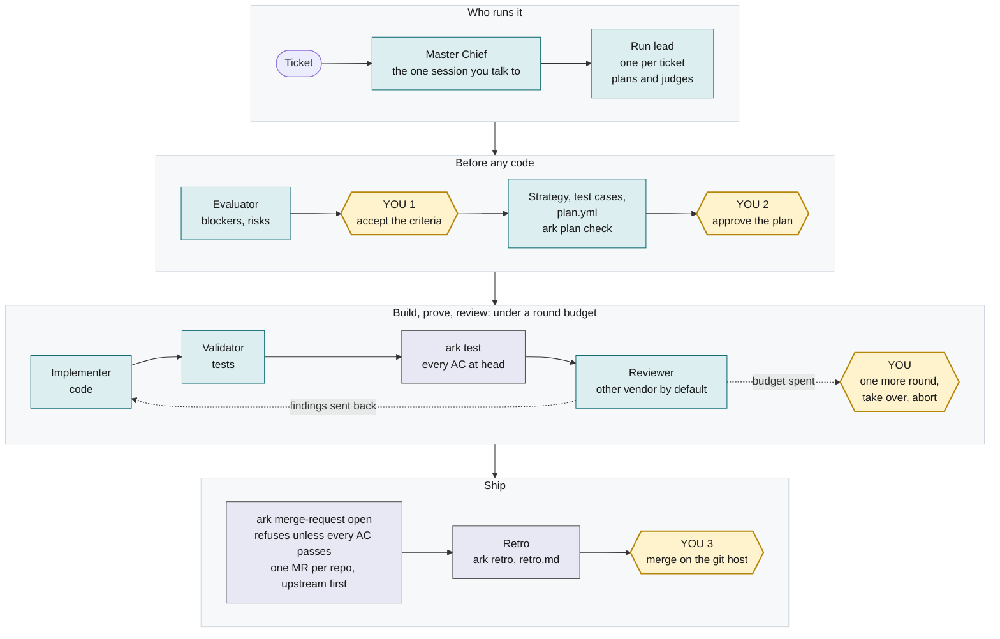
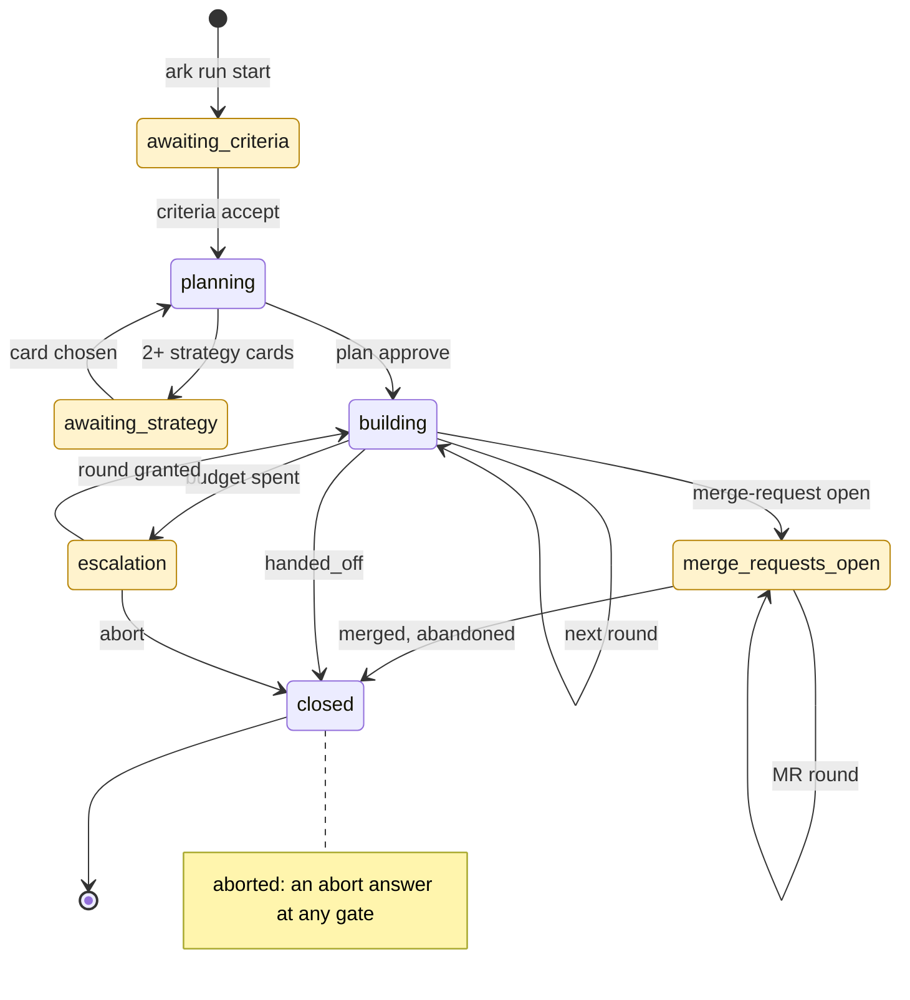
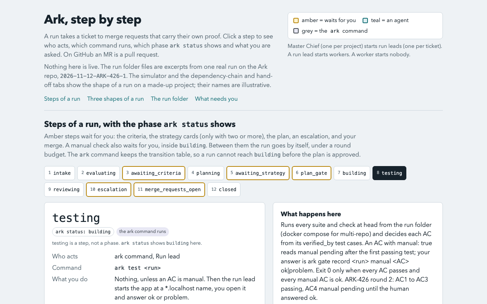
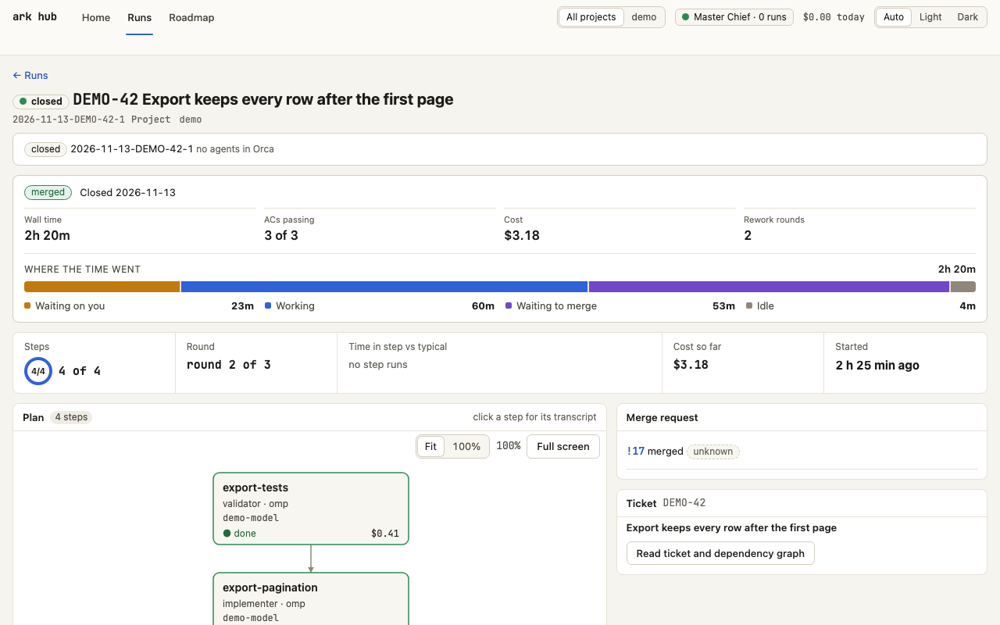

# Ark

Ark takes a ticket to merge-ready changes in one repo or across several dependent repos. You talk to one agent session. Agents plan, build, test and review. You decide at a few gates and you merge. [Open the interactive tour](docs/tour.html) to see a run move, or read on.

Ark builds itself: every change to this repo goes through an Ark run.

|                       |                                                                                                                                                                                                     |
| --------------------- | --------------------------------------------------------------------------------------------------------------------------------------------------------------------------------------------------- |
| **What you give it**  | A ticket: a Markdown file with acceptance criteria (ACs), from the project's ticket source. The source is local files, GitHub or Jira, as the project's `ark.yml` says.                             |
| **What you get back** | One merge request (MR) per repo, in merge order, each with passing test cases for every AC, plus a run folder with the plan, the evidence, the cost and a retro. On GitHub an MR is a pull request. |
| **What you do**       | Name the ticket. Answer the gates: accept the criteria, approve the plan, and a few others when they apply. Merge on your git host.                                                                 |

## How a run goes



Amber is you. Teal is an agent. Grey is the `ark` command, which keeps run state and refuses a step the run may not take yet. A strategy choice (when there are 2 or more approach cards) and manual checks (for an AC only a person can judge) also ask you when they apply.

### A run in one screen

Each step names the `ark` command or the file it leaves behind. [Scenarios](docs/explanation/scenarios.md) walks a real run with its numbers.

1. **Ticket in.** You tell Master Chief which ticket to run. It starts a run lead: `ark run start <ticket-file>`.
2. **Evaluate.** An evaluator reads the ticket and the code and writes `evaluation.md` with blockers and risks.
3. **Criteria gate.** You accept, edit or abort each AC's method and test cases: `ark gate record <run> criteria accept`.
4. **Strategy, test cases, plan.** The run lead writes `strategies.md` (`ark strategy record`), a test case writer and reviewer settle the test cases, then the run lead writes `plan.yml` (`ark plan check`).
5. **Plan gate.** You review the plan and approve, change or abort: `ark gate record <run> plan approve`. No code exists yet.
6. **Build, test, review.** Implementers and validators work in their own worktrees. `ark test` runs every AC at head. A reviewer returns findings, and the run lead sends fixes back until the round budget is spent. Then you decide at an escalation.
7. **Merge request.** `ark merge-request open` refuses until every AC passes, then opens one MR per repo, upstream first.
8. **Retro.** While the MRs are open, the run lead runs `ark retro` and writes `retro.md`: cost, time, rework and improvement proposals.
9. **You merge.** You merge on your git host. Ark's agents and the `ark` command never merge. Optionally, `ark services install` (macOS) installs an auto-merger that merges an MR once the host reports it clean under your branch protection and the run's `retro.md` exists. See [Run background services](docs/how-to/background-services.md).

A repo that is hand-off only opens no MR: the run ends with your branches, named `ark/<ticket id>-<slug>`.

## Words you need

- **Master Chief:** the one agent session you talk to. It starts run leads and never writes product code.
- **Run lead:** the agent that owns one ticket. It plans, starts workers and judges their findings.
- **Worker:** an agent that does one step, such as implementer, validator or reviewer. It starts no other agent.
- **Gate:** a point where the run stops and asks you.
- **Run folder:** the directory that holds everything about one run: events, plan, evidence, findings, retro.
- **Orca:** the desktop app that hosts every agent session and carries messages between them.

[CONTEXT.md](CONTEXT.md) defines every other word.

## Who does what

| Who                                      | Does                                                                                                              | Never                                              |
| ---------------------------------------- | ----------------------------------------------------------------------------------------------------------------- | -------------------------------------------------- |
| **You**                                  | Name the ticket. Answer the gates. Merge.                                                                         | Leave a gate to an agent's guess.                  |
| **Master Chief**                         | Queues tickets, starts one run lead per ticket, brings you every gate question, watches open MRs, closes the run. | Write product code.                                |
| **Run lead**                             | Plans across every repo, starts workers, judges each finding, opens the MRs, writes `retro.md`.                   | Write product code. Answer a gate that needs you.  |
| **Evaluator**                            | Reads the ticket and code, lists blockers and risks.                                                              | Edit product code.                                 |
| **Designer** (optional)                  | Makes mockups for the strategy cards when a person will see the change.                                           | Edit product code.                                 |
| **Test case writer, test case reviewer** | The writer drafts the test cases. A reviewer from another vendor approves or rejects them.                        | Start an implementer before the reviewer approves. |
| **Implementer**                          | Writes product code in one repo.                                                                                  | Start another agent.                               |
| **Validator**                            | Turns the test cases into tagged integration and E2E tests and makes them pass.                                   | Write a test for a manual AC.                      |
| **Reviewer**                             | Finds defects and reports findings.                                                                               | Edit.                                              |
| **`ark` command**                        | Run state, worktrees, tests, MRs, metrics. Refuses a step the run may not take.                                   | Decide anything that needs judgment.               |

Agents nest two levels: Master Chief starts run leads, run leads start workers, workers start nobody.

## Phases of a run



`ark status` prints the phase. `planning` waits for you once `ark plan check` passes: that is the plan gate. Evaluation, test design and the strategy cards happen inside `awaiting_criteria` and `planning`. Testing and review happen inside `building`. `merge_requests_open` waits for your merge.

## What you see



The [interactive tour](docs/tour.html) steps through a run in a browser, with no install.



`ark ui` serves the hub on port 4317. It is a view of every project's runs: what needs you, each run's plan, decisions, files and cost, and a roadmap. Its one action is "Open in Orca", which focuses a live agent's terminal. It sends no text and changes no run state, so you steer through Master Chief. To reach it as `http://ark.localhost` and start it at login, see [Reach the hub by a local name](docs/how-to/local-names.md).

## Requirements

- macOS, for the background services and the `ark.localhost` name (both use launchd).
- [Bun](https://bun.sh).
- git and `jq`.
- Orca and its `orca` CLI, with nested worker depth set to 2. Master Chief must run in an Orca terminal.
- [OMP](https://omp.sh), and any other harness a plan step names: Claude Code, Codex, pi.
- Plannotator, for plan review in a browser (optional; the chat works without it).
- `gh` for GitHub projects or `glab` for GitLab projects.
- docker with docker compose, for multi-repo projects.

## Install

```sh
bun install         # install dependencies
bun link            # put `ark` on your PATH
omp plugin link .   # install this repo as an OMP plugin
```

## Start

1. Teach Ark your project once: [Bootstrap a project](docs/how-to/bootstrap-a-project.md).
2. Run `ark ui` to open the hub.
3. In an Orca terminal that runs `omp`, type `/skill:ark chief`, then name a ticket. [Run a ticket](docs/how-to/run-a-ticket.md) walks through it.

## Where to go next

| If you want to…                                        | Read                                                                                 |
| ------------------------------------------------------ | ------------------------------------------------------------------------------------ |
| See a run move, with no install                        | [The interactive tour](docs/tour.html)                                               |
| Decide whether your team should use Ark                | [Why Ark](docs/why-ark.md), five minutes                                             |
| Follow a real ticket, step by step                     | [Scenarios](docs/explanation/scenarios.md): one repo, a dependency chain, a hand-off |
| Teach Ark your project, once                           | [Bootstrap a project](docs/how-to/bootstrap-a-project.md)                            |
| Run your first ticket                                  | [Run a ticket](docs/how-to/run-a-ticket.md)                                          |
| Know what Ark checks before it opens an MR             | [Project checks](docs/how-to/project-checks.md)                                      |
| Understand how it is built                             | [Architecture](docs/explanation/architecture.md): roles, gates, the run folder       |
| Look up a word                                         | [CONTEXT.md](CONTEXT.md), the glossary agents and people share                       |
| Look up a command or a file format                     | [Command reference](docs/reference/cli.md)                                           |
| Know what Ark promises, with the tickets that prove it | [Requirements](docs/prd.md), in EARS form                                            |
| Know why each design choice was made                   | [Decision records](docs/adr/)                                                        |
| Know what agents are told                              | [Playbooks](skills/ark/playbooks/)                                                   |
| Know where Ark is going                                | [Vision](docs/explanation/vision.md)                                                 |
| Find any other page                                    | [Documentation index](docs/README.md)                                                |

## Contributing

```sh
bun test --parallel # run the tests
```

To undo the install, run `bun unlink` and `omp plugin uninstall ark`.
