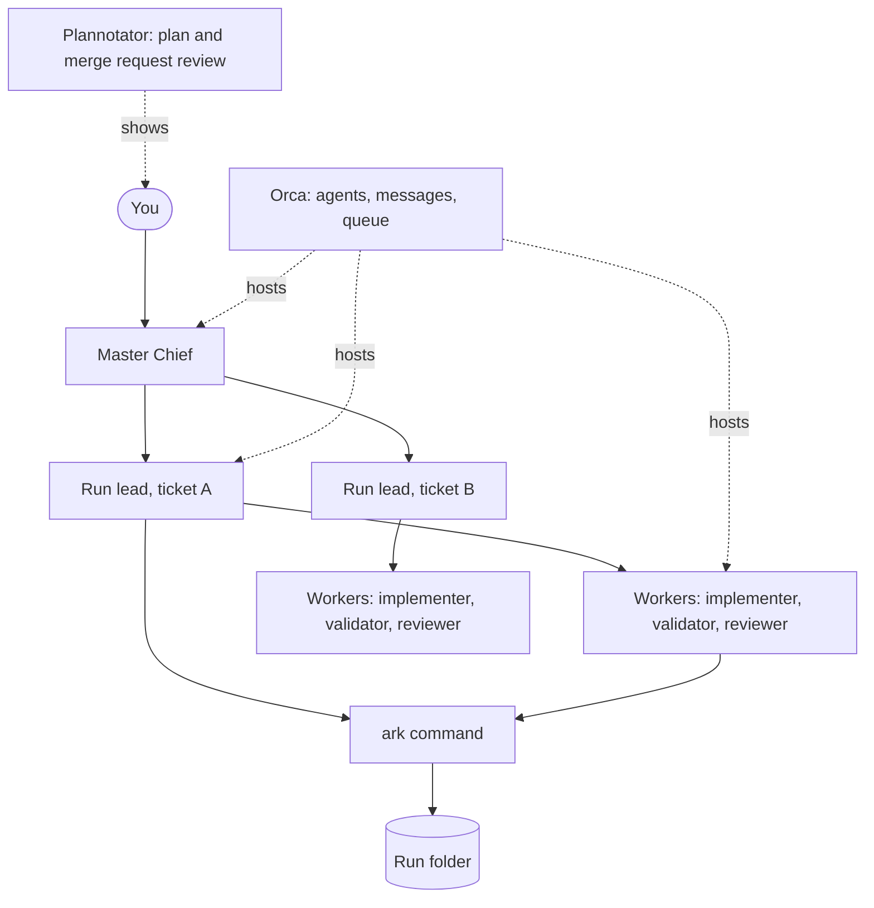

# Ark

Ark takes a ticket to merge-ready changes in one repo or across several dependent repos. You talk to one agent session, Master Chief. Master Chief starts a run lead for each ticket, and the run lead plans the work and starts workers to build, test, and review it.

A small `ark` command handles the mechanical parts: run state, worktrees, tests, merge requests, and metrics. Skills hold the judgment. Only you merge.

## Status

The redesign is being built. The commands are listed in the [command reference](docs/reference/cli.md), and the [product requirements](docs/prd.md) track which tickets are done.

## How it works



- You talk only to Master Chief.
- Each run lead owns one ticket and every repo the ticket touches.
- Each worker does one step. Workers never start agents, so the depth is 2.
- You approve the plan before any code is written.
- Ark opens one merge request per repo, and you merge.

[docs/explanation/architecture.md](docs/explanation/architecture.md) explains the roles, the run lifecycle, and the run folder.

## Requirements

- [Bun](https://bun.sh)
- [OMP](https://omp.sh)
- Orca
- Plannotator
- `gh` for GitHub projects or `glab` for GitLab projects
- docker, with docker compose, for multi-repo projects

## Developer setup

```sh
bun install         # install dependencies
bun link            # put `ark` on your PATH
omp plugin link .   # install this repo as an OMP plugin
bun test            # run the tests
```

To undo the setup, run `bun unlink` and `omp plugin uninstall ark`.

### Quality checks

Run `bun run typecheck` (TypeScript 7), `bun run lint` (type-aware oxlint),
`bun run format:check` (oxfmt), and `bun test` before submitting changes.
CI runs these commands in that order and blocks on any failure.
Use `bun run format` to format supported repository files in place.

The optional pre-commit hook runs the same checks without rewriting files:

```sh
git config --local core.hooksPath .githooks  # enable for this checkout
git config --local --unset core.hooksPath   # disable
```

The hook checks the working tree, not an isolated copy of the index; stage all
intended changes before committing. It does not replace CI. Enabling it replaces
any existing local hooks path, so preserve that setting if you already use hooks.

## Project layout

| Path       | Contents                                                 |
| ---------- | -------------------------------------------------------- |
| `cli/`     | The `ark` command.                                       |
| `skills/`  | The router skill, its playbooks and the reviewer rubric. |
| `scripts/` | The generator for the command reference.                 |
| `rules/`   | The naming and test-authoring rules.                     |
| `test/`    | Tests.                                                   |
| `docs/`    | Requirements, architecture, reference, and decisions.    |

## Documentation

- [Product requirements](docs/prd.md)
- [Architecture](docs/explanation/architecture.md)
- [Command reference](docs/reference/cli.md)
- [Glossary](CONTEXT.md)
- [Decisions](docs/adr/)
