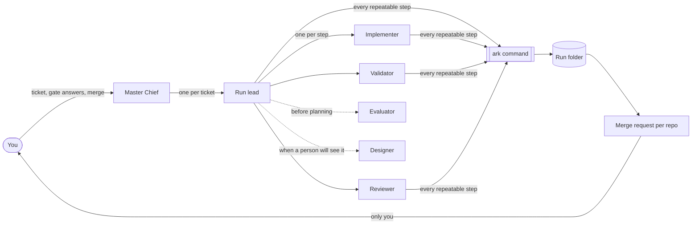

# Ark

Ark takes a ticket to merge-ready changes in one repo or across several dependent repos. You talk to one agent session, Master Chief. It starts a run lead for each ticket; the run lead plans the work and starts workers to build, test and review it. You decide at the gates and you merge.

A small `ark` command does every step that must be repeatable: run state, worktrees, tests, merge requests, metrics. Skills hold the judgment. Nothing merges without you.

**107 runs on this repo as of 2026-11-06.** Ark builds itself.

## Start here

| If you want to…                                             | Read                                                                                                        |
| ----------------------------------------------------------- | ----------------------------------------------------------------------------------------------------------- |
| Decide whether your team should use Ark                     | [Why Ark](docs/why-ark.md), five minutes                                                                    |
| See a run move, state by state, without installing anything | [The interactive tour](docs/tour.html), open it in a browser                                                |
| Understand the roles, the gates and the run folder          | [Architecture](docs/explanation/architecture.md)                                                            |
| Follow a ticket through, step by step                       | [Scenarios](docs/explanation/scenarios.md): one repo, a dependency chain, a hand-off                        |
| Know what Ark promises, with the tickets that prove it      | [Requirements](docs/prd.md), in EARS form                                                                   |
| Know where Ark is going                                     | [Vision](docs/explanation/vision.md): the closed loop from ticket to telemetry                              |
| Run your first ticket                                       | [Run a ticket](docs/how-to/run-a-ticket.md), then [Bootstrap a project](docs/how-to/bootstrap-a-project.md) |
| Look up a command or a file format                          | [Command reference](docs/reference/cli.md)                                                                  |
| Know what every word means                                  | [CONTEXT.md](CONTEXT.md), the glossary agents and people share                                              |

## How it works



- You talk only to Master Chief.
- Each run lead owns one ticket and every repo the ticket touches.
- Each worker does one step and never starts another agent. The depth is two.
- No code is written before you approve the plan.
- Each acceptance criterion is proven by test cases that pass at head, or by your own `manual` answer.
- Ark opens one merge request per repo, in merge order (the repo edges of the plan, upstream first). You merge.

## Requirements

- [Bun](https://bun.sh)
- [OMP](https://omp.sh), and any other harness a plan step names: Claude Code, Codex, pi
- Orca, with nested worker depth set to 2
- Plannotator, for plan review in a browser (optional; the chat works without it)
- `gh` for GitHub projects or `glab` for GitLab projects
- docker with docker compose, for multi-repo projects

## Developer setup

```sh
bun install         # install dependencies
bun link            # put `ark` on your PATH
omp plugin link .   # install this repo as an OMP plugin
bun test --parallel # run the tests
```

`ark ui` serves the hub on port 4317. It is a view: its one action is "Open in Orca", which focuses a live agent's terminal. It sends no text and changes no run state. To reach it as `http://ark.localhost` and start it at login, see [Reach the hub by a local name](docs/how-to/local-names.md).

To undo the setup, run `bun unlink` and `omp plugin uninstall ark`.
