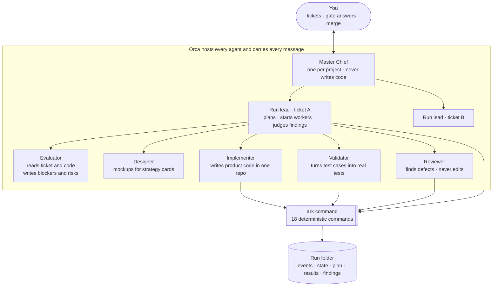
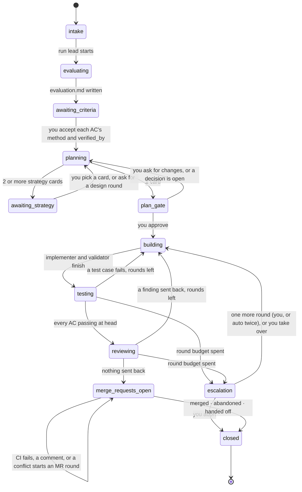
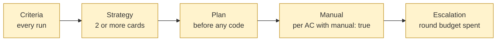
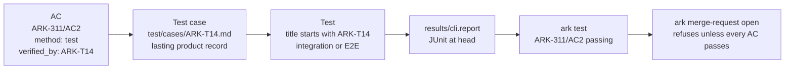
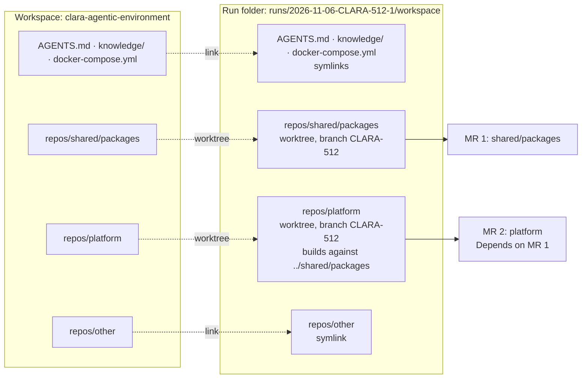
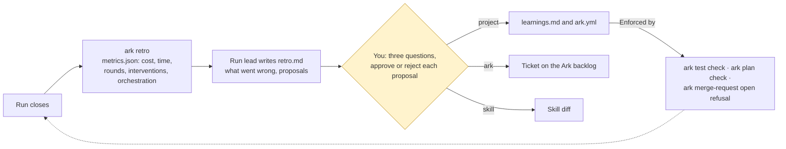

# Ark architecture

How Ark is built and why. [Why Ark](../why-ark.md) says what it is for. [Scenarios](scenarios.md) walk through three runs. The [requirements](../prd.md) list what Ark promises and the tickets that prove each promise. [CONTEXT.md](../../CONTEXT.md) defines every word used here.

## Roles and depth

Three kinds of agent and one human. The depth is two: Master Chief starts run leads, run leads start workers, and a worker never starts an agent.



| Role         | Does                                                                                                                             | Never                                                                  |
| ------------ | -------------------------------------------------------------------------------------------------------------------------------- | ---------------------------------------------------------------------- |
| You          | Name tickets, approve criteria and plans, answer escalations and manual checks, merge                                            | Answer through anything but Master Chief or Plannotator                |
| Master Chief | Suggests and queues tickets, starts one run lead per ticket, relays every gate, watches open MRs, runs the retro interview       | Writes product code; starts a second Master Chief for the same project |
| Run lead     | Reads the workspace, writes `plan.yml`, starts workers, decides which findings send work back, opens MRs, writes `retro.md`      | Writes product code; resolves a merge conflict itself                  |
| Evaluator    | Before planning: reads the ticket and the code, runs read-only probes, writes `evaluation.md` with blockers and risks            | Edits anything                                                         |
| Designer     | Mockups per strategy card; a throwaway prototype for an interaction question                                                     | Puts a mockup in an MR                                                 |
| Implementer  | One step of product code in one repo; runs the repo's checks before every commit                                                 | Starts an agent                                                        |
| Validator    | Turns the plan's test cases into tagged integration and E2E tests and makes them pass; audits each against `rules/test-audit.md` | Mocks the thing a test proves                                          |
| Reviewer     | Reads the diff and its callers; reports P0 to P3 findings with a repro command and evidence                                      | Edits; reports style the linter owns                                   |

Default models today: every role runs OMP with `claude-sonnet-5-5`, except the reviewer on `openai-codex/gpt-6.1-sol`. A plan sets harness and model per step and you can change them at the plan gate.

## Where each concern lives

| Concern                                                            | Lives in             | Why                                                                              |
| ------------------------------------------------------------------ | -------------------- | -------------------------------------------------------------------------------- |
| Hosting agents, messages between agents, the ticket queue          | Orca                 | It already runs agents from several harnesses and tracks tasks with dependencies |
| Plan review, MR review, questions when you are away from the chat  | Plannotator          | A review interface exists, so Ark does not build one                             |
| Run state, worktrees, tests, MRs, metrics                          | `ark` command        | These steps must give the same result every time, so no agent does them by hand  |
| Judgment: planning, writing tests, writing code, reviewing, retros | Skills and playbooks | Judgment changes often, and a skill is easy to change and review                 |
| What needs you, across projects                                    | Hub (`ark ui`)       | A view. It steers through Master Chief and changes no run state (ADR 0009)       |

The rule: if a step must be repeatable, it goes in the `ark` command. If it needs judgment, it goes in a skill. The [command reference](../reference/cli.md) lists the commands; `skills/ark/playbooks/` holds the judgment.

## Run lifecycle

A run moves through the states below. The `ark` command keeps the transition table, so a run cannot reach `building` before you approve the plan, and cannot open an MR before every criterion passes at head.



`building`, `testing` and `reviewing` form a loop. Each return to `building` after the first build is a round. The round budget defaults to two. When it is spent, the run opens an escalation gate. With `gates.escalation: auto`, Ark grants the first two extra rounds itself and asks you after that. If you take over, you are the implementer and the run continues through testing and review.

A run closes with one outcome: `merged`, `abandoned`, `aborted` or `handed_off`. A project with `merge_requests: none` ends every run `handed_off`: the branches stay in their clones for a person to review and nothing is pushed.

### Gates

A gate is a point where the run waits for you. You answer in Master Chief's session or in Plannotator; the run lead records the answer with `ark gate record`. An agent's decision is never an answer.



| Gate       | Opens when                                              | You answer with                                                    | What it stops                                      |
| ---------- | ------------------------------------------------------- | ------------------------------------------------------------------ | -------------------------------------------------- |
| Criteria   | Every run, after the evaluator                          | Accept each AC's `method` and `verified_by`; amend; abort          | Planning                                           |
| Strategy   | `strategies.md` has two or more cards                   | A card id, or annotate for a design round                          | Planning                                           |
| Plan       | Before any code, once `ark plan check` passes           | `approve`, `change`, `abort`; answer any open decision             | Building                                           |
| Manual     | An AC with `manual: true` or a method other than `test` | `ok` or `problem` with a note                                      | The MR; `problem` is a finding and sends work back |
| Escalation | The round budget is spent                               | `one_more_round`, `take_over`, `abort`; auto answers the first two | Another round                                      |

There is no evidence gate. Review on the merge request covers that. Merging is your approval on the git host, not an Ark gate.

## The plan and the proof

The plan is `plan.yml`: steps, test cases, a design block and decisions. `ark plan check` refuses a plan with a cycle, an unknown `needs`, a step with no repo or role, a `method: test` AC with no integration or E2E test case in its `verified_by`, an interface with no callers, or an open decision. A valid plan renders `plan.md`, the page you read at the gate.



An AC is proven by the test cases in its `verified_by`, passing at head on the composed workspace. Any level can be a test case, but each `method: test` AC needs an integration or E2E one. An AC with another method, or `manual: true`, is proven by your `manual ok`. Test cases are the lasting record of what the product does; an AC belongs to its ticket and never changes once the ticket is done (ADR 0010). Each test runner has a parser: `bun test` today, pytest and behave for Python projects.

The validator writes tests from the approved test cases. The proof that a criterion holds is its `verified_by` test cases: each one passes at head on the composed workspace. Each case also keeps before and after evidence: `ark test` runs every suite again at the base commit, with the head's new test files copied in, and writes `results/evidence/<test case id>/{base,head}/` with the result, the commit and the command output, plus any screenshots a UI test took. A new test fails at base and passes at head. For a criterion with `manual: true` or a `method` other than `test`, the proof is that you answer the `manual` gate `ok`, and one evidence file `results/evidence/<AC id>.md` holds what was done and seen. `ark merge-request open` refuses a run whose evidence is missing, malformed or stale. A criterion is decided from the results of its `verified_by` test cases at every level. An old-scheme criterion with no `verified_by` keeps the tag path, where only its tagged integration and end-to-end tests count. Each test runner has a parser that maps native tags to results. The first parser reads `bun test` names. Later parsers read pytest marks and behave tags.

The reviewer reads the diff and the callers against the ticket's ACs, the plan and the evaluator's risks. Its findings follow `skills/ark/rubrics/reviewer.md`: correctness, proof, security, complexity, naming; P0 to P3; a P0 or P1 without a repro command is written as P2. The run lead reads each finding, re-runs the repro, and writes `send back` or `leave` with a reason under `## Run lead decision`. Only sent-back findings cost a round.

## Multi-repo by local composition

A project is a workspace directory: one repo, or a meta-repo that holds several under `repos/`. Ark keeps no manifest; the run lead finds the repos by reading the workspace and its knowledge files.



For a multi-repo ticket, `ark worktree create` builds `<run>/workspace/` as a mirror of the workspace. Each repo the run touches is a worktree at its usual path; every other repo and every root file is a symlink to the workspace. Agents in a worktree find the workspace's context by walking up. `ark test` runs docker compose with `--project-directory <run>/workspace`, so every `./repos/*` path in the compose file resolves to the run's changes. The plan has a step per repo in dependency order, the integration tests run against both worktrees together, and Ark opens one MR per repo in that order, with a dependency where the host supports it and `Depends on !N` in the body otherwise. For a single-repo workspace, `<run>/workspace` is itself the worktree.

### Submodule composition

A worktree of a repo with submodules (`.gitmodules`) is filled, not left empty. `ark worktree create` runs `git -c protocol.file.allow=always submodule update --init` in it, with the source clone's submodule as reference when that is initialised, so each submodule sits at the commit the consumer's index records. The flag `protocol.file.allow=always` is needed because git 2.38 and later refuse a local-path submodule by default. Create runs this step every time, also when the consumer's worktree already exists, so a library worktree made after its consumer is picked up; `ark worktree sync` runs it again after the merges.

Which repo is the library: a submodule maps to the run worktree whose repo has an `origin` URL equal to the `.gitmodules` URL (a trailing `.git` or `/` is ignored), else the run repo with the same basename as the URL (or the submodule folder). The consumer is never its own library. A submodule with no such worktree stays at its recorded commit.

For a mapped submodule, create and sync fetch the committed `HEAD` of the library worktree into the submodule and check it out detached. Run head means that committed `HEAD`: uncommitted library changes are invisible, so commit in the library step, then run `ark worktree sync`. Ark never stages the submodule. `git ls-files --stage` of the consumer is the same before and after, and `ark worktree sync` first puts the recorded commit back, so its merge does not meet a modified submodule. `git status` in the consumer shows ` M <path>`; an implementer must not run `git add -A` or `git commit -a` on it, and `ark worktree cleanup` does not count that line as an uncommitted change. Bumping the pointer is a separate change.

`ark status` recomputes from git when it prints, with no event field: one line `submodule <consumer>/<path> at run head of <repo> <8 characters>` per submodule whose checkout equals the library worktree's head.

`discoverRepos` skips submodule folders: a submodule is part of its consumer, so `ark worktree create` does not accept `vendor/lib` as a repo. The `worktree.created` event is recorded before the submodule step. A submodule failure stops with the consumer, the submodule path and the git cause, and keeps the worktree; the next create finds the event, does not remove the worktree as stale, and runs the step again.

`ark test` at the base commit uses the recorded pointer, not the run head: the base checkout is a throwaway checkout of the consumer at its base, so its submodules are the library as recorded there. A package pin edge needs no worktree change: compose mounts the upstream repo's worktree, so the consumer already builds against the run's library.

## Run folder

Each project keeps its files under `~/.ark/projects/<project>/`.

```text
~/.ark/projects/<project>/
  ark.yml                 project config: workspace, ticket source, suites, roles, gates, checks
  learnings.md            lessons run leads read at plan time; each names the check that enforces it
  tickets/                tickets agents fetched
  runs/<date>-<ticket>-<n>/
    ticket.md             snapshot of the ticket with its ACs
    evaluation.md         blockers and risks from the evaluator
    strategies.md         one card per way to do it; mockups/ beside it
    plan.yml              steps, test cases, design, decisions
    plan.md               the plan as you read it at the gate
    events.ndjson         append-only event log: the record
    state.json            state derived from the log; rebuildable
    workspace/            mirror of the workspace, a worktree per touched repo
    results/              one report and log per suite and check, at head
    findings/             <step>.md per reviewer, round-<n>.md per send-back
    retro.md              the run lead's retro
    metrics.json          numbers from ark retro
```

The event log is the record. `state.json` is derived from it, so you can rebuild it. A new run lead that takes over a stopped run reads the log and resumes at the first unfinished step. The CLI fetches no tickets: an agent reads the ticket from the project's ticket source through a skill and writes the file, and `ark run start` snapshots it.

## After the MR opens

The run stays in `merge_requests_open` while any MR is open. Master Chief polls `ark merge-request status`. A failed check, a human comment or a conflict starts the run lead again for an MR round: fix, `ark test`, `ark worktree sync` to push the same branch, until the MR is clean. A change request in a comment starts a round; a question gets a reply; a note gets nothing. You resolve the threads and merge. `scripts/auto-merger.sh` can merge a CLEAN MR once `retro.md` exists; tell Master Chief to hold it if you want an MR round to finish first.

## Self-improvement loop



Every run ends in a retro. `ark retro` writes `metrics.json`; the run lead writes `retro.md` on top of it; Master Chief asks you what caused the most pain, what to change now and what surprised you. A proposal cites evidence and names a scope. Nothing changes until you approve it. A learning that can be checked by a command gets an `Enforced by:` line and becomes a refusal in the `ark` command, so the same mistake costs no second round. `learnings.md` on the Ark project holds fifteen such lines after 107 runs; most name the run that taught them.

## Why this design

- **Agents are trusted.** They act with your access, and the git host's branch protection makes sure only you merge. This replaced a hash-chained ledger, hashed gate packets, a launcher with tool restrictions and credential scrubbing that were hard to build and blocked work. See [ADR 0004](../adr/0004-trusted-agents-lightweight-harness.md).
- **Orca and Plannotator do the hosting and review.** Ark builds no agent hosting, messaging, queue or review interface. See [ADR 0005](../adr/0005-orca-and-plannotator.md).
- **The hub only reads.** It steers through Master Chief and never writes run state. See [ADR 0009](../adr/0009-hub-is-a-read-only-live-view.md).
- **Test cases describe the product, and an AC is proven through them.** Product repos keep their own validation; Ark adds no second proof system. See [ADR 0010](../adr/0010-test-cases-describe-the-product.md), which replaces [ADR 0006](../adr/0006-integration-and-e2e-proof-only.md).
- **Repeatable steps are commands, judgment is skills.** The `ark` command stays at 18 commands. When a retro finds a repeatable mistake, it becomes a refusal, not a paragraph in a playbook.
