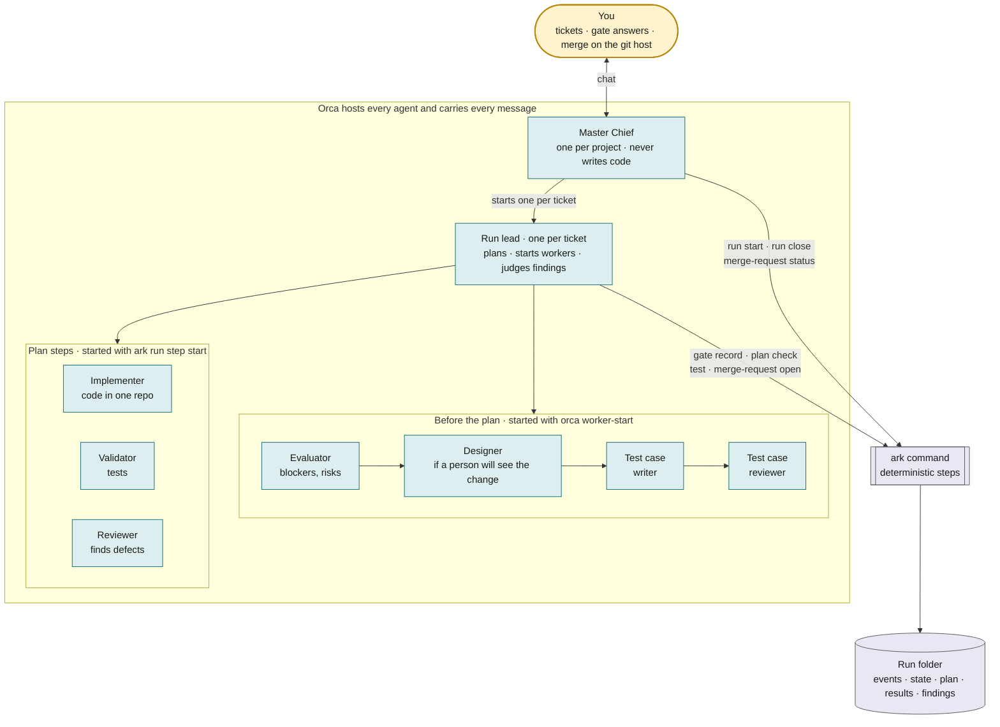
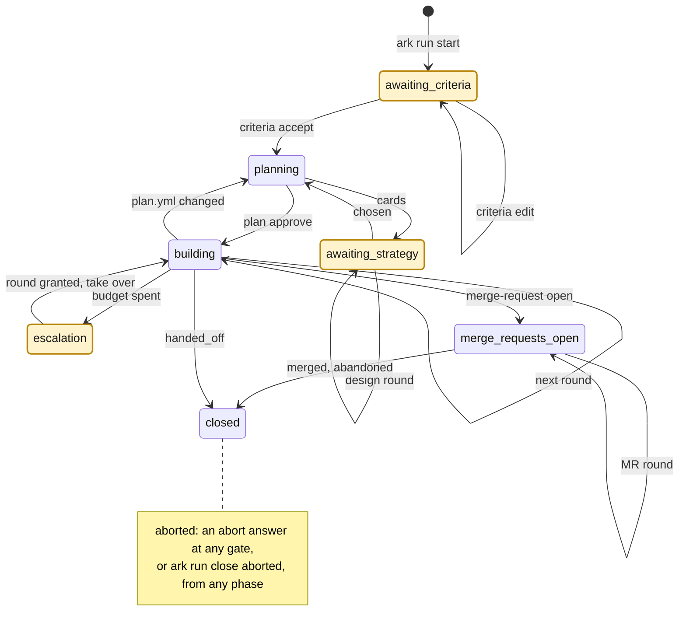
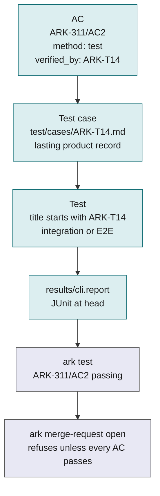
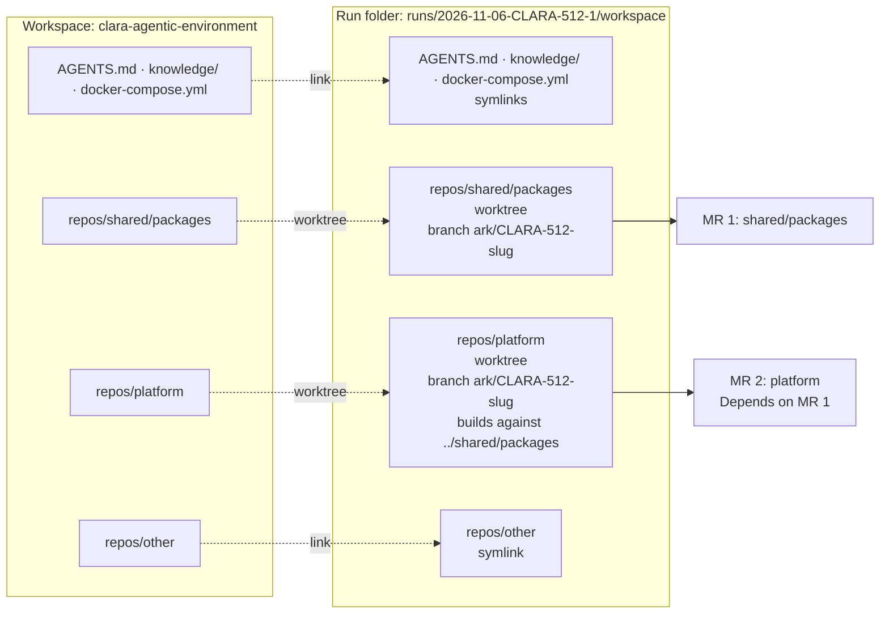
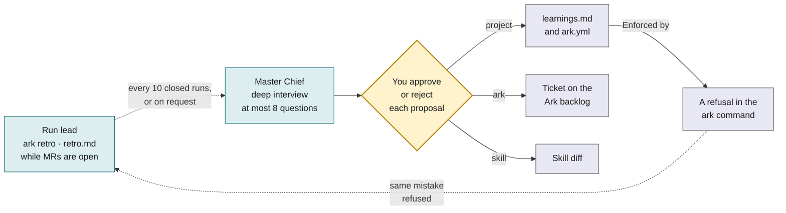

# Ark architecture

How Ark is built and why. [Why Ark](../why-ark.md) says what it is for. [Scenarios](scenarios.md) walk through three runs. The [requirements](../prd.md) list what Ark promises and the tickets that prove each promise. [CONTEXT.md](../../CONTEXT.md) defines every word used here. On GitHub an MR is a pull request.

## Roles

Master Chief, run leads and workers, plus you. You can also open a brainstorm partner yourself to write proposed tickets. The depth is two: Master Chief starts run leads, run leads start workers, and a worker never starts an agent. The files named below are listed under [Run folder](#run-folder).



Amber is you. Teal is an agent. Grey is the `ark` command and the files it keeps.

| Role               | Starts when                                               | Does                                                                                                                                                                                                                                 | Never                                                                  |
| ------------------ | --------------------------------------------------------- | ------------------------------------------------------------------------------------------------------------------------------------------------------------------------------------------------------------------------------------ | ---------------------------------------------------------------------- |
| You                | Always                                                    | Name tickets, answer gates, merge on the git host                                                                                                                                                                                    | Answer through anything but Master Chief or Plannotator                |
| Master Chief       | You open it; one per project                              | Suggests and queues tickets, checks that each AC is testable (its own pre-queue check, not the Evaluator), starts one run lead per ticket, relays every gate as chat text, watches open MRs, closes the run, runs the deep interview | Writes product code; starts a second Master Chief for the same project |
| Run lead           | Master Chief starts it, one per ticket                    | Reads the workspace, writes `plan.yml`, starts workers, records gate answers, decides which findings send work back, opens MRs, writes `retro.md`                                                                                    | Writes product code; resolves a merge conflict itself                  |
| Evaluator          | Run lead, before planning                                 | Reads the ticket and the code, runs read-only probes, writes `evaluation.md` with blockers and risks                                                                                                                                 | Edits product code                                                     |
| Designer           | Run lead, when a person will see the change               | Mockups per strategy card; a throwaway prototype for an interaction question                                                                                                                                                         | Puts a mockup in an MR                                                 |
| Test case writer   | Run lead, after the strategy and before `plan.yml`        | Writes the test cases and `test-design.md`                                                                                                                                                                                           | Writes product code or test code                                       |
| Test case reviewer | Run lead, after the writer, and again after the validator | Approves or rejects the test cases in `findings/test-case-review-<n>.md`. No implementer starts before it approves                                                                                                                   | Edits any repo file                                                    |
| Implementer        | Run lead, one plan step                                   | One step of product code in one repo; runs the repo's checks before every commit                                                                                                                                                     | Starts an agent                                                        |
| Validator          | Run lead, one plan step                                   | Turns the plan's test cases into tagged integration and E2E tests and makes them pass; audits each against `rules/test-audit.md`                                                                                                     | Mocks the thing a test proves                                          |
| Reviewer           | Run lead, after `ark test` passes                         | Reads the diff and its callers; reports P0 to P3 findings with a repro command and evidence                                                                                                                                          | Edits; reports style the linter owns                                   |

Bootstrap writes one `harness` and `model` per role into `ark.yml` (`roles:`). A plan sets them per step, and you can change them at the plan gate. See [Bootstrap a project](../how-to/bootstrap-a-project.md).

## Where each concern lives

| Concern                                                            | Lives in             | Why                                                                                                                                 |
| ------------------------------------------------------------------ | -------------------- | ----------------------------------------------------------------------------------------------------------------------------------- |
| Hosting agents, messages between agents, the ticket queue          | Orca                 | It already runs agents from several harnesses and tracks tasks with dependencies                                                    |
| Plan review, MR review, questions when you are away from the chat  | Plannotator          | A review interface exists, so Ark does not build one                                                                                |
| Run state, worktrees, tests, MRs, metrics                          | `ark` command        | These steps must give the same result every time, so no agent does them by hand                                                     |
| Judgment: planning, writing tests, writing code, reviewing, retros | Skills and playbooks | Judgment changes often, and a skill is easy to change and review                                                                    |
| What needs you, across projects                                    | Hub (`ark ui`)       | A view. It has one action, "Open in Orca". You steer through Master Chief ([ADR 0009](../adr/0009-hub-is-a-read-only-live-view.md)) |

The rule: if a step must be repeatable, it goes in the `ark` command. If it needs judgment, it goes in a skill. The [command reference](../reference/cli.md) lists the commands; `skills/ark/playbooks/` holds the judgment.

## Run folder

Each project keeps its files under `~/.ark/projects/<project>/`.

```text
~/.ark/projects/<project>/
  ark.yml                 project config: workspace, ticket source, suites, roles, gates, checks
  learnings.md            lessons run leads read at plan time; each names the check that enforces it
  tickets/                tickets agents fetched
  runs/<date>-<ticket>-<n>/
    ticket.md             snapshot of the ticket with its ACs
    evaluation.md         blockers and risks from the evaluator
    strategies.md         one card per way to do it
    test-design.md        test cases from the test case writer
    plan.yml              steps, test cases, design, decisions
    plan.md               the plan as you read it at the gate
    events.ndjson         append-only event log: the record
    state.json            state derived from the log; rebuildable
    workspace/            mirror of the workspace, a worktree per touched repo
    results/              reports, logs and evidence at head
    findings/             reviewer and test case reviewer findings
    retro.md              the run lead's retro
    metrics.json          numbers from ark retro
```

The [command reference](../reference/cli.md) lists every file. `ark run close` removes the worktrees, but keeps one with uncommitted changes.

The event log is the record. `state.json` is derived from it, so you can rebuild it. A new run lead that takes over a stopped run reads the log and resumes at the first unfinished step. The CLI fetches no tickets: an agent reads the ticket from the project's ticket source through a skill and writes the file, and `ark run start` snapshots it.

## Run lifecycle

A run moves through seven phases. `ark status <run>` prints the phase and the gate the run waits on. The `ark` command refuses an event the phase does not allow, so a run cannot reach `building` before you approve the plan, and cannot open an MR before every criterion passes at head.



Amber phases wait for your answer. `planning` waits for you once `ark plan check` passes: that is the plan gate. `planning` moves to `awaiting_strategy` when there are two or more strategy cards ("cards") and back when you pick one ("chosen"). Source: `cli/lifecycle.ts`, `cli/transitions.ts`, `cli/events.ts`.

| Phase                 | The run is here when                                                                               | Waiting gate (`ark status`)        |
| --------------------- | -------------------------------------------------------------------------------------------------- | ---------------------------------- |
| `awaiting_criteria`   | A new run, or the evaluation had blockers, until you answer `accept`. The evaluator runs here      | criteria                           |
| `awaiting_strategy`   | Two or more strategy cards are recorded and none is chosen                                         | strategy                           |
| `planning`            | No approved plan. Design and test design happen here                                               | plan, once `ark plan check` passes |
| `building`            | The plan is approved and rounds are left. Testing and review happen here                           | none (a manual gate per manual AC) |
| `escalation`          | The round budget is spent and the last test failed, or `ark escalate`, and you have not taken over | escalation                         |
| `merge_requests_open` | At least one MR is open                                                                            | none                               |
| `closed`              | The run has an outcome                                                                             | none                               |

Each return to implementation after the first build is a round. The round budget defaults to two. When it is spent, the run opens an escalation gate. With `gates.escalation: auto`, Ark grants up to two extra rounds in a run itself and asks you after that. If you take over, you are the implementer and the run continues through testing and review. A change to `plan.yml` after you approved it clears the approval and returns the run to `planning`. An implementer step in `merge_requests_open` needs an escalation answer first, so each MR round that changes code opens that gate too.

A run closes with one outcome: `merged`, `abandoned`, `aborted` or `handed_off`. A project with `merge_requests: none` ends every completed run `handed_off`. The run leaves from `building`, never from `merge_requests_open`: the run lead runs `ark worktree sync` and writes the retro, and Master Chief runs `ark run close <run> handed_off` after you say you took the branches. The branches are named `ark/<ticket id>-<slug>`, stay in their clones, and nothing is pushed.

## Gates

A gate is a point where the run waits for you. You answer in Master Chief's session or in Plannotator; the run lead records the answer with `ark gate record`. An agent's decision is never an answer. Where `ark.yml` sets a gate to `auto` under `gates:`, Ark itself answers and the event records `by: auto`.

| Gate       | Opens when                                                                                                                                      | You answer with                                                                                                             | Can Ark answer it?                                                     | What it stops                                      |
| ---------- | ----------------------------------------------------------------------------------------------------------------------------------------------- | --------------------------------------------------------------------------------------------------------------------------- | ---------------------------------------------------------------------- | -------------------------------------------------- |
| Criteria   | Every run, after the evaluator                                                                                                                  | `accept`, `edit` or `abort`                                                                                                 | No, always you                                                         | Planning                                           |
| Strategy   | `strategies.md` has two or more cards                                                                                                           | A card id, or `abort`. Notes without a card start a design round: a new `strategy.recorded`, and the run stays at this gate | Yes: `gates.strategy: auto` picks the recommended card                 | Planning                                           |
| Plan       | `ark plan check` passes                                                                                                                         | `approve`, `change` or `abort`; answer any open decision first                                                              | Yes: `gates.plan: auto` approves a valid plan with no open decision    | Building                                           |
| Manual     | An AC has `manual: true` or a method other than `test`                                                                                          | `ok` or `problem` with a note                                                                                               | No                                                                     | The MR; `problem` is a finding and sends work back |
| Escalation | The round budget is spent, you run `ark escalate`, or an implementer step starts in `merge_requests_open` (a `--merge` conflict step is exempt) | `one_more_round`, `take_over` or `abort`                                                                                    | Yes: `gates.escalation: auto` grants at most two extra rounds in a run | Another round                                      |

`ark criteria amend` is a different command: it changes an AC's wording after planning, with your approval. It is not a criteria gate answer.

There is no evidence gate. Review on the MR covers that. Merging is not a gate: you merge on the git host.

## The plan and the proof

The plan is `plan.yml`: steps, test cases, a design block and decisions. `ark plan check` refuses a plan with a cycle, an unknown `needs`, a step with no repo or role, a `method: test` AC with no integration or E2E test case in its `verified_by`, or an interface with no callers. A valid plan renders `plan.md`, the page you read at the gate. An open decision does not fail the check, but `plan approve` is refused while the latest check has one: you answer it at the plan gate.



An AC is proven by the test cases in its `verified_by`, passing at head on the composed workspace. Any level can be a test case, but each `method: test` AC needs an integration or E2E one. The validator writes the tests from the approved test cases. Each test runner has a parser that maps native tags to results: `bun test`, pytest and behave.

| Kind of AC                         | Proof                                                                              | Where it lives                                                                           | `ark merge-request open` refuses when                                                    |
| ---------------------------------- | ---------------------------------------------------------------------------------- | ---------------------------------------------------------------------------------------- | ---------------------------------------------------------------------------------------- |
| `method: test`                     | Each `verified_by` case passes at head. `ark test` also runs it at the base commit | `results/evidence/<case id>/{base,head}/`: `result.json`, `command.log`, any screenshots | A case has no `base` or `head` result, or its head commit is not the repo's current head |
| `manual: true` or another `method` | You answer the `manual` gate `ok`                                                  | `results/evidence/AC<k>.md`: what was done and seen                                      | The answer is not `ok`, or the evidence file is missing or malformed                     |

A new test fails at base and passes at head. Test cases are the lasting record of what the product does; an AC belongs to its ticket and never changes once the ticket is done ([ADR 0010](../adr/0010-test-cases-describe-the-product.md)).

The reviewer reads the diff and the callers against the ticket's ACs, the plan and the evaluator's risks. Its findings follow `skills/ark/rubrics/reviewer.md`: correctness, proof, security, complexity, naming; P0 to P3; a P0 or P1 without a repro command is written as P2. The run lead reads each finding, re-runs the repro, and writes `send back` or `leave` with a reason under `## Run lead decision`. Only sent-back findings cost a round.

## After the MR opens

The run stays in `merge_requests_open` while any MR is open. Master Chief polls `ark merge-request status`. A failed check, a human comment or a conflict starts the run lead again for an MR round: fix, `ark test`, `ark worktree sync` to push the same branch, until the MR is clean. A change request in a comment starts a round; a question gets a reply; a note gets nothing. While the MRs are open, the run lead runs `ark retro` and writes `retro.md`.

Ark's agents and the `ark` command never merge. You resolve the threads and merge on the git host. Optionally, `ark services install` (macOS, launchd) installs an auto-merger service (`scripts/auto-merger.sh`). It merges an MR once the host reports it CLEAN under your branch protection, the run's `retro.md` exists, the ticket is not done or superseded, and the run is still in `merge_requests_open`. Tell Master Chief to hold it if you want an MR round to finish first.

`ark worktree sync` runs the project `setup` in a worktree after a clean merge that changed `package.json` or `bun.lock`, before the push. It writes `.omp/setup-pending` first and removes it when setup succeeds. A failed setup keeps the marker, skips that repo's push and exits 1 naming the repo; the next sync runs setup again, even when it merges nothing.

## Multi-repo by local composition

A project is a workspace directory: one repo, or a meta-repo that holds several under `repos/`. Ark keeps no manifest; the run lead finds the repos by reading the workspace and its knowledge files.



`ark worktree anchor` makes the run's first worktree at run start: Master Chief runs it before it starts the run lead, and the run lead runs it again before the evaluator, so the evaluator and designer work in the run and not in your main workspace. `ark worktree create` runs after you approve the plan. For a multi-repo ticket it builds `<run>/workspace/` as a mirror of the workspace. Each repo the run touches is a worktree at its usual path, on a branch named `ark/<ticket id>-<slug>`; every other repo and every root file is a symlink to the workspace. Agents in a worktree find the workspace's context by walking up. `ark test` runs docker compose with `--project-directory <run>/workspace`, so every `./repos/*` path in the compose file resolves to the run's changes. The plan has a step per repo in dependency order, the integration tests run against both worktrees together, and Ark opens one MR per repo in that order, with a dependency where the host supports it and `Depends on !N` in the body otherwise. For a single-repo workspace, `<run>/workspace` is itself the worktree.

A worktree of a repo with submodules is filled in by `ark worktree create`. See [Submodule composition](../reference/submodule-composition.md).

## Self-improvement loop



The run lead runs `ark retro` and writes `retro.md` while the MRs are open, before merge or close. Nobody asks you questions after a single run. When a finding repeats in a run, the run lead writes a rule to the run's `rules.md`: every worker that starts after that gets it in its spec, and `retro.md` proposes each rule as a `learnings.md` entry. Every 10 closed runs (`ark chief state` shows `(due)`), or when you ask, Master Chief runs a deep interview: it reads the retros, groups repeated problems, and asks you at most 8 questions, one at a time, each with evidence and a recommended answer. You approve or reject each proposal, and nothing changes until you approve it. A learning that a command can check gets an `Enforced by:` line and becomes a refusal in the `ark` command, so the same mistake costs no second round. Most lines in `learnings.md` name the run that taught them.

## Why this design

- **Agents are trusted.** They act with your access, and branch protection on the git host decides what merges: no agent and no `ark` command merges. This replaced a hash-chained ledger, hashed gate packets, a launcher with tool restrictions and credential scrubbing that were hard to build and blocked work. See [ADR 0004](../adr/0004-trusted-agents-lightweight-harness.md).
- **Orca and Plannotator do the hosting and review.** Ark builds no agent hosting, messaging, queue or review interface. See [ADR 0005](../adr/0005-orca-and-plannotator.md).
- **The hub only reads.** It has one action, "Open in Orca", and you steer through Master Chief. See [ADR 0009](../adr/0009-hub-is-a-read-only-live-view.md).
- **Test cases describe the product, and an AC is proven through them.** Product repos keep their own validation; Ark adds no second proof system. See [ADR 0010](../adr/0010-test-cases-describe-the-product.md), which replaces [ADR 0006](../adr/0006-integration-and-e2e-proof-only.md).
- **Repeatable steps are commands, judgment is skills.** The `ark` command holds only repeatable steps (see the [command reference](../reference/cli.md)). When a retro finds a repeatable mistake, it becomes a refusal, not a paragraph in a playbook.
