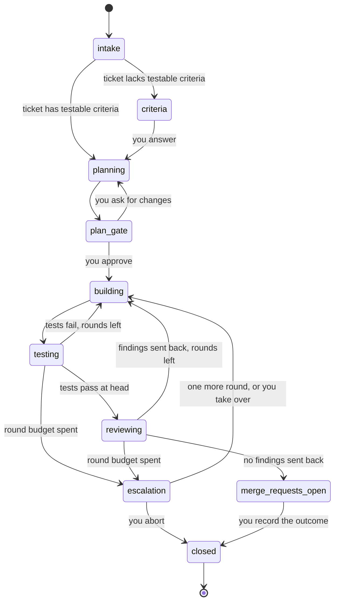

# Ark architecture

This page explains how Ark is designed and why. The redesign is not built yet. Everything here describes the planned design. The [product requirements](../prd.md) list the tickets that build it.

## Roles and depth

Ark has three kinds of agent and one human.

- **You** talk only to Master Chief. You approve tickets, plans, escalations, and merges.
- **Master Chief** is the one session you work with. It evaluates a ticket you name, suggests related tickets to queue, starts a run lead for each approved ticket, and relays gate questions to you. It never writes product code.
- **A run lead** owns one ticket and every repo the ticket touches. It reads the workspace, writes the plan, starts workers, judges their findings, and opens merge requests.
- **A worker** does one step: implementer, validator, or reviewer. A worker never starts another agent.

The depth is 2: Master Chief starts run leads, and run leads start workers. [ARK-151](../prd.md#milestones) checks that Orca allows this nesting.

## Where each concern lives

| Concern | Lives in | Why |
| --- | --- | --- |
| Hosting agents, messages between agents, the ticket queue | Orca | Orca already runs agents from several harnesses and tracks tasks with dependencies. |
| Review interface: the plan gate, merge request review, away-from-chat questions | Plannotator | A review interface exists, so Ark does not build one. |
| Run state, worktrees, tests, merge requests, metrics | `ark` command | These steps must give the same result every time, so no agent should do them by hand. |
| Judgment: planning, writing tests, writing code, reviewing, retros | Skills | Judgment changes often, and a skill is easy to change and review. |

The rule of thumb: if a step must be repeatable, it goes in the `ark` command. If a step needs judgment, it goes in a skill. The [command reference](../reference/cli.md) lists the nine commands.

## Run lifecycle

A run moves through the states below. The `ark` command keeps a small transition table, so a run cannot reach `building` before you approve the plan.



The states `building`, `testing`, and `reviewing` form a loop. Each return to `building` after the first build is a round. The round budget defaults to 2. When the budget is spent, the run opens an escalation gate, and you choose one more round, take over, or abort. If you take over, you become the implementer and the run continues through testing and review.

A run closes with one outcome: merged, abandoned, aborted, or handed off. The [glossary](../../CONTEXT.md) defines each term.

### Gates

A gate is a point where the run waits for you.

- **Criteria.** Opens only when the ticket lacks testable acceptance criteria. You accept or edit the criteria.
- **Plan.** Opens before any code is written. You review the graph of steps and the test cases, then approve, edit `plan.yml`, or ask for changes in chat.
- **Escalation.** Opens when the round budget is spent.

There is no evidence gate. Review on the merge request covers that.

You answer in Master Chief's session or in Plannotator. The run lead records the answer with `ark gate record`. Answers are decisions you made, so Ark does not prove who typed them.

## The plan and the proof

The plan is `plan.yml`. It lists steps and test cases. Each step names a role, a repo, a harness, a model, the steps it needs, and the criteria it serves. Each test case names an acceptance criterion and a level, either integration or end-to-end.

`ark plan check` rejects a plan with a cycle, an unknown `needs`, a step with no repo or role, or a criterion with no integration or end-to-end test case. It also renders `plan.mmd`, a diagram of the steps.

The validator writes tests from the approved test cases. The proof that a criterion holds is that its tagged tests pass at head on the composed workspace. Unit tests never prove a criterion. Each test runner has a parser that maps native tags to results. The first parser reads `bun test` names. Later parsers read pytest marks and behave tags.

The run lead picks review models. A plan defaults to a reviewer from a different vendor than the implementer, and you can change that per step. Ark does not enforce it. The run lead decides which findings send work back and says why.

## Multi-repo by local composition

A project is a workspace directory. It holds one repo, such as Ark, or a meta-repo that holds many, such as Clara. Ark keeps no repo manifest. The run lead finds the repos by reading the workspace.

For a multi-repo ticket, `ark worktree create` makes one worktree per repo, side by side in the run folder. Downstream repos build against upstream changes through local paths. `ark test` writes a docker compose override that points at the run's worktrees, so the composed workspace under test contains every change in the run.

Here is a Clara example. A ticket changes the shared Python core package and a platform service that uses it.

```text
runs/2026-10-29-CLARA-512-1/repos/
  shared/packages/   worktree with the core package change
  platform/          worktree with the service change, built against ../shared/packages
```

Today Clara's `docker-compose.yml` bind-mounts `repos/shared/packages/python/core` into the platform services. The compose override points that mount, and each service's build context, at the run's worktrees instead.

The plan has a step for `shared/packages` and a step for `platform` that needs it. The integration tests run against both worktrees together. Ark then opens a merge request for `shared/packages` first and one for `platform` second. On GitLab, Ark sets a merge request dependency where the tier allows it. Otherwise it writes `Depends on !N` in the description. On GitHub, it writes `Depends on #N`.

[ARK-150](../prd.md#milestones) checks that this layout works with Orca and docker compose before the rest is built.

## Run folder

Each project keeps its files under `~/.ark/projects/<project>/`.

```text
~/.ark/projects/<project>/
  ark.yml                 project config
  learnings.md            lessons that run leads read at plan time
  tickets/                tickets that agents fetched
  runs/<run>/
    ticket.md             snapshot of the ticket
    plan.yml              steps and test cases
    plan.mmd              diagram rendered from plan.yml
    events.ndjson         append-only event log
    state.json            state derived from the event log
    repos/<name>/         one worktree per repo
    results/              test results
    retro.md              the run lead's retro
    metrics.json          numbers from ark retro
```

`<run>` is `<date>-<ticket>-<n>`.

The event log is the record. `state.json` is derived from it, so you can rebuild it. Step start and step finish are events. A new run lead that takes over a stopped run reads the log and resumes at the first unfinished step.

The CLI fetches no tickets. An agent reads the ticket from the project's ticket source through a skill and writes a file. `ark run start` snapshots that file as `ticket.md`.

## Self-improvement loop

Every run ends in a retro. `ark retro` writes `metrics.json` with cost, time, rework, your interventions, and orchestration health, and compares the run with earlier runs. The run lead writes `retro.md` on top of those numbers. Master Chief then asks you three questions: what caused the most pain, what to change now, and what surprised you.

Retros produce improvement proposals. A proposal cites evidence and names a scope:

- **Project.** A change to `ark.yml` or `learnings.md`.
- **Ark.** A ticket on the Ark backlog.
- **Skill.** A new or changed skill, shown as a diff.

Nothing changes until you approve it. Cost is tracked live in `ark status` and judged only in retros. Ark sets no cost estimates, alerts, or caps.

## Why this design

- **Agents are trusted.** They act with your access, and the git host's branch protection makes sure only you merge. This replaces the old ledger, packet hashing, launcher, and credential scrubbing. See [ADR 0004](../adr/0004-trusted-agents-lightweight-harness.md).
- **Orca and Plannotator do the hosting and review.** Ark does not build agent hosting, messaging, a queue, or a review interface. See [ADR 0005](../adr/0005-orca-and-plannotator.md).
- **Only integration and end-to-end tests prove a criterion.** Product repos keep their own validation, and Ark does not add a second proof system. See [ADR 0006](../adr/0006-integration-and-e2e-proof-only.md).
- **If a spike fails, Ark falls back to a tmux host.** The two spikes, ARK-150 and ARK-151, test the parts that depend most on Orca.
