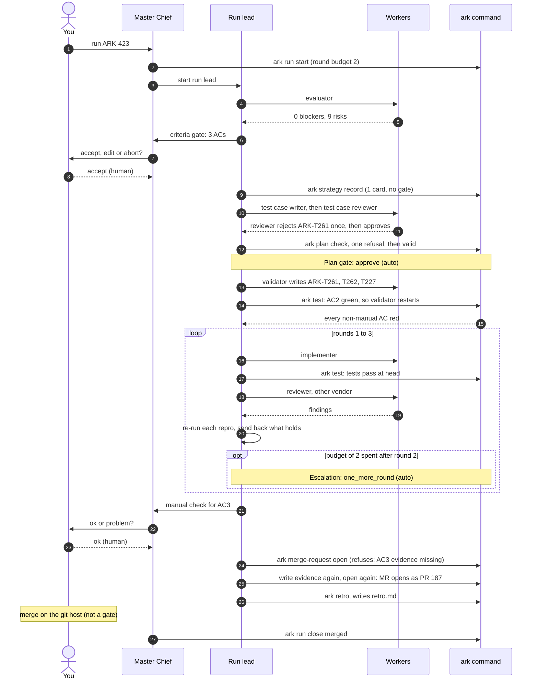
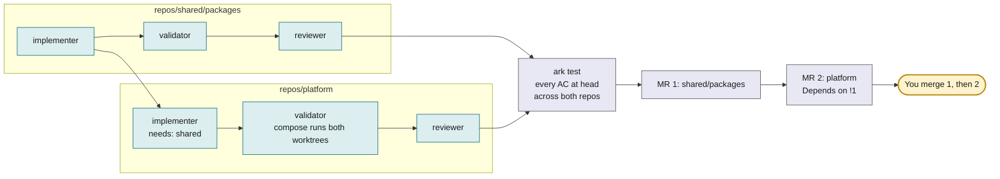
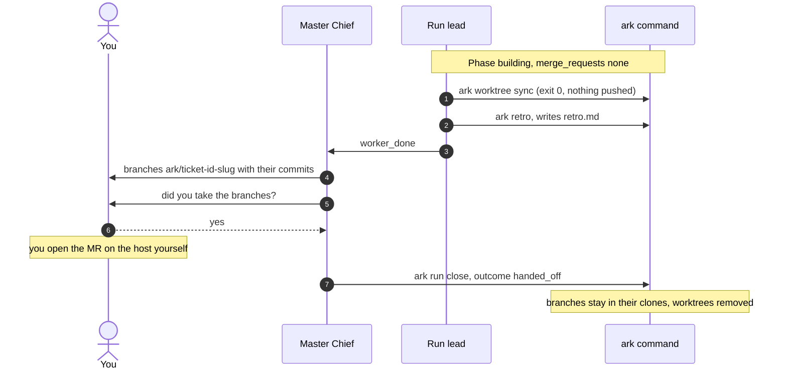

# Scenarios

Three runs, step by step: what the human does, what each agent does, what the `ark` command refuses, and what lands at the end. The first uses a real run on this repo. The other two are the shape of a run, not a transcript. The [architecture](architecture.md) page explains each part; [the tour](../tour.html) lets you click through the same states. On GitHub an MR is a pull request.

## 1. One repo: a ticket on Ark itself

Run `2026-11-11-ARK-423-1`. The ticket: CI failed on a different git or worktree test almost every run, and a Home-page test failed at certain hours of the day. It had three acceptance criteria (ACs). One repo, one MR: [#187](https://github.com/cobekarhoff/ark/pull/187), merged after three rounds.

Every fact below comes from the run folder (`events.ndjson`, `state.json`, `metrics.json`, `plan.yml`, `retro.md`, `findings/`). Each gate answer says who gave it, as the log records it: `by: human` or `by: auto`. Where `retro.md` and `metrics.json` differ in a number, this page uses `metrics.json`, which was written last.

What happened at each step:

| Step                | Answered by        | What happened                                                                                                                                                                                                                                                                                                                                                  |
| ------------------- | ------------------ | -------------------------------------------------------------------------------------------------------------------------------------------------------------------------------------------------------------------------------------------------------------------------------------------------------------------------------------------------------------- |
| 1. Criteria         | You (`by: human`)  | The evaluator found no blockers and 9 risks. One risk: the test preload covers `bun test` only, so `playwright.config.ts` needed the setting too; the plan lists it as an interface. You accepted the 3 ACs: AC1 (`test`, ARK-T261), AC2 (`test`, ARK-T227 and ARK-T262) and AC3 (`analysis`: CI green 5 times in a row on one head, which no test can prove). |
| 2. Strategy         | No gate            | One approach card, S1. A strategy gate opens only with 2 or more cards.                                                                                                                                                                                                                                                                                        |
| 3. Test cases       | Test case reviewer | The writer wrote `test-design.md` with 3 cases. The reviewer rejected the first ARK-T261: checks made from the parent process cannot show what the `ark worktree create` child inherited. The writer revised it to log the git settings at each git call; the reviewer approved. No implementer starts before this approval.                                   |
| 4. Plan             | Ark (`by: auto`)   | `ark plan check` refused once (a step named a harness and model pair that is not in `roles` of `ark.yml`), then passed. The project's `gates.plan` is `auto`, so Ark approved. The plan has 3 steps (validator, implementer, reviewer), a Design block with each interface and its callers, and the 3 test cases.                                              |
| 5. Red before green | `ark` command      | The validator's first tests passed on the old code for AC2, because it had frozen the clock in the test itself. A bug run refuses to start the implementer until every non-manual AC fails in an `ark test`, so the validator restarted and the second `ark test` failed as required.                                                                          |
| 6. Round 1          | Run lead           | The implementer made its fix and `ark test` passed. The reviewer's first start read an empty diff; it was restarted with the full diff. It found a P1 with a `Repro:` command: `TZ=Asia/Tokyo` failed ARK-T262, because fixture dates used host time and the browser used UTC. The run lead re-ran it and sent it back.                                        |
| 7. Round 2          | Run lead           | Fixed and re-reviewed. CI on the pushed branch then failed two jobs: the usage tile wrapped to four lines on Linux fonts at 23:30 UTC (the defect in the ticket), and ARK-T4 failed because a `pkill` by run id killed another file's test run. Two more P1 findings went back.                                                                                |
| 8. Escalation       | Ark (`by: auto`)   | The budget of 2 rounds was spent, so the run could not continue without an answer. `gates.escalation` is `auto`: Ark answered `one_more_round` (the first of at most 2 it grants). This sits inside the loop, between rounds 2 and 3.                                                                                                                          |
| 9. Round 3          | Run lead           | Both CI failures were fixed and `ark test` passed. The reviewer left one P2 open: the new cleanup trusts a stored PID without checking the process. P2 does not send work back.                                                                                                                                                                                |
| 10. Manual check    | You (`by: human`)  | AC3 has `method: analysis`, so it waits for a person. The run lead ran the full CI five times on one head (twice, because main moved) and wrote the evidence. You answered `ok`: "5 of 5 full CI reruns on db4b569".                                                                                                                                           |
| 11. MR              | `ark` command      | `ark merge-request open` refused because the AC3 evidence file was gone: `ark test` removes `results/evidence/`. The run lead wrote it again and the MR opened as PR #187.                                                                                                                                                                                     |
| 12. Retro           | Run lead           | While the MR was open, `ark retro` wrote `metrics.json` and the run lead wrote `retro.md`: what went wrong and four proposals, each with status `proposed`. Nothing changes until you approve a proposal in a deep interview.                                                                                                                                  |
| 13. Merge           | On the git host    | The run closed `merged` 8 minutes after the MR opened. The log records the outcome, not who clicked merge.                                                                                                                                                                                                                                                     |

What the human did, in total: accepted the criteria, answered `ok` on the manual check 3 hours and 37 minutes later, and merged. Between those two answers Ark answered the plan and escalation gates itself. You also aborted a second run, ARK-424, that Master Chief had started for the same flake (the retro says so). Everything else was unattended.

The totals, from `metrics.json`: 3 rounds, 9 test runs, 3 findings sent back, $6.45 and 26.8 M tokens, 3.9 hours wall, 0 restarts. The [numbers table](../why-ark.md#numbers-from-one-real-run) on the Why Ark page lists each field.

## 2. A dependency chain: one ticket across several repos

Clara and Smart QC are multi-repo products Ark is aimed at. Both are the same shape: a meta-repo workspace with `repos/*` cloned from a GitLab group, knowledge files at the root, and docker compose to run the services together. The [bootstrap guide](../how-to/bootstrap-a-project.md) uses Clara as its example. One ticket needs a change in a shared package and in the service that uses it.

Step by step:

1. **Evaluate.** The evaluator reads the ticket, the workspace's `AGENTS.md` and `knowledge/`, and the code in both repos. It names which repos change and in what order, and any AC that no integration test could prove across the boundary.
2. **Criteria.** You accept each AC's `method` and `verified_by`. An AC that only a person can check in a running stack gets `manual: true`, or a `method` other than `test`.
3. **Plan.** `plan.yml` has the steps per repo, with `needs` running from the package to the service. The design block lists the changed interface in the package and every caller in the service. `ark plan check` refuses a cycle between repos, and a service step that has no `needs` path from an implementer step of the package.
4. **Worktrees.** `ark worktree create` mirrors the workspace into the run folder: the two repos the run touches become worktrees on the same branch name; everything else, including `docker-compose.yml` and `knowledge/`, is a symlink. The service builds against `../shared/packages` because the compose file's `./repos/*` paths resolve inside the run folder.
5. **Build and prove.** The package implementer finishes first; the service implementer starts after. Validators write integration tests that run through compose against both worktrees. `ark test` runs every suite from the run folder and decides each AC from its `verified_by` cases at head. A manual AC waits for your `ok` from a running stack.
6. **Review.** One reviewer step per repo, each reading its repo's diff against its base. Each reviewer reads the callers across the boundary.
7. **Merge requests.** `ark merge-request open` pushes both branches and opens one MR per repo in merge order (the repo edges of the plan, upstream first), with a dependency where the GitLab tier allows it and `Depends on !N` in the description otherwise. You merge the package MR first; the service MR's pipeline runs against the merged package.
8. **While open.** A failed pipeline, a comment that asks for a change, or a conflict in either MR starts an MR round on that repo. A product fix in an MR round is an implementer step, and it needs an escalation answer first (`gates.escalation: auto` grants the first two). A test-only fix, a reviewer step and a conflict step (`--merge`) need none. `ark worktree sync` merges the target branch into each worktree and pushes every open branch; a conflict goes to an implementer with `--merge`.

The point of the shape: one ticket, one run, one plan, one proof across the chain, and the order of the MRs comes from the plan, not from a person remembering it.

## 3. A hand-off: a repo where Ark may not push

A project with `merge_requests: none` in `ark.yml` has no MRs. You choose it when the project must not push, for example every clone has its push URL disabled or no host token exists yet. Ark does the whole run and stops before the host. The run leaves from `building`, never from `merge_requests_open`.

What differs from scenario 1:

- `ark merge-request open` refuses in a `merge_requests: none` project. The run lead runs `ark worktree sync`, reads that it exited 0, and goes to the retro. The run stays in `building`.
- Master Chief lists the branches, which are named `ark/<ticket id>-<slug>`, with their commits. It asks whether you took them, and only then runs `ark run close <run> handed_off`. A run cannot be handed off once it has MRs.
- Every refusal that guards an MR still runs at close: the last full `ark test` passed at the latest commit, every manual AC is `ok`, every AC literal is in a tracked file, no commit followed the last test. A run cannot be handed off with less proof than it would need to open an MR.
- The outcome is `handed_off`. Each branch with commits beyond its base stays in its clone (Ark prints a `kept <repo> <branch>` line); the worktrees are removed.
- Workers never push in any run; they commit in their worktree.

This is the mode for a repo whose own validation and review gates are the record: Ark produces the branch, the passing tests at head and the review findings, and a person carries them across the line. When the git host can take Ark's pushes, the same project switches to `merge_requests: open` with no other change to the run.

## What the three have in common

|                          | One repo                                                          | Dependency chain                                                                                               | Hand-off                                                           |
| ------------------------ | ----------------------------------------------------------------- | -------------------------------------------------------------------------------------------------------------- | ------------------------------------------------------------------ |
| Where you decide         | criteria, manual checks, merge; plan and escalation unless `auto` | the same, with manual ACs checked on a running stack                                                           | the same, minus the merge: you take the branches                   |
| Proof                    | test cases at head in one worktree                                | test cases at head across composed worktrees                                                                   | the same; checked at close instead of at open                      |
| What Ark refuses         | an MR before every AC passes                                      | an MR before every AC passes; a plan with a repo cycle or a service step with no `needs` path from the package | `ark merge-request open`; a close with less proof than an MR needs |
| What lands               | one MR                                                            | one MR per repo, in order                                                                                      | branches in their clones                                           |
| What you read afterwards | `retro.md`, `metrics.json`                                        | the same, per run                                                                                              | the same                                                           |
