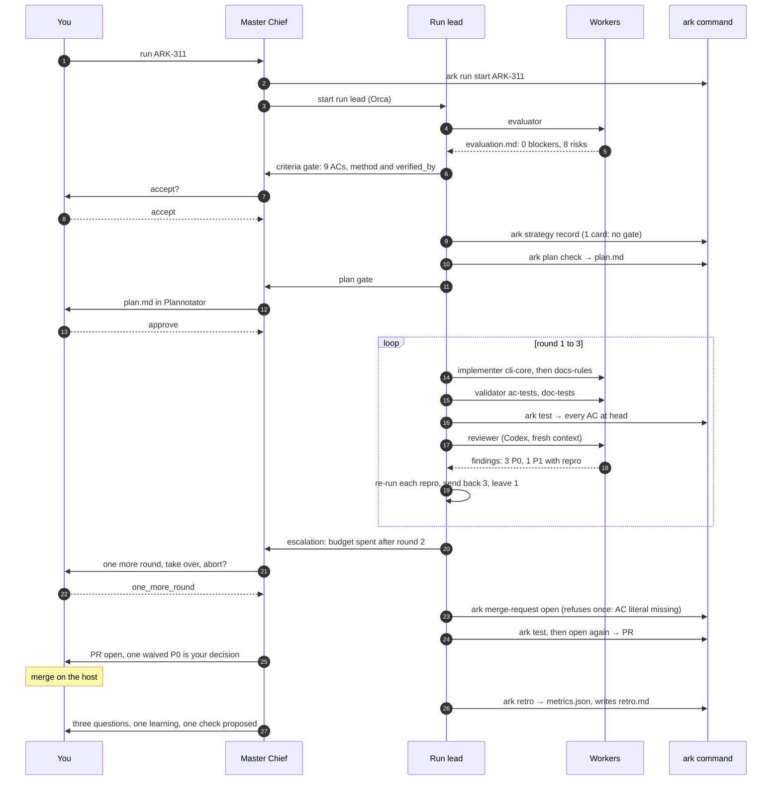
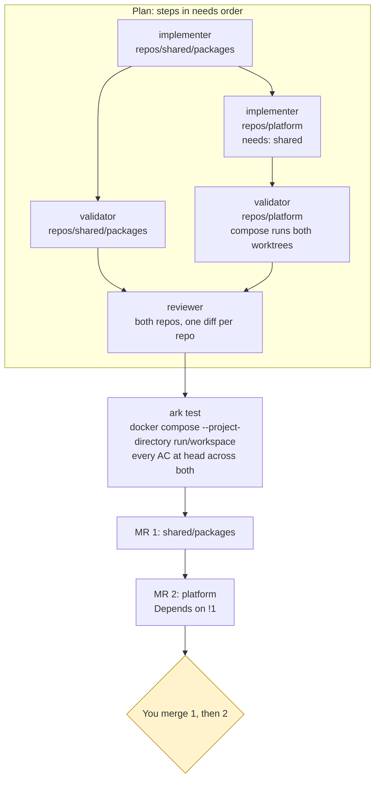
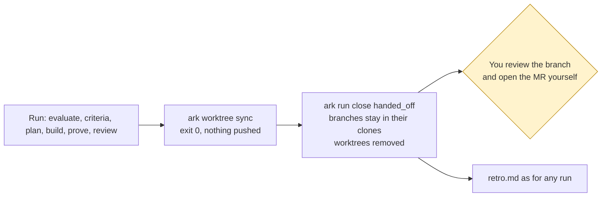

# Scenarios

Three runs, step by step: what the human does, what each agent does, what the `ark` command refuses, and what lands at the end. The first uses a real run on this repo. The other two are the shape of a run, not a transcript. The [architecture](architecture.md) page explains each part; [the tour](../tour.html) lets you click through the same states.

## 1. One repo: a ticket on Ark itself

Run `2026-11-05-ARK-311-1`. The ticket changed how Ark proves acceptance criteria: nine ACs, two implementer steps, two validator steps, one cross-vendor review. It merged as [#123](https://github.com/cobekarhoff/ark/pull/123) after three rounds.

What each gate looked like:

1. **Criteria.** The evaluator found no blockers and eight risks, among them that the always-open criteria gate would stall every existing test fixture. Those risks went into the implementer's spec word for word. You accepted the nine ACs with their `method` and `verified_by`.
2. **Plan.** One strategy card, so no strategy gate. `plan.md` showed five steps in a graph (`cli-core` → `docs-rules`, `ac-tests` → `doc-tests` → `repo-review`), the Design block with each interface and its callers, and the test cases as Gherkin. You approved.
3. **Rounds.** Round 1 review: three P0s and a P1, each with a `Repro:` command and quoted output. The run lead re-ran every repro. Three were sent back (docs still stated the old rules; pytest and behave reports were hand-built instead of captured; parsers dropped the slash-form AC tag). One P0, touched old-id tests not converted, was left: the ticket said not to migrate old tests in bulk and the edits were fixture-only. Round 2 fixed two; one docs file still used other words, so round 3 was needed.
4. **Escalation.** The budget of two was spent after round 2. You answered `one_more_round`.
5. **Merge request.** `ark merge-request open` refused the first time: the AC literal `ark test-case new ARK` was in no tracked file. The validator added it, `ark test` ran again, the PR opened. You merged it.
6. **Retro.** $8.48, 33.6 M tokens, 7.3 hours wall. Twelve orchestration restarts, nine tool errors. Two proposals: a learning that a validator spec lists the ACs' backticked literals, and a docs-rule step that greps diagrams as well as prose. You approved the first; it is enforced by the `ark merge-request open` AC-literal refusal.

What the human did, in total: named the ticket, accepted the criteria, approved the plan, answered one escalation, waived one finding, merged. Everything else was unattended.

## 2. A dependency chain: one ticket across several repos

Clara and Smart QC are the same shape: a meta-repo workspace with `repos/*` cloned from a GitLab group, knowledge files at the root, and docker compose to run the services together. One ticket needs a change in a shared package and in the service that uses it.

Step by step:

1. **Evaluate.** The evaluator reads the ticket, the workspace's `AGENTS.md` and `knowledge/`, and the code in both repos. It names which repos change and in what order, and any AC that no integration test could prove across the boundary.
2. **Criteria.** You accept each AC's `method` and `verified_by`. An AC that only a person can check in a running stack gets `method: demonstration` and a `manual: true` flag.
3. **Plan.** `plan.yml` has one step per role per repo, with `needs` running from the package to the service. The design block lists the changed interface in the package and every caller in the service. `ark plan check` refuses a cycle or a service step that does not `need` the package step.
4. **Worktrees.** `ark worktree create` mirrors the workspace into the run folder: the two repos the run touches become worktrees on the same branch name; everything else, including `docker-compose.yml` and `knowledge/`, is a symlink. The service builds against `../shared/packages` because the compose file's `./repos/*` paths resolve inside the run folder.
5. **Build and prove.** The package implementer finishes first; the service implementer starts after. Validators write integration tests that run through compose against both worktrees. `ark test` runs every suite from the run folder and decides each AC from its `verified_by` cases at head. A `manual` AC waits for your `ok` from a running stack.
6. **Review.** One reviewer step covers both repos: one diff per repo against its base, the callers read across the boundary.
7. **Merge requests.** `ark merge-request open` pushes both branches and opens one MR per repo in merge order (the repo edges of the plan, upstream first), with a dependency where the GitLab tier allows it and `Depends on !N` in the description otherwise. You merge the package MR first; the service MR's pipeline runs against the merged package.
8. **While open.** A failed pipeline, a comment or a conflict in either MR starts an MR round on that repo. `ark worktree sync` merges the target branch into each worktree and pushes every open branch; a conflict goes to an implementer with `--merge`.

The point of the shape: one ticket, one run, one plan, one proof across the chain, and the order of the MRs comes from the plan, not from a person remembering it.

## 3. A hand-off: a repo where Ark may not push

Smart QC today runs with `merge_requests: none` and every clone has its push URL disabled. Ark does the whole run and stops before the host.

What differs from scenario 1:

- `ark merge-request open` refuses in a `merge_requests: none` project. The run lead runs `ark worktree sync`, reads that it exited 0, and goes straight to the retro.
- Every refusal that guards an MR still runs at close: the last `ark test` passed at the latest commit, every manual AC is `ok`, every AC literal is in a tracked file, no commit followed the last test. A run cannot be handed off with less proof than it would need to open an MR.
- The outcome is `handed_off`. Each branch with commits beyond its base stays in its clone under `review/<ticket>`; the worktrees are removed. Master Chief tells you which branches to look at.
- Skills in the product repo that contain push steps are skipped by the workers; the run lead says so in the plan.

This is the mode for a regulated product repo while its own validation and review gates are the record: Ark produces the branch, the passing tests at head and the review findings, and a person carries them across the line. When the git-host gate can verify that evidence itself, the same project switches to `merge_requests: open` with no other change to the run.

## What the three have in common

|                          | One repo                           | Dependency chain                               | Hand-off                                      |
| ------------------------ | ---------------------------------- | ---------------------------------------------- | --------------------------------------------- |
| Where you decide         | criteria, plan, escalation, merge  | the same, plus manual ACs from a running stack | the same, minus merge; you open the MR        |
| Proof                    | test cases at head in one worktree | test cases at head across composed worktrees   | the same; checked at close instead of at open |
| What Ark refuses         | an MR before every AC passes       | an MR out of merge order; a plan with a cycle  | any push                                      |
| What lands               | one MR                             | one MR per repo, in order                      | branches in their clones                      |
| What you read afterwards | `retro.md`, `metrics.json`         | the same, per run                              | the same                                      |
