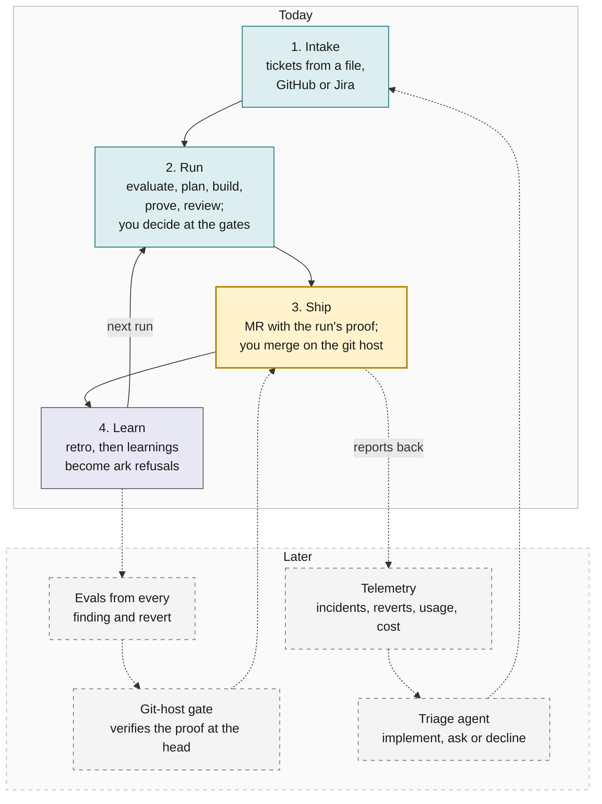

# Vision: the closed loop

Where Ark goes, and which parts exist today. The roadmap file lives in `~/.ark/projects/ark/ROADMAP.md`, outside the repo; its [format](../reference/roadmap.md) is a reference page. This page draws the whole loop so each roadmap milestone has a place, and lists the milestones with their state.

## The loop

A ticket comes in. A run turns it into MRs that carry their own proof. You merge on the git host; a gate there could verify that proof instead of re-deriving it. What ships would report back as incidents, reverts, cost and usage, and those become the next tickets and the next checks. Every stage runs by itself; people decide at the gates and own what ships. On GitHub an MR is a pull request.

The top box exists today. The dashed box is planned. Each stage section below lists what exists today, what is next and what is later.

Amber is where you act. Teal is agents, grey is the `ark` command, dashed is planned. You decide at the gates inside the run and you merge, which is not a gate. A project can set the plan and escalation gates to `auto`; the criteria gate is always a person.

## Where each stage stands

### 1. Intake

- **Today:** Tickets are Markdown files with acceptance criteria. Master Chief fetches one from the project's `ticket_source` (a local file, a GitHub issue, or Jira through the agent's Jira tools) and snapshots it. A brainstorm partner writes proposed tickets with you, Master Chief suggests related tickets, and you rank the roadmap.
- **Next:** Zephyr Scale, a test-management tool, as a source of test cases (ARK-315).
- **Later:** Scheduled jobs find dependency updates, hub defects and stale proposals, and write proposed tickets for your approval (M10). A triage agent reads a Slack thread or an incident, researches the code, and either writes a ticket with ACs or asks one question. Telemetry opens tickets by itself, with a person ranking them.

### 2. Run

- **Today:** Everything in the [architecture](architecture.md): the evaluator, the criteria and plan gates, test cases written and reviewed before the plan, workers, review in a fresh context with evidence for each finding, a round budget, and a retro.
- **Next:** Reliable runs with no manual repair (M5, active).
- **Later:** One ticket across a multi-repo workspace in dependency order, Smart QC first, then Clara (M7). Each step reports its real model, and a provider limit never stops a run (M8). A run that knows what it will cost before it starts, from the retros of runs like it.

### 3. Ship

- **Today:** One MR per repo in merge order (the repo edges of the plan, upstream first). `ark merge-request open` refuses without proof, and writes the MR body from the run folder: outcome, evidence by kind, what is not done, merge risk and how to revert. Master Chief polls open MRs and the run lead repairs CI failures, comments and conflicts; the roadmap milestone for finishing this is M6 (later). You merge on the git host. Optionally, `ark services install` (macOS) installs an auto-merger that merges an MR once the host reports it CLEAN under your branch protection, the run's `retro.md` exists, the ticket is not done or superseded and the run is still in `merge_requests_open`.
- **Next:** A fuller evidence bundle in the MR body: who and which models did what, AC-by-AC proof with before and after, and the review rounds. It is a proposal with no milestone yet.
- **Later:** Arbiter, the planned gate on the git host, verifies the evidence against the head instead of re-reviewing it, sets review depth and required approvers from the merge risk, and never approves. Staged release behind feature flags.

### 4. Learn

- **Today:** `ark retro` writes the run's metrics, and the run lead writes `retro.md` with proposals while the MRs are open. Every 10 closed runs, or on request, Master Chief runs a deep interview: at most 8 questions, one at a time, and you approve or reject each proposal. A learning that a command can check carries an `Enforced by:` line and becomes an `ark` refusal.
- **Next:** The hub shows what is next, why, and what each run did (M9). Retro proposals are answered in one pass.
- **Later:** Every reviewer finding and its disposition becomes a labelled eval case. Every revert and incident becomes a case the gate must catch. A change to a skill, prompt or model shows its before and after score.

## What never changes

- **People decide at the gates and own what ships.** The criteria gate and manual checks are always a person's answer. Plan, strategy and escalation are a person's unless you set them to `auto`; then Ark answers and records `by: auto`, never as a person.
- **Proof is test cases passing at head**, or a person's recorded `ok`. Nothing ships on a claim.
- **Repeatable steps are commands; judgment is skills.** When a retro finds a repeatable mistake, it becomes a refusal.
- **Ark is not the regulated system.** Product repos keep their validation. Ark produces the evidence that validation reads, in the run folder and the MR, and never a second record of truth.
- **You merge.** Ark's agents and the `ark` command never merge. You merge on the git host. The optional auto-merger service merges an MR only once the host reports it CLEAN under your branch protection and the run's `retro.md` exists.

## The shape of a factory, in one sentence each

- **Depth two.** Master Chief (one per project) starts run leads, one per ticket. Run leads start workers. Workers start nobody. Every run is readable and every cost is attributable.
- **One run per ticket, many at once.** Worktrees per repo per run; a question in one run never stops another.
- **The plan before the code, the test cases before the tests.** Design is reviewed where it is cheap to change.
- **Review in a fresh context, from another vendor by default, with evidence.** A finding without a repro command is an opinion and is ranked as one.
- **One record.** The event log is the run; `state.json`, the hub, the retro and the MR body are views of it.
- **Learnings that enforce themselves.** A lesson that a command can check is a refusal, not a paragraph.

## Milestones on the loop

Clara and Smart QC are the two multi-repo products Ark is first aimed at. The State column is copied from the roadmap file and can lag it. M1 to M4 are done: the core loop on the Ark repo, the first Clara cut, the retro and learnings loop, and the read-only hub.

| Milestone                    | Stage       | State              | Outcome                                                                                                                          |
| ---------------------------- | ----------- | ------------------ | -------------------------------------------------------------------------------------------------------------------------------- |
| M5 Reliable runs             | Run         | active             | A run starts, plans, builds and closes with no manual repair                                                                     |
| M6 MR follow-up              | Ship        | later              | After an MR opens, Ark handles CI failures and conflicts until you merge. Review comments come back when a project has reviewers |
| M7 Multi-repo                | Run         | later              | One ticket goes across a multi-repo workspace, Smart QC first, then Clara, in dependency order                                   |
| M8 Models and vendors        | Run         | later              | Each step reports its real model, and a provider limit does not stop a run                                                       |
| M9 See the work              | Learn       | active             | The hub shows what is next, why, and what each run did                                                                           |
| M10 Standing work            | Intake      | later              | Scheduled jobs find dependency updates, hub defects and stale proposals, and write proposed tickets for your approval            |
| Proposed: evidence-first MRs | Ship        | not on the roadmap | The MR carries the run's full proof; the gate verifies it                                                                        |
| Proposed: Arbiter hand-off   | Ship, Learn | not on the roadmap | The git-host gate reads the bundle; Ark's findings feed its evals                                                                |
| Later: intake from telemetry | Intake      | not on the roadmap | Incidents, reverts and usage open and rank tickets                                                                               |
