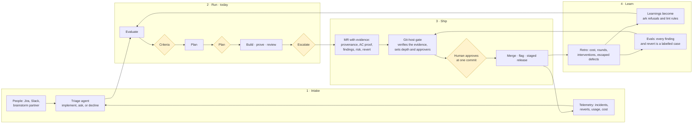

# Vision: the closed loop

Where Ark goes, and which parts exist today. The [roadmap](../reference/roadmap.md) holds the ranked milestones; this page draws the whole loop so each milestone has a place.

## The loop

A ticket comes in. A run turns it into merge requests that carry their own proof. A gate on the git host verifies that proof instead of re-deriving it. What ships reports back as incidents, reverts, cost and usage, and those become the next tickets and the next checks. Every stage runs by itself; people decide at the gates and own what ships.

## Where each stage stands

| Stage      | Today                                                                                                                                                                                         | Next                                                                                                                                                                                                                                                                  | Later                                                                                                                                                                                                    |
| ---------- | --------------------------------------------------------------------------------------------------------------------------------------------------------------------------------------------- | --------------------------------------------------------------------------------------------------------------------------------------------------------------------------------------------------------------------------------------------------------------------- | -------------------------------------------------------------------------------------------------------------------------------------------------------------------------------------------------------- |
| **Intake** | Local ticket files; a brainstorm partner writes proposed tickets; Master Chief suggests related tickets and you rank the roadmap                                                              | Jira as a ticket source for Clara and Smart QC (M7); Zephyr as a test-case source (ARK-315)                                                                                                                                                                           | A triage agent reads a Slack thread or an incident, researches the code, and either writes a ticket with ACs or asks one question; telemetry opens tickets by itself with a person ranking them          |
| **Run**    | Everything in the [architecture](architecture.md): evaluator, criteria and plan gates, workers, cross-vendor review with evidence, round budget, retro                                        | Reliable runs with no manual repair (M5); each step reports its real model and a provider limit never stops a run (M8)                                                                                                                                                | A run that knows what it cost before it starts, from the retros of runs like it                                                                                                                          |
| **Ship**   | One MR per repo in dependency order; `ark merge-request open` refuses without proof; Master Chief watches CI, comments and conflicts; a guarded auto-merger merges CLEAN MRs you have cleared | The MR body carries the run's evidence: who and which models did what, AC-by-AC proof with before/after, the review rounds, merge risk and how to revert ([proposal](https://claude.ai/artifact/H66kcwc6ZWLvYiHLf2pcY9)); a plugin of skills Ark loads at the MR step | Arbiter, the git-host gate, verifies the bundle against the head instead of re-reviewing it, sets review depth and required approvers from merge risk, and never approves; staged release behind flags   |
| **Learn**  | `ark retro` metrics; `retro.md`; three questions; proposals you approve; fifteen learnings with `Enforced by:` lines on the Ark project                                                       | The hub shows what is next, why, and what each run did (M9); retro proposals answered in a pass                                                                                                                                                                       | Every reviewer finding and its disposition becomes a labelled eval case; every revert and incident becomes a case the gate must catch; a change to a skill, prompt or model shows its before/after score |

## What never changes

- **People decide at the gates and own what ships.** Criteria, plan, escalation, manual checks, merge. An agent's answer is never a gate answer; an agent's approval is never a person's.
- **Proof is test cases passing at head**, or a person's recorded `ok`. Nothing ships on a claim.
- **Repeatable steps are commands; judgment is skills.** When a retro finds a repeatable mistake, it becomes a refusal.
- **Ark is not the regulated system.** Product repos keep their validation. Ark produces the evidence that validation reads, in the run folder and the MR, and never a second record of truth.
- **Only you merge.** Branch protection on the host enforces it; the auto-merger acts only on MRs you have cleared.

## The shape of a factory, in one sentence each

- **Depth two.** Master Chief, run leads, workers. No agent starts an agent two levels down, so every run is readable and every cost is attributable.
- **One run per ticket, many at once.** Worktrees per repo per run; a question in one run never stops another.
- **The plan before the code, the test cases before the tests.** Design is reviewed where it is cheap to change.
- **Cross-vendor review with evidence.** A finding without a repro command is an opinion and is ranked as one.
- **One record.** The event log is the run; `state.json`, the hub, the retro and the MR body are views of it.
- **Learnings that enforce themselves.** A lesson that a command can check is a refusal, not a paragraph.

## Milestones on the loop

| Milestone                    | Stage       | Outcome                                                                                       |
| ---------------------------- | ----------- | --------------------------------------------------------------------------------------------- |
| M5 Reliable runs             | Run         | A run starts, plans, builds and closes with no manual repair                                  |
| M6 MR follow-up              | Ship        | After an MR opens, Ark handles CI, review comments and conflicts until you merge              |
| M7 Multi-repo                | Run, Intake | One ticket across a multi-repo workspace, Smart QC first, then Clara, with Jira as the source |
| M8 Models and vendors        | Run         | Each step reports its real model; a provider limit does not stop a run                        |
| M9 See the work              | Learn       | The hub shows what is next, why, and what each run did                                        |
| Proposed: evidence-first MRs | Ship        | The MR carries the run's proof; the gate verifies it                                          |
| Proposed: Arbiter hand-off   | Ship, Learn | The git-host gate reads the bundle; Ark's findings feed its evals                             |
| Later: intake from telemetry | Intake      | Incidents, reverts and usage open and rank tickets                                            |
