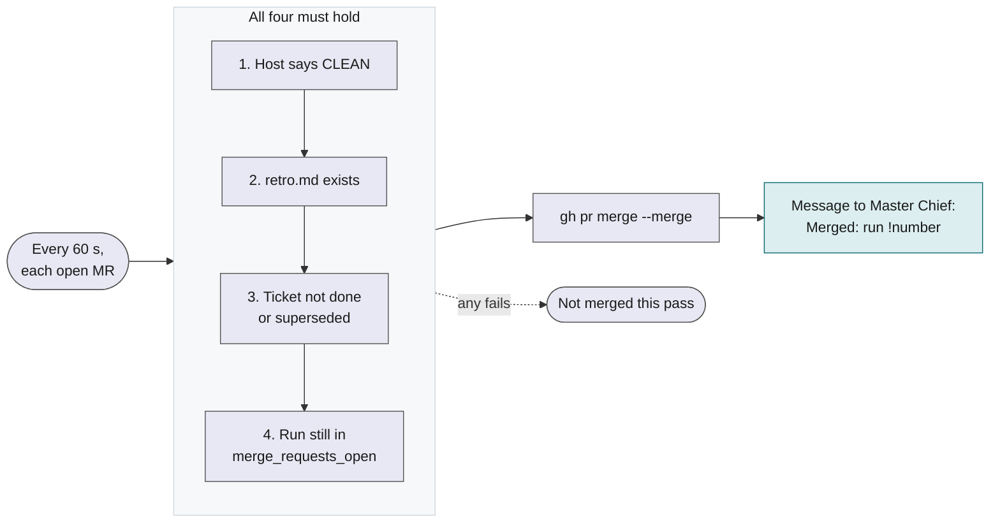

# Run Ark's background services

macOS only. The services run under launchd, so `ark services` does nothing useful on Linux.

`ark services install` starts three small jobs for one project. They run all the time, in the background, and restart if they stop. You do not need them to run a ticket, but they do three chores for you: one of them can merge MRs. On GitHub an MR is a pull request.

## What the services do

| Service        | Script                    | Runs every | What it does                                                                                                                                                                                                                  |
| -------------- | ------------------------- | ---------- | ----------------------------------------------------------------------------------------------------------------------------------------------------------------------------------------------------------------------------- |
| `auto-merger`  | `scripts/auto-merger.sh`  | 60 s       | Merges an open MR when the rules in [The auto-merger](#the-auto-merger) hold. Sends `Merged: <run> !<number>` to Master Chief after each merge. Not installed for a project with `merge_requests: none`.                      |
| `temp-cleaner` | `scripts/temp-cleaner.sh` | 300 s      | Removes Ark test temp folders from `$TMPDIR` after their test process ended, then runs `git worktree prune` in the workspace. When `/` has less than 15 GB free, it sends `Disk low: <n> GB free` to Master Chief.            |
| `sweep`        | `scripts/sweep.sh`        | 300 s      | Closes the Orca terminal of each settled worker of the project's runs, and lists terminals with no output for more than a day. It only lists those; it never stops them. Sends `Sweep: closed <n>, idle <m>` to Master Chief. |

The messages go to Master Chief's Orca Run, `Master Chief: <project> tickets`. Master Chief passes a low disk and a list of idle terminals on to you.

## Requirements

- macOS. The jobs are LaunchAgents in `~/Library/LaunchAgents`.
- `ark`, `gh`, `orca` and `jq` on the PATH of the shell that runs `ark services install`. launchd gives the services that PATH. If a program is missing, install prints `Warning: <names> not found on the PATH of this shell`, and the jobs that need it log a notice and do nothing.
- `ark.yml` of the project must be valid. Install reads its `workspace`.
- The project name, from `--project <name>` or the `ARK_PROJECT` environment variable.

## Install, check and remove

```sh
ark services install --project ark
ark services status --project ark
ark services uninstall --project ark
```

| Command                  | What it does                                                                                                                                                                                  |
| ------------------------ | --------------------------------------------------------------------------------------------------------------------------------------------------------------------------------------------- |
| `ark services install`   | Writes and loads one LaunchAgent for each service, named `dev.ark.<project>.<service>`. Run it again after a change: an unchanged service prints `... is already installed. Nothing changed.` |
| `ark services status`    | Prints one line for each service: `not installed`, `loaded` or `running` with its pid, and the last line of its log.                                                                          |
| `ark services uninstall` | Unloads and deletes all three LaunchAgents of the project. With none installed it prints `No services of project <project> are installed. Nothing changed.`                                   |

A real `ark services status`:

```text
auto-merger   running   pid 80115   last log: CHANGE: 2026-11-12-ARK-435-1 #194 merged;
temp-cleaner  running   pid 80117   last log: none
sweep         running   pid 80121   last log: none
```

`merge_requests: none` in `ark.yml` means the project has no MRs. Install then skips the auto-merger, and removes one that an earlier setting loaded.

### Logs

Each service writes to `~/.ark/projects/<project>/services/<service>.log`. `ARK_HOME` moves the `~/.ark` part. The log is where the auto-merger says why it did not merge:

```text
HELD: 2026-11-12-ARK-435-1 #194 no final report
CHANGE: 2026-11-12-ARK-435-1 #194 merged;
```

## The auto-merger

The auto-merger merges an MR once all of these hold:

1. The host reports the MR as `CLEAN`. The auto-merger reads this from `gh` (`mergeStateStatus`): CI passed on the latest head and your branch protection allows the merge.
2. The run's `retro.md` exists. The run lead writes it while the MRs are open.
3. The ticket is not `done` or `superseded`. A missing ticket file counts as live.
4. The run is still in `merge_requests_open`, checked again right before the merge.



The rules do not ask whether you finished reviewing. If you review an MR slowly, it can merge while you read it. Rules 2 and 3 print one `HELD: <run> #<number> <reason>` line in the log. A new conflict or a failed merge prints one `CHANGE:` line.

After a merge, Master Chief gets `Merged: <run> !<number>` and closes the run when every MR is merged. A message that cannot be sent is kept and retried on the next pass.

### Stop it

Merge by hand, or stop the service:

- `ark services uninstall --project <project>` removes the auto-merger. It removes the other two services as well: there is no switch for one service.
- Run `ark services install --project <project>` again to start them.

Without these services, only you merge. Ark's agents and the `ark` command never merge.
