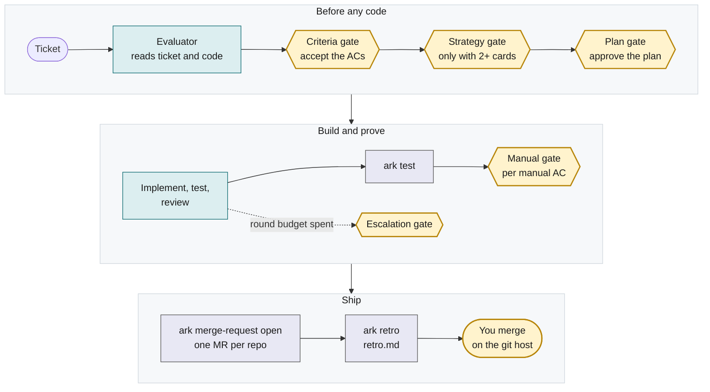

# Run a ticket from Master Chief to a merged MR

This page shows you how to take one ticket to a merged MR with Ark. You talk to Master Chief. It starts a run lead for the ticket, the run lead plans and builds the change, you answer a few gates, and you merge on your git host. On GitHub an MR is a pull request.



Amber is you. Teal is an agent. Grey is the `ark` command. Merging is not a gate: Ark never merges for you.

## Before you start

- **Ark installed.** Follow the install steps in the [README](../../README.md). `bun link` puts the `ark` command on your PATH, and `omp plugin link .` makes `/skill:ark` available in OMP. Check with `ark --help`.
- **OMP.** `/skill:ark chief` is OMP syntax. Start your agent with `omp` in an Orca terminal.
- **Orca.** Orca runs, and Settings → Orchestration → Nested worker depth is 2. Ark needs this so Master Chief can start run leads and run leads can start workers.
- **A bootstrapped project.** Do [Bootstrap a project](bootstrap-a-project.md) once. It writes `~/.ark/projects/<project>/ark.yml`.
- **A git host login.** Sign in to `gh` for GitHub or `glab` for GitLab.
- **Plannotator (optional).** With it you review the plan in a browser. Without it, you review the plan in the Master Chief session.

> **Note: workers run without permission prompts.** Workers started by omp run without permission prompts, in the run's worktrees only. `ark worktree anchor` and `ark worktree create` write `.omp/config.yml` with `tools.approvalMode: yolo` in each repo worktree of the run. Nothing in your `~/.omp` and nothing in the main workspace changes, and a `.omp/.gitignore` keeps the file out of the MR.
>
> To turn it off for a worktree, delete its `.omp/config.yml` before the worker starts. Every new run writes the file again, and there is no Ark switch. Terminal mode and the claude and codex harnesses were not measured and ignore the file. A worker that still stops at a permission prompt is a defect: tell Master Chief, and do not click the prompt through.

## 1. Open Master Chief in an Orca terminal

1. In Orca, open a terminal in the project's workspace.
2. Start `omp` in that terminal.
3. Run:

   ```text
   /skill:ark chief
   ```

Master Chief must run inside an Orca terminal. If it does not, it stops and tells you why. Open `omp` from an Orca terminal and run the command again.

## 2. Name the ticket

Tell Master Chief which ticket to run. It reads the ticket from the project's `ticket_source` in `ark.yml`: local files, GitHub or Jira. It tells you:

- whether each AC is testable,
- which repos the ticket likely changes,
- what it depends on or what is unclear.

Master Chief then suggests related tickets: blockers, tickets blocked by this one, and tickets that touch the same repos. Choose which to queue. Master Chief queues only the tickets you approve, and it keeps their dependencies.

### Create a local ticket

For `ticket_source: local`, a ticket is one Markdown file at `~/.ark/projects/<project>/tickets/<ticket id>.md`. Either write it yourself, or open `omp` in the project and run `/skill:ark brainstorm`: it talks the idea through with you and writes the tickets you keep, with `status: proposed`. Both ways follow the format in section 6 of the [Master Chief playbook](../../skills/ark/playbooks/chief.md): front matter (`id`, `title`, `summary`, `kind`, `acceptance_criteria`), then `## Problem`, `## Change` and `## Acceptance criteria`. A minimal ticket:

```markdown
---
id: DEMO-1
title: "Export shows the unit"
summary: "Export shows the unit"
kind: feature
acceptance_criteria:
  - id: AC1
    text: "Each exported value has a unit column"
---

## Problem

Exports drop the unit, so users cannot read the values.

## Change

Add a unit column to the export.

## Acceptance criteria

| ID  | Criterion                             |
| --- | ------------------------------------- |
| AC1 | Each exported value has a unit column |
```

The `summary` is the MR title after the ticket id, so keep `<ticket id>: <summary>` to 72 characters or less. `kind` is `feature` (the default), `bug`, `perf` or `refactor`; it changes what `ark test` requires (see [Project checks, ticket kinds and proof](project-checks.md)). A ticket with `acceptance_criteria: []` is allowed: the run lead drafts the ACs at the criteria gate.

## 3. Let the run start

Master Chief starts a run for each ticket that is ready, up to the `concurrency` set in `ark.yml`. That is the most runs open at once. For each one it saves the ticket, runs `ark run start`, and starts a run lead. The run lead has an evaluator read the ticket and the code, and the run waits at the criteria gate.

To see where a run is at any time, run:

```sh
ark status
ark status <run>
```

`ark status` lists every open run: the run id, its phase, its current step (`-` for none) and its age. `ark status <run>` shows the phase, the round, the current step, the gate that waits for you, the gates answered so far, the MR links and the cost so far. This is real output, trimmed:

```text
$ ark status
2026-11-12-ARK-335-1  building  hub-live-tests  10m
2026-11-12-ARK-344-1  building  -  3m

$ ark status 2026-11-12-ARK-372-1
run: 2026-11-12-ARK-372-1
ticket: ARK-372 cli/ark.ts is split into one file per command group with a small registry, ...
kind: refactor
phase: building
round: 1/2
current step: none
waiting gate: none
manual pending: ARK-372/AC2
gates answered:
  criteria accept by human
  plan approve by auto
last test: passed
merge requests: none
cost: $5.20 (17196569 tokens)
```

`by auto` means the project's `ark.yml` answered that gate (see [Gates you can hand to Ark](#gates-you-can-hand-to-ark)). `manual pending` lists the ACs that wait for your manual gate. A run with no activity for 24 hours gets `stale` after its age.

To open the hub as `http://ark.localhost` and have it start at login, see [Reach the hub by a local name](local-names.md). The hub is a read-only view with one action, "Open in Orca". You steer through Master Chief.

## 4. Answer the gates

The run lead asks for your decision at a gate. Master Chief shows you each question and sends your answer back. You answer only in Master Chief's session or in Plannotator. The gates open in this order:

| Gate       | Phase it opens in   | When                                                                     | Your answers                           |
| ---------- | ------------------- | ------------------------------------------------------------------------ | -------------------------------------- |
| Criteria   | `awaiting_criteria` | Every run                                                                | `accept`, `edit`, `abort`              |
| Strategy   | `awaiting_strategy` | Only when the run lead proposes 2 or more cards                          | A card id, or `abort`                  |
| Plan       | `planning`          | Once the plan is valid, before any code                                  | `approve`, `change`, `abort`           |
| Manual     | `building`          | One for each AC that is `manual: true` or has a method other than `test` | `ok`, `problem`, for one AC            |
| Escalation | `escalation`        | The run spends its round budget                                          | `one_more_round`, `take_over`, `abort` |

Behind each answer is `ark gate record <run> <gate> <answer>`. The run lead or Master Chief runs it for you; you only say the answer.

### Criteria gate

Every run opens here first, also when the ticket has good ACs. The run lead shows the ticket's ACs, the method of each (`test`, `demonstration`, `inspection` or `analysis`), the test cases that verify each, and what the evaluator found (blockers and risks). If the ticket has no ACs, the run lead drafts them.

| Answer   | What happens                                                                               |
| -------- | ------------------------------------------------------------------------------------------ |
| `accept` | The criteria are fixed. `accept` is refused if an AC with `method: test` has no test case. |
| `edit`   | You give the changes. The run lead revises the ACs and asks again.                         |
| `abort`  | The run closes with the outcome `aborted`.                                                 |

This gate is always yours: `ark.yml` cannot answer it.

### Strategy gate

This gate opens only when the run lead proposes two or more approaches. They are cards in `strategies.md` in the run folder, with mockups for a change a person will see. Pick one by its card id, or write a note to mix cards or change one: the designer revises the cards and you choose again. With one card there is no gate and the run goes straight to planning. Answer `abort` to stop the run.

### Plan gate

This gate opens before any code is written, and only once `ark plan check` accepts `plan.yml`. The run lead shows you `plan.md`: a summary, a Design section, a table of changes, a diagram of the steps, and the test cases.

1. If Plannotator opens, read the plan there. Approve it, or annotate what to change and submit. Annotated feedback sends the plan back for changes.
2. If it is shown in Master Chief's session, answer `approve`, `change` or `abort`.
3. You can edit `plan.yml` yourself. The run lead checks the file again with `ark plan check` and asks you again.

What to check:

- Every interface in `design.interfaces` lists its `callers`, and no caller is blank, or `ark plan check` refuses the plan.
- The Design section shows the approach and an example of the new output in a code fence.
- Every AC that is not manual has an integration or E2E test case. A manual AC needs none: the manual gate proves it.
- Each repo the ticket touches has a step.
- Which model reviews each step. By default, the reviewer is a different vendor from the implementer.

### Manual gate

For an AC with `manual: true`, or with a method other than `test`, you try the change yourself. The run lead tells you what to do and what to look for. Answer `ok` or `problem` for that AC. `ok` is the proof for that AC. You answer this gate once for each such AC, and `ark.yml` cannot answer it for you.

### Escalation gate

This gate opens when the run spends its round budget, which defaults to two rounds. The run lead shows what still fails. Choose one of:

| Answer           | What happens                                                                            |
| ---------------- | --------------------------------------------------------------------------------------- |
| `one_more_round` | The budget grows by one round.                                                          |
| `take_over`      | You write the change yourself in the run's worktree. Tell the run lead when you finish. |
| `abort`          | The run stops before any MR is opened.                                                  |

### Gates you can hand to Ark

In `ark.yml`, `gates:` may set `strategy`, `plan` and `escalation` to `auto`. Ark then answers for you and records the answer with `by: auto`.

- `strategy: auto` picks the recommended card.
- `plan: auto` approves a valid plan without you. Use it only after you trust the project's plans.
- `escalation: auto` answers `one_more_round`, at most 2 extra rounds in a run. `ark run step ... start` prints `escalation one_more_round by auto (<n> of 2)`, and Master Chief tells you in one line, with nothing to answer. The third spent budget, and any escalation the run lead opens with `ark escalate`, wait for you as above.

The criteria and manual gates are always yours.

## 5. Wait for the build

After you approve the plan, the run lead creates the run's worktrees with `ark worktree create`. This is the `building` phase. Workers then build the change:

- an implementer writes the code,
- a validator writes the tests that prove each AC,
- a reviewer looks for defects.

The run lead runs `ark test` on the composed workspace. A criterion is proven only when its tagged integration or E2E test passes, or, for a manual AC, when you answer the manual gate `ok`. `ark test` also runs the suites at the base commit, so each test case has a before and an after in `results/evidence/` (see [Project checks, ticket kinds and proof](project-checks.md)). The run lead decides which review findings send work back to the implementer, and it says why. It opens the MRs only when the tests pass at the latest commit.

You do not need to do anything in this phase except answer gates.

## 6. Review the MRs

When the run lead opens the MRs with `ark merge-request open`, Master Chief gives you a link for each. The run is now in `merge_requests_open`. For a ticket that changes several repos, there is one MR for each repo, listed in the order to merge them.

### What the MRs look like

- The title is `<ticket id>: <summary>`, 72 characters or less, from the `summary:` of the ticket.
- The body leads with the problem and says what is not done, how to verify and how to revert.
- The generated text sits between the `<!-- pr-writing:begin -->` and `<!-- pr-writing:end -->` markers. What you write outside them stays.

### What happens on later rounds

After each post-MR round the run lead runs `ark merge-request open` again. It updates the generated text of each open MR and leaves what you wrote outside the markers.

### If the branch no longer merges cleanly

Before it pushes anything, `ark merge-request open` fetches origin and checks, with `git merge-tree`, that each branch merges cleanly into its target. If one does not, it refuses and pushes nothing. The run lead then starts an implementer step with `--merge` to fix the conflict.

## 7. Merge

Ark's agents and the `ark` command never merge. You merge on the git host:

1. Review each MR there. Ask for changes there if you need them.
2. Merge the MRs in the order listed. Each later MR says which one it depends on.
3. Tell Master Chief that you merged them.

Optionally, `ark services install` (macOS) installs an auto-merger service that merges an MR once the host reports it clean under your branch protection, the run's `retro.md` exists, the ticket is not done or superseded, and the run is still in `merge_requests_open`. It does not wait for you to finish reviewing. See [Run Ark's background services](background-services.md) for the rules and how to stop it.

## 8. Close the run

Master Chief checks the state of each MR with `gh` or `glab`, and then closes the run with `ark run close <run> <outcome>`:

| What happened                             | Outcome      |
| ----------------------------------------- | ------------ |
| You merged every MR                       | `merged`     |
| You closed the MRs without merging        | `abandoned`  |
| You took the branches and want no MRs     | `handed_off` |
| You stopped the run before any MR existed | `aborted`    |

### Hand off the branches

A project with `merge_requests: none` in `ark.yml` has no MRs. Its run leaves from `building`, never from `merge_requests_open`. The run lead runs `ark worktree sync` and the retro. Take the branches, named `ark/<ticket id>-<slug>`, then tell Master Chief. Master Chief runs `ark run close <run> handed_off`.

`ark run close ... handed_off` first applies the refusals of `ark merge-request open`:

- a non-manual AC not `passing`,
- a manual AC with no `ok`,
- a repo head changed since the last test,
- a counted AC string in no tracked file, or a `not:` string still in one,
- the `perf` and `refactor` rules, and missing, malformed or stale evidence.

See [Project checks, ticket kinds and proof](project-checks.md) for each. On a refusal it exits 1, appends no event and removes nothing: run `ark test <run>` again, or `ark criteria amend`. Then each branch that has commits beyond its base stays in its clone, and `ark run close` prints a `kept` line for it. The worktrees are removed. `git -C <repo> log <base>..<branch>` lists the commits; the `kept` line names the branch and the first 8 characters of the base.

## 9. Retro

While the MRs are open, before merge or close, the run lead runs `ark retro` and writes `retro.md` for the run: the numbers (cost, time, rework) and proposals for improvement, one for each rule in `rules.md` (a rule the run lead wrote when a finding repeated). Nobody asks you questions after a single run.

Every 10 closed runs, or when you ask (`/skill:ark retro interview`), Master Chief runs a deep interview. It asks at most 8 questions, one at a time. You approve or reject each proposal. Nothing changes without your approval.

## If something goes wrong

- **Master Chief refuses to start.** The session is not in an Orca terminal. Open it from one.
- **A run lead cannot start a worker.** Orca's nested worker depth is below 2. Set it to 2 in Orca's settings.
- **`ark evaluation record` or `ark strategy record` says `ark.yml ... has no roles.evaluator` (or `roles.designer`).** Add the role to `ark.yml` (see [Bootstrap a project](bootstrap-a-project.md)) and start the run again.
- **An AC wording is wrong after planning.** Tell Master Chief the new text and your reason. The run lead runs `ark criteria amend <run> <criterion id> <file> --reason <text>`, which works from the strategy gate until the MRs open. At the criteria gate, answer `edit` instead. Before plan approval it runs `ark plan check` again; after approval it does not, and the run keeps its phase. `ark status` lists each amendment with its reason. When test case ids are renumbered, the lead runs `ark criteria amend <run> <criterion id> --verified-by <case ids> --reason <text>` instead of editing `ticket.md`.
- **You want to stop a run.** Tell Master Chief to abort it. An abort at any gate closes the run with the outcome `aborted`. An aborted run keeps a branch that has commits beyond its base, as with `handed_off`, and `ark run close` prints a `kept` line for it.
- **A bug turns up after you merge.** Give Master Chief the bug ticket and say which run caused it. It links the two as an escaped defect.
