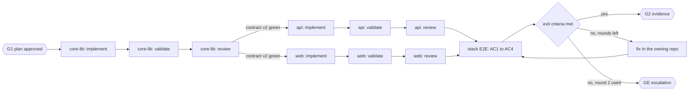

# Ark — Product Requirements (v1)

Oct 21, 2026 · @Cobe Karhoff

This PRD specifies Ark, a software factory built as an OMP plugin that configures itself to a repo's stack and takes a ticket through planning, implementation, real-test validation and cross-vendor review across one or more GitLab repos, with human gates and an audit trail fit for FDA-regulated work. It is written to be handed off and built from, including by Ark itself.

**How to read it.** Part 1 is the product: the problem, goals, the core rule, numbered requirements with acceptance criteria, packaging, dogfooding, milestones and risks. Part 2 is the technical design that meets those requirements. Part 3 is the research behind the review design, and the sources. An engineer can start from the milestones in Part 1; each requirement names the Part 2 section that explains it.

# Part 1 — Product requirements

## Problem and context

Agents can already write the code; what the team lacks is a repeatable, auditable way to get from a ticket to merge-ready changes across several dependent repos.

- **The estate is multi-repo.** Several GitLab repos, described by an interconnected Markdown knowledge base, depend on each other as packages. One ticket often needs changes in two or three repos, landed in order.
- **The software is FDA-regulated.** Every requirement needs traceable verification, every approval needs an owner and a time, and records must survive for audit.
- **Today's agent sessions are ad hoc.** A session that analyzes and plans but stops before implementing loses the run. Verification depends on what the agent chose to test. Review, when it happens, is often the same model grading its own work. Subagent activity and cost are hard to reconstruct afterwards.
- **Unit-heavy, mock-heavy tests are not the evidence the team trusts.** Real end-to-end and integration tests that finish green are.

The Ark turns that into a defined pipeline: deterministic tooling for everything mechanical, agents only for judgment and code, and a human at every decision that matters.

## Goals and non-goals

v1 succeeds when a real ticket spanning several repos reaches merge-ready MRs with a complete, replayable record, in either harness.

**Goals.**

1. A ticket goes from intake to merge-ready MRs across one or more repos, with humans approving the plan, the evidence and the merge.
2. Every acceptance criterion is traced to a passing real test, with proof the test fails without the change.
3. Every agent action, the model that took it, and every human decision is recorded and can be reconstructed from the run folder alone.
4. A run can be stopped at any point and resumed from deterministic state in a fresh session.
5. Review is adversarial across vendors, and no finding sends work back without proof.
6. It installs into any repo or multi-repo project as an OMP plugin and fits itself to that stack, asking you only what it cannot detect.
7. Cost per run is visible, and review effort scales with risk.

**Non-goals for v1.**

- Auto-merge or deploy. Agents never merge.
- Replacing GitLab approvals or the QMS's formal sign-off.
- Generating unit tests or heavily mocked integration tests for coverage's sake.
- Unattended runs with no human gates.
- A hosted multi-user service. v1 runs on an engineer's machine or a CI runner.
- Hard token caps. Cost is measured, not capped.
- Claude Code and other harnesses such as herdr. Claude Code subagents run only Anthropic models, and the review design needs Codex. Keeping logic in the CLI keeps a later port cheap.

## Users

Four roles touch the Ark; the operator and approver may be the same person on small teams.

| Role | Who | What they do | What they need from the Ark |
| --- | --- | --- | --- |
| Operator | The engineer who owns the ticket | Starts runs; answers G0, G1 and escalations; reviews evidence at G2 | Clear gate packets, the execution diagram, one-command resume, a needs-you queue |
| Approver | Code owners on the git host | Approves and merges MRs under the host's approval rules | MRs with the trace matrix, evidence links and upstream MR order |
| QA and RA | Quality and regulatory | Audit runs after the fact | Immutable run records, approvals with identity and packet hash, the trace matrix |
| Maintainer | Whoever owns the Ark | Changes skills, agents, the CLI and models | CLI tests, golden-ticket evals, per-reviewer metrics, setup, doctor and format parsers |

## The core rule: agents think, the CLI does

**Agents are for judgment and for writing code. Everything else is a deterministic, repeatable `ark` CLI command.** This rule outranks every other section of this doc. When a later section seems to let an agent do something mechanical, the rule wins.

The test for any step: given the same inputs, should two runs produce the same output? If yes, it is a CLI command. If it needs judgment, it is an agent, and the agent's output is a file that a CLI command validates before anything acts on it.

| Agents do this | The `ark` CLI does this |
| --- | --- |
| Read and understand the ticket and the code | Fetch the ticket and save it untouched |
| Draft acceptance criteria and spot ambiguity | Create the run folder, worktrees and branches from `repos.yml` |
| Design the plan and write `run-plan.json` | Check the plan (cycles, repo order, AC coverage, fail routes, vendor rule) and render the DAG diagram |
| Write product code | Move the state machine, write the ledger, hash every artifact |
| Write and fix tests | Run builds and test suites, capture JUnit, logs and the environment fingerprint |
| Hunt for bugs in review | Run the red-green proof: base branch, then feature branch, tagged tests only |
| Bucket findings and decide what goes back | Build the trace matrix and fail the gate on gaps |
| Diagnose a failure and propose a fix | Record gate answers with approver, time and packet hash |
|  | Render `context.md` and subagent briefs from templates |
|  | Open MRs in dependency order, set dependencies, post ticket comments |
|  | Copy session files, total tokens and cost, send gate alerts |

**How the rule is enforced, not just stated.**

- **Agents call the CLI; they never do its job by hand.** The validator writes tests, then runs `ark test`; it does not invent its own test command. The orchestrator runs `ark advance`; it never edits `state.json`.
- **Agents cannot reach what only the CLI should touch.** Worktrees are created with the push URL disabled, so an agent's `git push` fails. MRs open only through `ark mr`. The `tool_call` hook blocks writes to `state.json`, the ledger and `run-plan.json` after G1.
- **Each command is small, tested and boring.** A CLI step gets ordinary tests with fixed inputs. That is what makes the orchestration evaluable: the deterministic half is tested like any software, and only the agent half needs evals, run against a set of golden tickets.
- **A later port stays cheap.** Any other harness would only have to run agents that call one CLI. The more that lives in the CLI, the less there is to port.

## Requirements

Thirty-eight functional and five non-functional requirements, each with numbered acceptance criteria. IDs are stable: when the Ark builds itself, criterion 3 of FR-08 becomes `FR-08-AC3` in its own `ac.yml`.

**Functional.**

| ID | Requirement | Acceptance criteria | Milestone | Design |
| --- | --- | --- | --- | --- |
| FR-01 | A deterministic `ark` CLI owns every non-judgment operation | AC1 every operation in the core rule's CLI column is a subcommand. AC2 each subcommand has tests with fixed inputs and expected outputs. AC3 no agent can write state, ledger or the approved plan, or push | M1 | The core rule |
| FR-02 | One router skill is the entry point, with playbooks `setup`, `ticket`, `bugfix`, `investigate`, `review`, `resume` | AC1 the route and its reason are the first ledger event. AC2 playbook steps appear verbatim in the todo list; skipped steps carry a reason. AC3 starting a ticket that already has a run resumes it | M1 (`setup`, `ticket`, `resume`), M3 (rest) | Router skill and playbooks |
| FR-03 | Run state is event-sourced | AC1 replaying the ledger rebuilds `state.json` byte for byte. AC2 an illegal transition is refused and changes nothing. AC3 every state has a computed next action | M1 | Run state and resume |
| FR-04 | Any run resumes from any state in a fresh session | AC1 killing the session in each non-terminal state, then running resume, continues at the recorded next action with no completed step repeated. AC2 `context.md` is identical for identical inputs | M1 | Run state and resume |
| FR-05 | Early stops are caught | AC1 ending a session while status is `active` triggers one continuation naming the next action | M2 | Run state and resume |
| FR-06 | One writer per run, and drift is detected | AC1 a second session cannot advance a locked run. AC2 a worktree HEAD that differs from the recorded SHA sets status `blocked` and shows the diff | M2 | Run state and resume |
| FR-07 | Acceptance criteria are normalized at intake | AC1 every AC gets a stable ID. AC2 missing or untestable AC opens G0. AC3 the ticket is stored unchanged | M1 | Acceptance criteria to tests |
| FR-08 | The plan is executable and drawn as a DAG | AC1 `run-plan.json` passes `plan check` (cycles, repo order, AC coverage, fail routes, vendor rule). AC2 the Mermaid render is deterministic. AC3 `advance` refuses nodes not in the approved plan. AC4 a change after G1 reopens G1 with old and new diagrams | M1 single repo, M2 multi-repo | The execution DAG at G1 |
| FR-09 | Implementers work per repo in isolated worktrees and cannot push | AC1 one worktree per repo on a `ark/*` branch. AC2 the push URL is disabled. AC3 implementer output passes its schema. AC4 implementers never edit AC-tagged tests | M1 | Agents and models; Multi-repo |
| FR-10 | Real tests, tagged by AC, run by the CLI | AC1 `ark test` runs the repo's configured commands and captures JUnit, logs and the environment fingerprint. AC2 owned services are not mocked | M1 | Acceptance criteria to tests |
| FR-11 | New behavior has red-green proof | AC1 each new-behavior AC's tagged tests fail on the base source with the head test files overlaid, and pass on the head SHA. AC2 a missing proof fails the gate. AC3 red records whether each test failed an assertion or errored | M1 | Acceptance criteria to tests |
| FR-12 | The trace matrix gates the loop | AC1 `trace-check` fails on an AC without a passing tagged test, an unknown AC tag, missing red-green proof, or an unsigned manual AC. AC2 a flaky test is not green | M1 | Acceptance criteria to tests |
| FR-13 | Review uses a two-vendor panel sized by tier | AC1 preflight refuses a run where `validate` or `reviewer-x` shares the implementer's vendor, or `reviewer-s` does not. AC2 T1 runs one reviewer, T2 two, T3 two plus security. AC3 the model that actually answered is recorded. AC4 fallbacks stay inside a vendor | M1 one reviewer, M3 tiers | Agents and models; Token economy |
| FR-14 | Findings are verified and judged | AC1 every finding is bucketed Act on, Consider, Noted or Dismissed, with a reason. AC2 no Act-on P0 or P1 goes back without a failing test or traced path. AC3 P2 and P3 never block | M1 | Adversarial review research; Gates and loop policy |
| FR-15 | Human gates use fixed packets and answers | AC1 GS, G0, G1, GE and G2 each record answer, approver, time and packet sha256. AC2 no step after a gate runs without its approval | M1 | Gates and loop policy |
| FR-16 | The fix loop is bounded | AC1 at most the configured number of fix rounds per run, two by default. AC2 one more failure opens GE with a diagnosis. AC3 the shared premise is checked and logged before the last round | M1 | Gates and loop policy |
| FR-17 | Dangerous actions always pause | AC1 push to non-ark branches, force-push, merge, CI/CD or secrets edits, dependency changes and shared-environment writes are blocked by hook and routed to a human | M2 | Gates and loop policy |
| FR-18 | Repos are ordered by a manifest | AC1 `repos.yml` validates. AC2 `impact.json` gives a topological order. AC3 each edge's contract is approved at G1 and diffed after implementation. AC4 siblings run in parallel | M2 | Multi-repo |
| FR-19 | The composed stack is validated | AC1 downstream repos test against local upstream builds. AC2 stack E2E covers cross-repo ACs | M2 | Multi-repo |
| FR-20 | MRs open in order through the CLI | AC1 MRs open in topological order with upstream links and merge order. AC2 GitLab MR dependencies are set where supported. AC3 agents cannot merge | M2 | Multi-repo |
| FR-21 | Each run has a complete record | AC1 the run folder holds ticket, AC, plans, state, ledger, events, all session files (main and subagent), stage outputs, test evidence and a verified `MANIFEST.sha256`. AC2 a QA reviewer can say who did what, on which model, from the folder alone | M1 main session, M2 subagents | Observability, audit, and the dashboard |
| FR-22 | A local Ark Console serves live run views | AC1 ark console serves on localhost only and reads only run folders, session files and CLI output. AC2 views update within seconds of a ledger or session write. AC3 a runs list with stage, waiting gate, rounds and cost, and a desktop alert when a run enters a gate. AC4 the console never writes run state; every action goes through the CLI | M1 | Observability, audit, and the dashboard |
| FR-23 | Cost and reviewer value are measured | AC1 tokens and cost per run and per stage come from session usage. AC2 a report lists each reviewer's unique accepted findings | M3 | Token economy |
| FR-24 | The Ark ships as one OMP plugin package | AC1 it installs with `omp plugin install` from the internal catalog or Git. AC2 it provides the router skill, playbooks, agents, the hooks extension, format parsers, schemas and the CLI. AC3 CI installs it into a clean OMP and runs a golden smoke ticket | M1 | Packaging (OMP) |
| FR-25 | First-run setup fits the plugin to a repo or project | AC1 setup detects each repo's stack deterministically and records each value as detected, inferred or confirmed. AC2 you are asked only about inferred or unknown values and policy choices. AC3 every command is proven by doctor before config is written. AC4 config lands as an MR through gate GS. AC5 it works for a single repo and for a multi-repo project | M1 single repo, M2 multi-repo project | Setup and configuration |
| FR-26 | Configuration is layered and inspectable | AC1 plugin defaults, project, repo and user layers merge deterministically. AC2 `config show --resolved` names the layer behind each value. AC3 schema validation refuses unknown keys. AC4 model roles are written to the project's OMP config from `ark.yml` | M1 | Setup and configuration |
| FR-27 | Doctor keeps the setup honest | AC1 a quick doctor runs before every run (schema, tools, auth, clean worktree base, plugin version). AC2 a full doctor proves commands, tag selection, JUnit capture, environment up and down, and `link_cmd`. AC3 manifest changes since setup mark the config stale | M1 | Setup and configuration |
| FR-28 | Test frameworks plug in as format parsers | AC1 each suite in `.ark/repo.yml` is plain commands plus a `format`. AC2 a new framework needs only one parser (collect-only output to tag-to-test map, JUnit to results) and its fixture tests. AC3 parsers are added when a repo that needs them is onboarded | M1a `bun-test`, M1 `pytest` and `behave` | Setup and configuration |
| FR-29 | The run DAG and swim lanes are live | AC1 the DAG from run-plan.json shows each node as pending, running, passed, failed or waiting on a gate. AC2 swim lanes show one lane per repo plus one for gates, over time, with agent spans, gate waits and fix rounds. AC3 clicking a node or span opens its transcript, artifacts and evidence | M1 DAG, M2 swim lanes | Observability (Ark Console) |
| FR-30 | Agent cards show live stats | AC1 each running agent shows role, repo, the model that is answering, current tool, context use, tokens, cost, retries and fallbacks. AC2 stats come from tailing session files, so they need no hooks. AC3 a subagent appears as soon as its session file exists | M1 main session, M2 subagents | Observability (Ark Console) |
| FR-31 | Gates can be answered in the console | AC1 the gate inbox shows each waiting gate's packet, with the DAG for G1 and the evidence for G2. AC2 an answer runs ark gate with your identity and the packet hash. AC3 a gate answered in the terminal cannot also be answered in the console, and the reverse | M1 | Observability (Ark Console) |
| FR-32 | The ticket view shows AC status and evidence | AC1 each AC shows its tests, red and green SHAs and evidence links, updating as tests run. AC2 diffs per repo, findings with dispositions, and transcripts are one click away | M1 | Observability (Ark Console) |
| FR-33 | Open MRs are watched until they merge | AC1 ark watch follows each MR's pipeline and starts a fix round on failure, within the run's round budget. AC2 when an upstream MR merges, the CLI rebases downstream branches and updates version pins. AC3 a rebase conflict goes to an agent, then to you. AC4 a run closes only when every MR is merged or abandoned | M3 | Multi-repo |
| FR-34 | Integrations plug in through adapters | AC1 each integration point has one interface with contract tests. AC2 ark.yml selects one adapter per point. AC3 doctor checks each selected adapter's auth and reachability. AC4 adding an adapter needs no change outside its module | M1a interfaces; adapters per milestone | Integrations |
| FR-35 | Tickets from any source normalize to one shape | AC1 local files, GitLab issues, GitHub issues and Jira all produce the same ticket.json and ac.yml. AC2 acceptance criteria come from the configured field or description section. AC3 the raw source payload is stored unchanged. AC4 status sync is optional per source | M1a local, M1 Jira, later GitLab and GitHub issues | Integrations |
| FR-36 | GitLab and GitHub both work as git hosts | AC1 opening, describing, linking and watching MRs goes through one interface. AC2 the host is detected from the git remote and confirmed at setup. AC3 merge order uses native MR dependencies where available and the description otherwise | M1a GitHub, M1 GitLab | Integrations |
| FR-37 | Setup learns each repo, including existing ones | AC1 setup writes .ark/repo.md (purpose, architecture, entry points, build and test, conventions, risk areas) for review at GS. AC2 the CLI collects the test inventory with the runner's collect-only mode, and an agent classifies each suite as E2E, real integration, mocked integration or unit. AC3 existing CI, CODEOWNERS, MR templates and agent context files are adopted, not overwritten. AC4 existing tests are never retro-tagged; only new and changed ACs need tagged tests | M1 | Setup and configuration |
| FR-38 | One install manages many projects, each one repo or several | AC1 setup asks whether a project is one repo or several and records the shape in its config. AC2 \~/.ark/projects.yml registers every project, and ark project list shows them. AC3 each project keeps its own config, adapters, models, run folders and cost totals, and every run belongs to exactly one project. AC4 the console opens on all projects with their active runs and needs-you items, and every view filters by project. AC5 run folders live outside product repos by default | M1 registry and console, M2 multi-repo projects | Projects |

**Non-functional.**

| ID | Requirement | Acceptance criteria |
| --- | --- | --- |
| NFR-01 | Determinism | Every CLI command returns the same output for the same inputs, and tests prove it |
| NFR-02 | Least privilege | Agents get the narrowest tool lists; no push or merge credentials reach an agent's environment |
| NFR-03 | Portability | The CLI has no harness-specific logic; harness glue is limited to manifests, agent frontmatter and thin hook shims |
| NFR-04 | Auditability | The ledger is append-only, every artifact is hashed, and the answering model is recorded per step |
| NFR-05 | Regulatory fit | QA and RA review the gate mapping before the Ark is used on production tickets |

## Success metrics

One metric has a fixed target from day one; the rest get baselines over the first 20 runs, then targets.

| Metric | How it is measured | Target |
| --- | --- | --- |
| Audit completeness | Share of closed runs whose manifest verifies and whose ledger replays to the same state | 100%, always |
| Plan first-pass rate | Share of runs approved at G1 without changes | Set after baseline |
| Evidence first-pass rate | Share of runs approved at G2 without being sent back | Set after baseline |
| Escalation rate | Share of runs that reach GE, by tier | Set after baseline |
| Escaped defects | Bugs traced to Ark MRs after merge, against the team's pre-Ark rate | Below the pre-Ark rate |
| Reviewer value | Unique accepted findings per reviewer, per tier | A reviewer with none at a tier is dropped from that tier |
| Human time per gate | Minutes from gate open to answer | Set after baseline |
| Cost per run | Tokens and spend per run, and the review-to-build cost ratio | Set after baseline |
| Resume success | Share of interrupted runs finished through `resume` with no manual repair | Set after baseline |

## Packaging (OMP)

v1 ships as one OMP plugin package. Claude Code is out of scope for v1: its subagents run only Anthropic models, and the review design depends on Codex.

**What OMP accepts (from its plugin docs).**

| Aspect | OMP behavior |
| --- | --- |
| Manifest | `package.json` with an `omp` key listing extension entry points; optional `features` and typed `settings` |
| Components | Conventional `skills/`, `commands/`, `hooks/`, `tools/`, `rules/`, `prompts/` and `agents/` directories, plus `.mcp.json` |
| Install sources | npm package, Git repo, local directory, or a marketplace catalog (`.omp-plugin/marketplace.json`) |
| Scope | `--scope project` records a marketplace install in `.omp/plugins/installed_plugins.json`; npm, Git and local installs go to the user plugin directory. Project scope is not a security boundary |

**Package layout.**

```
ark/
  package.json            omp.extensions -> extensions/hooks.ts
  cli/                    the ark CLI and its tests
  skills/ark/      router SKILL.md and playbooks/ (setup, ticket, bugfix, investigate, review, resume)
  agents/                 implementer, validator, reviewer-x, reviewer-s
  extensions/hooks.ts     maps tool_call and session_stop to `ark hook <event>`
  schemas/                ark.yml, repo.yml, state, run-plan, stage outputs
  evals/golden/           golden tickets with expected gate outcomes
  .omp-plugin/marketplace.json
```

**Rules.**

- **Hook logic lives in the CLI.** The extension is a thin shim that calls `ark hook <event>`, so the policy is tested as ordinary CLI code.
- **Teams install from an internal catalog** with `--scope project`, and the project config pins the plugin version. `ark doctor` refuses to start a run on a different version.
- **The CLI stays harness-neutral** (NFR-03). That keeps a later port open, for example if Claude Code gains other vendors' models or Codex roles get proxied.

## Setup and configuration

Installing the plugin changes nothing in a repo until `setup` runs. Setup detects the stack, asks you only what it cannot detect, proves every command by running it, and lands the config as an MR you review.

**Setup flow.** Each step names who does it, per the core rule.

1. **Locate (CLI).** `ark setup` finds the project root. For a single repo, that is the repo. For multi-repo work, it is the knowledge-base repo; the CLI lists candidate repos from the knowledge base's links and the local clones it finds.
2. **Detect (CLI).** For each repo, a deterministic scan reads manifests and lockfiles, test-runner and E2E configs, Compose files, and the `.gitlab-ci.yml` jobs, which are the best record of the commands the team really runs. It proposes suites with a known `format` and writes `detect.json`.
3. **Propose (agent).** The `setup` playbook reads `detect.json`, the CI config, READMEs and the knowledge base. It proposes each repo's commands, environment bring-up, AC tag syntax, `link_cmd`, dependency edges and risk paths. Every value is marked detected, inferred or unknown.
4. **Ask (you).** Through OMP's `ask`, only for inferred or unknown values and for policy: ticket system, implementer vendor, tier thresholds, which paths are safety-relevant, approvers, the alert webhook. Each question comes with concrete options.
5. **Prove (CLI).** `ark doctor` runs everything for real: build, a tagged test selection against a probe test on a scratch branch (which proves tag filtering and JUnit capture), environment up and down, and a `link_cmd` round trip. A failure goes back to step 3 with the error, twice at most, then to you.
6. **Approve (you, gate GS).** You review the config diff and the doctor report. The CLI commits the files on a `ark/setup` branch and opens an MR, so config changes go through normal change control.

**Retrofitting existing repos.** Most repos Ark meets already have history, tests and conventions. Setup is built for that case, not for greenfield.

- **Learn before configuring.** An agent writes `.ark/repo.md`: purpose, architecture, entry points, how to build and test, conventions, and risk areas. You review it at GS, and every later run uses it as context. Where the knowledge base already describes the repo, the brief links to it rather than repeating it.
- **Inventory the tests.** The CLI lists every test with the runner's collect-only mode. An agent classifies each suite as E2E, real integration, mocked integration or unit, and setup reports what real-test coverage exists. Your planned test-audit skill fits here.
- **Adopt, don't overwrite.** Existing CI jobs, CODEOWNERS, MR templates and agent context files (such as AGENTS.md) are read and respected. Setup only adds files under `.ark/`.
- **No retro-tagging.** Old tests keep their names. Only acceptance criteria from new tickets need tagged tests, so onboarding a large repo does not start with a rewrite.
- **Integrations first.** Before commands are proposed, setup settles the git host, CI, ticket source and test environment adapters (see Integrations), because those decide which commands and signals matter.

**Configuration layers.** Later layers override earlier ones; the merge is deterministic.

| Layer | File | Holds | Committed |
| --- | --- | --- | --- |
| Plugin defaults | Inside the package | Format parsers, default tiers, gate packet templates | No |
| Project | `ark.yml` and `repos.yml` at the project root | Ticket system, models per role, tiers and risk tags, gates, loop budget, always-pause list, alerts, pinned plugin version; the repo graph | Yes |
| Repo | `.ark/repo.yml` in each repo | Build, test and E2E commands, AC tag syntax, `link_cmd`, environment bring-up, risk paths | Yes, versioned with the code |
| OMP project | `.omp/config.yml` | Model roles for the agents' aliases, written by the CLI from `ark.yml` | Yes |
| User | `~/.ark/user.yml` | Your approver identity, alert target, local clone paths | No |

`ark config show --resolved` prints the merged config and which layer set each value. `ark config validate` checks every file against its schema and refuses unknown keys.

**Example `.ark/repo.yml`.**

```yaml
name: platform
commands:
  build: uv sync
suites:
  api:
    format: pytest                      # tags: @pytest.mark.ac("CLARA-247-AC1")
    level: integration
    collect: uv run pytest --collect-only -q
    run: uv run pytest -m "ac" {select} --junitxml=$ARK_OUT/api.xml
    junit: $ARK_OUT/api.xml
  e2e:
    format: behave                      # tags: @CLARA-247-AC1 on the scenario
    level: e2e
    collect: uv run behave --dry-run --format json --no-summary
    run: uv run behave --tags="{tags}" --junit --junit-directory $ARK_OUT/e2e
    junit: $ARK_OUT/e2e/*.xml
    env:
      up: docker compose up -d --wait   # floci (AWS emulator) + services
      down: docker compose down -v
link_cmd: uv pip install -e {upstream_path}
risk_paths:
  T3: [src/auth/**, migrations/**]
provenance:
  suites.e2e.env.up: confirmed by cobe, 2026-10-21
```

**Example project `ark.yml`.**

```yaml
project: platform
plugin_version: 0.3.1
integrations:
  tickets: {adapter: gitlab, project: group/platform, ac_from: description-section}
  git_host: {adapter: gitlab}
  ci: {adapter: gitlab-ci}
  notify: {adapter: desktop}
models:
  orchestrator: anthropic/claude-opus-5-5:high
  implement: openai-codex/gpt-5.5:high
  validate: anthropic/claude-sonnet-5-5:high
  review-x: anthropic/claude-opus-5-5:high
  review-s: openai-codex/gpt-5.5:high
tiers:
  t1_max_changed_lines: 200
  t3_tags: [auth, patient-data, safety, migration, contract-change]
loop: {max_fix_rounds: 2}
always_pause: [push-non-ark, force-push, merge, ci-config, secrets, dependency-change, shared-env-write]
alerts: {webhook_env: ARK_WEBHOOK}
```

**Suites are commands plus a format parser.** There are no stack profiles in v1. A repo lists named suites; each is plain commands (`collect`, `run`, optional `env.up` and `env.down`), a `junit` glob, and a `format` that picks a small built-in parser. The parser turns the runner's collect-only output into a map from AC tag to test ID, and joins that map to JUnit results. Frameworks with native tags use them (Behave `@ID`, pytest markers, Playwright tags); frameworks without tags put the AC ID in the test or describe name (Ark's own `bun test`). Supporting a new framework means adding one parser with fixture tests when a repo that needs it is onboarded. Stack profiles and detection return when setup automation has real repos to learn from.

**Keeping config honest over time.**

- A quick doctor runs before every run: schema, required tools, auth to GitLab and both model providers, a clean worktree base, and the pinned plugin version.
- Setup records a hash of the manifests it detected from. When they change, doctor marks the config stale and suggests `ark setup --repo <name>`.
- `ark setup --repo <name>` adds or re-onboards one repo without touching the others.

## Projects

One Ark install manages many projects. A project is the unit you onboard, configure and run tickets in; it holds one repo or several, and you choose which at setup.

- **What a project holds.** A name, its repos with their dependency edges, its ticket-source and git-host adapters, models, tiers, gates and alert settings. Every run belongs to exactly one project, and ticket IDs are namespaced by it.
- **Shape is decided at onboarding.** `ark setup` asks whether this is a single-repo or multi-repo project. A single-repo project keeps its config in that repo's `.ark/` folder. A multi-repo project keeps `ark.yml` and `repos.yml` in a project root repo (the knowledge-base repo, or a small config repo), and each member repo has its own `.ark/repo.yml`. `ark project add-repo` turns a single-repo project into a multi-repo one later.
- **A local registry.** `~/.ark/projects.yml` lists every project on the machine with its name, root path and shape. Setup registers a project when GS is approved; `ark project list` and `ark project remove` manage the rest.
- **Runs live outside repos.** Run folders default to `~/.ark/projects/<project>/runs/`, so run records never land in product repos. The location is configurable, for example to a shared drive or, later, S3.
- **Separate by default.** Each project has its own config, models, adapters, locks and cost totals. Nothing crosses projects except the plugin itself and your user settings.
- **The console spans projects.** It opens on a home view of every registered project with active runs, needs-you items and cost, and every other view filters to one project.

| Example project | Shape | Tickets | Git host |
| --- | --- | --- | --- |
| `ark` | Single repo | Local files in `tickets/` | GitHub |
| `platform` | Knowledge-base repo plus product repos | Jira | GitLab, with Arbiter on MRs |

## Integrations

Everything that differs between teams sits behind an adapter: a small, deterministic CLI module with one interface, chosen in `ark.yml` and checked by doctor. The core never knows which tracker or host it is talking to. This doc says MR throughout; on GitHub, read PR.

| Integration point | v1 adapters | Later | What Ark uses it for |
| --- | --- | --- | --- |
| Ticket source | Local files (Ark's own project), Jira (team projects) | GitLab issues, GitHub issues | Intake, AC extraction, optional status sync |
| Git host | GitHub (Ark's own project), GitLab (team projects) | Others on request | Branches, MRs, links between MRs, merge order, approval status |
| CI | GitHub Actions, GitLab CI | Jenkins | Finding the commands a repo really runs at setup; watching pipelines |
| Review gate | Arbiter, read-only, on GitLab projects | Other review bots, or none | Optional fix round on Arbiter findings (open question 2) |
| Notifications | Desktop | Slack, Teams, email | Gate alerts and stalled runs |
| Test environment | Docker Compose | Ephemeral AWS environments (CDK or Terraform), local Kubernetes (kind), Testcontainers | Bringing the real stack up and down for E2E |
| Package registry | Per-repo `link_cmd` | npm, PyPI or CodeArtifact, Maven, Go modules | Local linking, and version pins after upstream merges |
| Test secrets | Environment variables | AWS Secrets Manager, Vault | Credentials the CLI injects into test runs; never shown to agents |
| Run record storage | Local folder | S3 with Object Lock | Retention and audit |
| Knowledge context | Markdown knowledge base | Confluence, Notion | Context for analysis and planning |
| Requirements and test management | None | Jira Xray or Zephyr, Jama, Polarion | Exporting the trace matrix to the QMS system of record, if QA and RA want it |
| Telemetry export | None | OpenTelemetry | Sending run and agent spans to existing observability tools |

**One ticket shape.** Every source normalizes to `ticket.json` and `ac.yml`, and the raw payload is kept unchanged beside them. Local tickets are Markdown files with frontmatter. The backlog for building Ark is written in this format, so Ark can read its own backlog from day one.

```md
---
id: ARK-013
title: ark test runs tagged tests and records red-green proof
status: ready
milestone: M1a
traces: [FR-10, FR-11]
depends_on: [ARK-011]
acceptance_criteria:
  - id: ARK-013-AC1
    text: ark test runs a repo's tagged-test command for a set of AC IDs and saves JUnit XML and logs to the run folder
---
Context and notes for the implementer.
```

**Where acceptance criteria come from.** Local tickets use frontmatter. GitLab and GitHub issues use a section headed "Acceptance criteria", usually a checklist. Jira uses a configured custom field, or the same description section. `ark.yml` sets this per source (`tickets.ac_from`), and anything missing opens G0.

**How setup picks adapters.** The git host comes from the remote URL and the CI from files present (`.gitlab-ci.yml`, `.github/workflows/`). The ticket source is asked (local files or Jira in v1); Jira keys in recent commit messages are a signal setup surfaces when it asks. Everything else defaults to the v1 adapter unless a signal suggests otherwise.

## Dogfooding

From the end of the walking skeleton (M1a), the Ark builds itself: every remaining requirement in this PRD is delivered as an Ark run against the Ark's own repo.

1. **This PRD is the backlog.** Each FR becomes a ticket whose acceptance criteria are copied with their IDs, so FR-08's third criterion is `FR-08-AC3` in that run's `ac.yml`. The Ark's own trace matrix is this requirements table.
2. **M0 and the walking skeleton are built with pstack, in Ark shape.** There is no Ark yet, so they are built with OMP and pstack, but still as tickets with tagged tests, a ledger kept by hand where the CLI does not exist yet, and GitHub PRs that a human reviews and merges. Ark moves to GitLab later.
3. **From the walking skeleton on, every change runs through the Ark.** The `ticket` playbook, the gates, red-green proof and the trace matrix all apply to the Ark's own changes.
4. **Guardrail code gets an extra human.** Changes to the state machine, gates, hooks or the trace check are the Ark grading its own safety rails. Their CLI tests run in CI on every change. While Ark is a one-person project, every PR is human-reviewed and merged by hand, never automatically; a second human approver is required once Ark moves to the team's GitLab.
5. **Golden tickets keep the agent half honest.** A fixed set of past tickets, single and multi-repo, with expected gate outcomes, is replayed after any change to skills, agents or models. The ark eval command replays them and compares gate outcomes.
6. **The Ark repo is in its own `repos.yml`**, so multi-repo runs can include the Ark alongside a product repo when a ticket needs an Ark change to land.

## How we build it

Build a thin deterministic CLI and agent loop by hand, run Ark's first ticket on itself, then dogfood everything else, onboarding first.

1. **The backlog is local tickets.** Tickets are written in Ark's local ticket format with acceptance criteria traced to this PRD, and live outside the repo in `~/.ark/projects/<project>/tickets/`, next to the runs. Later requirements become tickets the same way.
2. **One spike upfront.** Only ARK-101 (plugin install, CLI on PATH, runtime) blocks building. The other harness questions are answered by the ticket that first uses the feature, as a "record observed behavior" criterion. Hooks and session files inside subagents are settled right before the tickets that depend on them (ARK-112, ARK-113).
3. **Built directly in OMP.** No pstack bootstrap; the thin loop is built by hand in OMP sessions, as tickets with tagged tests and GitHub PRs you review and merge.
4. **Deterministic CLI first, thin.** `run start`, `advance`, `gate`, `ws create`, `test --red-green`, `trace-check` and `mr`. Plan check and render, context render, session capture, manifest and the console are deferred to dogfooded tickets.
5. **Agent layer on top.** Router skill, `ticket` playbook, implementer, validator and `reviewer-x`, lead judgment by the orchestrator, a main-session write-block hook and the vendor preflight.
6. **Thin loop, then dogfood.** ARK-109 (`ark context`) is the first ticket Ark runs on itself, from local ticket to PR through G1 and G2. Every later ticket runs through Ark.
7. **Onboarding right after.** Ark's own config is hand-written to start. The first dogfood ticket after the thin loop is the `setup` playbook with a thin doctor (ARK-110), then the pytest and behave parsers with CLARA as the first real onboarding (ARK-111). CLARA runs use local tickets and stop at a ready branch with no MR until the GitLab and Jira adapters exist.
8. **Console after the loop.** It only reads files, so it can be dogfooded once the run folder shape settles.

**Thin-loop backlog.** ARK-101 to ARK-108 are built by hand; ARK-109 is the first Ark run; the rest are dogfooded. This supersedes the earlier ARK-001 to ARK-021.

| ID | Ticket | Traces | Depends on |
| --- | --- | --- | --- |
| ARK-101 | Spike: plugin install from Git, CLI on PATH, typed tools, runtime | FR-24, NFR-03 | None |
| ARK-102 | Scaffold: Bun/TS package, `ark` bin, skills, agents, extensions, schemas, CI | FR-01, FR-24 | ARK-101 |
| ARK-103 | Run core: `run start`, ledger, state replay, `ark advance` | FR-01 to 03, FR-07, FR-35 | ARK-102 |
| ARK-104 | Gates: `ark gate` packet and answer for G0, G1, G2 | FR-15 | ARK-103 |
| ARK-105 | Worktrees and `ark test` with red-green proof | FR-09 to 12, FR-28 | ARK-103 |
| ARK-106 | `trace-check` builds the matrix and gates G2 | FR-12 | ARK-105 |
| ARK-107 | `ark mr` through `gh`, optional per project | FR-20, FR-36 | ARK-106 |
| ARK-108 | Router skill, `ticket` playbook, agents, lead judgment, write-block hook | FR-02, 09, 13, 14, 17 | ARK-104 to 106 |
| ARK-109 | `ark context` renders the resume brief, as the first Ark run | FR-04 | ARK-107, ARK-108 |
| ARK-110 | Setup playbook and thin doctor, on Ark | FR-25, 27, 37 | ARK-109 |
| ARK-111 | pytest and behave parsers; onboard CLARA platform | FR-28, FR-37 | ARK-110 |
| ARK-112 | Hooks inside subagents: per-role rules, always-pause list | FR-05, FR-17 | ARK-109 |
| ARK-113 | Session capture, `MANIFEST.sha256` and `ark verify` | FR-21 | ARK-109 |
| ARK-114 | `run-plan.json` with plan check and plan render | FR-08 | ARK-109 |

## Milestones

Milestones are closed by exit criteria a reviewer can check; no dates yet.

| Milestone | Scope | Exit criteria | Built by |
| --- | --- | --- | --- |
| M1a Thin loop | FR-01 (thin command set), 02 (`ticket`), 03, 07, 09 to 12, 13 (one reviewer), 14, 15 (G0, G1, G2), 20 (one PR), 35 (local tickets), 36 (GitHub) | ARK-109 runs through Ark on its own repo from local ticket to PR through G1 and G2, with hand-written config, and its ledger replays to the same state | OMP by hand |
| M1 Single repo, complete | FR-02 (`setup`, `resume`), 04, 16, 22, 25 (single repo), 26 to 28, 29 (DAG), 30 (main session), 31, 32, 35 (Jira), 36 (GitLab), 37, 38 (registry, console across projects) | Setup and full doctor pass on the Ark project and one team project on Jira and GitLab. Three real team tickets reach merge-ready MRs, with G1 and G2 answered in the console. Ledger replay is byte-identical. Resume works from every state | The Ark |
| M2 Multi-repo | FR-05, 06, 08 (multi-repo), 17 to 20, 21 (subagents), 25 (multi-repo project), 29 (swim lanes), 30 (subagents), 38 (multi-repo projects) | Multi-repo project setup over the knowledge-base repo succeeds. One three-repo ticket runs end to end, watched live in the console | The Ark |
| M3 Review tiers, metrics and MR watch | FR-02 (remaining playbooks), 13 (tiers), 23, 33 | 20 runs completed; reviewer value report produced; one multi-repo run watched through to merge | The Ark |
| M4 Retention and audit outputs | Closed runs shipped to write-once S3; the audit outputs QA and RA choose | A closed run verifies from S3 | The Ark |
| M5 RPC runner (only if needed) | Live subagent capture, a deterministic outer state machine | Triggered if ARK-112 shows hooks do not fire inside subagents | The Ark |

**Harness questions and where they are answered.**

- [ ] Plugin install from Git puts `ark` on PATH; `tools/` exposes typed tools; runtime (ARK-101).
- [ ] Is an `ask` question and answer recorded in the session file (ARK-104)?
- [ ] Can a subagent work in a worktree outside the session's repo (ARK-105)?
- [ ] Output schemas in agent frontmatter, how the parent reads them; model selectors, project role aliases, in-vendor fallback (ARK-108).
- [ ] Do project hooks fire inside subagents, with the role visible (ARK-112)? If not, M5 triggers.
- [ ] Where subagent session files land, how they link to the parent, and whether they grow live (ARK-113).

## Risks

The two biggest risks are unverified harness behavior and the lack of a real test environment; M0 and open question 4 address them first.

| Risk | What goes wrong | Mitigation |
| --- | --- | --- |
| Hooks do not fire in subagents | Subagent guardrails and live capture have gaps | Push disabled at the git level, narrow tool lists, session files copied after each stage; the RPC runner in M5 |
| OMP plugin or agent format changes | The plugin stops loading after an OMP upgrade | Pin the OMP version per project; CI installs the plugin into a clean OMP on every change |
| Setup proposes wrong commands | Runs fail late, or test evidence comes from the wrong suite | Doctor proves every command before config is written; config lands as a reviewed MR |
| No reproducible real-stack environment | E2E tests are slow, flaky or impossible, so verification falls back to weaker evidence | Start with Docker Compose for one repo; environment bring-up is part of setup, not an afterthought |
| Flaky E2E tests | Runs stall or pass on luck | Flaky is never green; a quarantine list that only a human can add to |
| Agents write tests that assert nothing | False green | Red-green proof, validator on a different vendor from the implementer, the test-audit step |
| Silent same-model review | Cross-vendor benefit lost without anyone noticing | In-vendor fallback chains, the vendor preflight, actual-model audit per step |
| Gates not accepted as quality records | Ark output cannot be used for regulated work | QA and RA review before production use; formal approval stays in GitLab |
| The Ark weakens its own guardrails | A dogfood run edits gate or hook code badly | Second human approver on guardrail MRs; guardrail tests in CI |
| Sensitive content in run folders | Source and command output leak | Treat run folders as controlled records; restricted access; encrypted write-once storage |
| Cost creep | Spend grows with every reviewer added | Risk tiers, per-run cost, dropping reviewers with no unique accepted findings |

## Parked ideas

Ideas raised during design and deliberately left out of v1, kept here so nobody re-derives them.

| Idea | What it would do | Why parked |
| --- | --- | --- |
| Label-driven intake | An `ark:ready` label on a GitLab issue queues a run | Runs start by hand until the flow has earned trust |
| Knowledge-base write-back | After merge, update the Markdown knowledge base through a reviewed MR | Useful once multi-repo runs are routine |
| Refine mode | Draft ACs and a test plan for a ticket before work is scheduled | G0 covers the gap for now |
| Plan-only dry run | Produce the G1 packet and a cost estimate without implementing | Needs cost data from real runs first |
| Run replay | Step through a past run's ledger in the console | Follows once the console exists |
| Model A/B runs | Rerun a golden ticket on different models and compare | Part of the eval work after M3 |
| Run handoff and queue | Hand a run to a teammate; limit concurrent runs | v1 is single-operator |
| Lessons into rules | Turn recurring accepted findings into review rules | Needs findings history from M3 |

## Decided questions

Settled on 2026-10-21 in two design grillings. The second cut the walking skeleton to a thin loop so dogfooding and onboarding start sooner (see How we build it).

1. **Tickets.** Ark's own project uses local tickets and GitHub; team projects use Jira and GitLab. Jira acceptance criteria come from a description section matched by heading (`ac_from: description-section`).
2. **Arbiter.** Humans handle Arbiter findings until M3. In M3, a read-only Arbiter adapter arrives with `ark watch`, and its findings follow the same verify-before-bounce rule and round budget.
3. **Implementer vendor.** Configurable per project. `ark.yml` names every role's model explicitly, and preflight enforces the vendor invariants (FR-13). The default is chosen during ARK-108.
4. **Real test environment.** A suite may declare `env.up` and `env.down` commands, such as Docker Compose with floci for AWS services. `ark test` brings the environment up and down around both the red and green runs and fingerprints image digests. Local emulators of owned dependencies count as real, not mocks. Ephemeral AWS environments stay parked.
5. **QA and RA.** G1 and G2 are engineering records: approver from OS and git identity, time and packet hash. Formal sign-off is the host's MR approval. Ark ships a per-run audit bundle (the run folder with a verified manifest). Production use waits for QA and RA to review this mapping (NFR-05).
6. **Where runs execute.** Laptops only in v1. CI installs the plugin and runs the golden smoke ticket. A shared runner waits for S3 storage (M4).
7. **Plugin catalog.** Install from the GitHub Git URL for now; `plugin_version` is a git tag. The internal target is chosen when Ark moves to GitLab.
8. **Codename.** Ark, after the Forerunner installation that builds the Halo rings. It names the plugin, the router skill and the CLI. Arbiter keeps its role as the GitLab MR review gate.

# Part 2 — Technical design

## Design summary

Agents think and write code; a deterministic Ark CLI does everything else, and OMP is the harness that runs the agents.

- **One router skill** (pstack `poteto-mode` pattern) is the only entry point. It matches the request to a playbook and copies that playbook's steps into the todo list.
- **Opus orchestrates and judges.** It never writes product code. Implementation goes to Codex, validation to a Claude model, review to a two-vendor pair.
- **Adversarial review = two generalists on different vendors, same rubric, plus a verify step.** Specialists are added only by risk tag. Research basis is in the next section.
- **Acceptance criteria get IDs at intake.** Every AC maps to an E2E or real integration test, tagged with its ID. A script, not a model, builds the trace matrix and fails the gate on gaps.
- **Ark gates:** GS setup, G0 AC clarity, G1 plan, GE escalation, G2 evidence. Merge is the git host's own approval, not an Ark gate. Agents never merge.
- **Two fix rounds max,** then escalate to a human with a diagnosis.
- **Multi-repo from day one.** A repo manifest declares dependencies. Work runs in topological order; a single repo is a graph of one.
- **Every run gets a folder** with a CLI-written state.json, an append-only ledger, raw OMP session files (main and subagents), typed stage outputs and hashes. The dashboard reads that folder.
- **Spend scales with risk.** Three tiers decide reviewer count and thinking level. No cap yet, but cost per run is tracked from day one.

## The flow

&#91;embedded content: factory flow · 10 stages, Ark gates G1 and G2 plus host merge, 1 fix loop\]

A failed exit check sends work back to a fresh implementer; after the second fix round it comes to you instead. Every step writes to the run folder described under Observability.

## Router skill and playbooks

One skill is the front door; it picks a playbook, logs why, and copies the playbook's steps into the todo list verbatim. This is pstack's `poteto-mode` shape, cut to what the Ark needs first.

**How it is wired.** A skill is `SKILL.md` with frontmatter in a skill folder. Set `disable-model-invocation: true` so it only starts when called explicitly (`/skill:<name>` in OMP). The skill ships in the plugin's `skills/` folder of the OMP package; see Packaging in Part 1.

**Rules the router enforces.**

- Input is a ticket ID or free text. A ticket is pulled through the tracker's CLI or MCP and saved to the run folder untouched.
- The playbook choice and its reason are the first ledger entry.
- Every playbook step stays in the todo list. A skipped step reads `skip: <reason>`, which a reviewer can audit later.
- Follow-ups such as "continue" stay in the same playbook. "new task" re-routes.

**v1 playbooks.**

| Playbook | When | Steps | Human gates |
| --- | --- | --- | --- |
| `ticket` | A ticket with new or changed behavior | Intake, analyze, plan, implement, validate, review, judge, fix loop, evidence pack, MRs | G1 plan, G2 evidence; then host merge |
| `bugfix` | A reported defect | Intake, reproduce with a failing E2E test on the base branch, plan, fix, validate, review, MRs | G1 (plan plus repro), G2; then host merge |
| `investigate` | A read-only question about the system | Explore, cite, report | None |
| `review` | An existing branch or MR | Review panel, lead judgment, report | None; nothing is changed |
| `resume` | Picking up a run | Read the ledger, show state, continue from the last open step | Whatever gate is open |

Later candidates: `spike` for throwaway prototypes, `refactor`, and `dependency-change` for third-party (SOUP) updates.

## Agents and models

Seven roles, each bound to a role alias so a model swap is a one-line config change and never an agent-file edit. Model IDs below are starting points; confirm exact selectors with `omp models anthropic` and `omp models openai-codex`.

| Agent | Role alias | Starting model | Tools | Returns |
| --- | --- | --- | --- | --- |
| Orchestrator (main session) | `default` | `anthropic/claude-opus-5-5:high` | All, including `task`, `ask`, `todo` | Ledger entries, plan, gate packets, lead judgment |
| `scout` (bundled) | `smol` | `anthropic/claude-haiku-5-5` | Read-only | Exploration notes, so Opus context stays small |
| `implementer` | `@implement` | `openai-codex/gpt-5.5:high` | read, write, edit, bash, grep, glob; no `task` | Typed result: repo, branch, commits, files, ACs addressed, risks |
| `validator` | `@validate` | `anthropic/claude-sonnet-5-5:high` | read, write, edit, bash, grep, glob | Per-AC verdict with red-green proof and evidence paths |
| `reviewer-x` | `@review-x` | `anthropic/claude-opus-5-5:high` | read, grep, glob, bash in a throwaway checkout | Findings P0 to P3, confidence, file and line, evidence |
| `reviewer-s` | `@review-s` | `openai-codex/gpt-5.5:high` | Same as reviewer-x | Same schema |
| `security-reviewer` (bundled, tier 3 only) | via `agentModelOverrides` | Same as reviewer-x | Read-only | Same schema |

**Why this split.**

- **Opus judges, it does not type.** A `tool_call` hook blocks the orchestrator's writes outside the run folder. That keeps lead judgment independent of any code it would have to defend.
- **Hooks apply rules per role.** The hook reads which agent's session it is in and applies that role's rules: the orchestrator writes only in the run folder; the implementer cannot touch AC-tagged test files. `ark advance` repeats the test-file check on the implementer's diff, so the rule holds even where a hook does not fire.
- **The validator is a different vendor from the implementer.** Tests written by the model that wrote the code tend to encode the same assumptions. Greptile's data says each vendor's blind spots line up with its own bug types. A consequence: the validator and `reviewer-x` share a vendor.
- **`reviewer-x` is always the vendor that did not implement.** `ark.yml` sets every role's model explicitly, with no derivation. A ten-line preflight compares provider prefixes and refuses to start a run when `validate` or `review-x` shares the implementer's vendor, or `review-s` does not.
- **Fallbacks stay inside a vendor.** OMP fallback chains can jump providers. Pin each review role's chain to its own vendor, so a rate limit never quietly turns cross-model review into same-model review. The session file records the model that actually answered, and the audit uses that, not the configured one.
- **Subagents get no `task` tool.** OMP treats `task` without `spawns` as permission to spawn anything, and subagents run headless with no per-tool approval. A flat tree of depth one is easier to audit.

## Gates and loop policy

Five Ark gates: one-time setup (GS), plan (G1) and evidence (G2) on every run, and two conditional gates, AC clarity (G0) and escalation (GE). Each gate is a fixed packet plus a fixed set of answers, so every decision lands in the ledger the same way. Merge happens afterwards under the git host's own approval rules and is not an Ark gate.

| Gate | When | Packet the human sees | Answers |
| --- | --- | --- | --- |
| GS Setup | First install in a repo or project, or re-onboarding a repo | Config diff with each value marked detected, inferred or confirmed, and the full doctor report | Approve and open the setup MR, change values, abort |
| G0 AC clarity | Only if the ticket lacks testable acceptance criteria | Drafted AC candidates with IDs, and what is ambiguous | Accept, edit, abort |
| G1 Plan | Before any code | `plan.md`, the execution DAG diagram, AC-to-test plan, risk tier | Approve, request changes, abort |
| GE Escalation | Second fix round still fails | What failed, attempts so far, hypotheses, the orchestrator's recommendation | Give guidance, take over, one more round, abort |
| G2 Evidence | Loop exits clean, before MRs open | Diff per repo, trace matrix, red-green test evidence, findings with dispositions (dismissed ones with reasons), plan deviations, cost | Approve to open MRs, send back, abort |
| Merge (host, not an Ark gate) | In GitLab or GitHub | The MRs themselves | Arbiter's review where present, plus your normal approval rules; agents never merge |

**Loop exit criteria.** All must hold:

- Every AC has at least one passing test, with red-green proof where the AC adds behavior.
- The trace-check script passes.
- Build and lint are green in every touched repo.
- No open Act-on finding at P0 or P1.

P2 and P3 findings never block the loop. They go to G2 as Consider items for you to call.

**Round budget.** A round is one implementer pass after a failure. Two rounds, then GE. Before round two the orchestrator writes down the premise both fixes share and checks it directly (pstack's Attack the Premise principle), because a second fix on the same wrong premise burns tokens for nothing.

**Always-pause list, enforced by a hook.** A `tool_call` hook blocks these and routes them to a human, whatever the prompt says:

- Push to any branch not named `ark/*`, force-push, or merge.
- Edits to CI/CD config or secrets files.
- Adding or changing a third-party dependency, since each is a SOUP item.
- Migrations or writes against shared environments.

**How a gate is captured.** The orchestrator calls OMP's `ask` tool with the fixed answers. The question and answer land in the session file. It then calls a small `ark gate` CLI that writes the ledger entry: gate, answer, approver from the OS and git identity, timestamp, and the sha256 of the packet approved. For G1 in the terminal, OMP's plan mode is worth a trial: its Plan Review screen lets you annotate and edit sections before approving.

**Regulatory note.** These gates are engineering checkpoints. How they map to your design controls and electronic-signature rules is for QA and RA to decide; I'm not a regulatory advisor. Keeping the formal approval in GitLab, which you already validate, is the conservative default.

## The execution DAG at G1

At G1 you approve a picture of exactly what will run, drawn by the CLI from the same file the state machine executes, so the diagram cannot drift from the run.

**`run-plan.json` is the executable plan.** The orchestrator writes it alongside `plan.md`. Each node has an ID, a kind (implement, validate, review, stack E2E, gate), a repo, the agent and role alias, the nodes it waits on, the ACs it covers, and where it goes on pass and on fail. The plan also carries the tier and the reviewer panel.

**The CLI checks it before drawing it.** `ark plan check` refuses a plan with a cycle, a repo order that contradicts `repos.yml`, an AC no node covers, a node with no fail route, or a reviewer on the implementer's vendor.

**The CLI draws it.** `ark plan render` turns the plan into Mermaid, with no model involved. The diagram goes in the G1 packet, the dashboard, and the ticket comment; GitLab renders Mermaid in Markdown. It shows:

- Which repos change, in what order, and which run in parallel.
- The contract on each repo edge, and what must be green before downstream work starts.
- Every pass and fail route, including which repo a stack-level failure goes back to.
- Where the gates sit, the round budget, and the reviewer panel for the tier.

An example for a three-repo ticket:



**Approval binds execution.** G1 records the hash of `run-plan.json`. `ark advance` refuses to start any node that is not in the approved plan or whose upstream nodes have not passed. Changing the plan after G1 (a repo added, an edge reordered, the tier raised) is an amendment: the CLI renders the old and new graphs side by side and reopens G1 for just that change.

**Why it is not overkill.** It costs nothing to produce, because the CLI draws it from data the run needs anyway. It catches the expensive mistake early: a wrong repo order or a missing downstream repo found at G1 costs a comment, while the same mistake found at G2 costs a full build and review cycle. What would be overkill is a model drawing the diagram by hand, or a separate approval step just for it. For a single-repo T1 ticket the graph is a straight line, and the packet shows it as one line of text instead of a picture.

## Run state and resume

Every ticket's run has one `state.json` that only the `ark` CLI writes, so any fresh session can read exactly where the run stopped and what comes next. A run that was analyzed and planned but never implemented resumes at "spawn the implementer for the first repo", not at "re-read the ticket".

**The ledger is the truth; the state file is its projection.** Every change is an event appended to `ledger.ndjson`. `state.json` is rebuilt by replaying the ledger, so the same ledger always yields the same state, byte for byte. Models never edit either file: the `tool_call` hook blocks writes to both.

**Transitions come from a table, not from judgment.** The orchestrator calls `ark advance <run> <event>`. The CLI checks that the event is legal from the current state, that the required artifacts exist and pass their schemas, and records their hashes. An illegal move is refused with a reason and changes nothing. The model decides what to do; the CLI decides whether it is allowed and writes it down.

| State | Means | Next action (computed by the CLI) | Who acts |
| --- | --- | --- | --- |
| `intake` | Ticket saved untouched | Write `ac.yml`, or open G0 | Orchestrator |
| `analyzed` | `ac.yml` and `impact.json` valid | Write `plan.md` and the G1 packet | Orchestrator |
| `awaiting_g1` | Plan packet hashed | Approve, change or abort | You |
| `approved` | G1 approved | Create worktrees, spawn the implementer for the first repo in order | Orchestrator |
| `building` | Per-repo implement, validate and review steps in progress | The next unfinished step for the next repo in order | Orchestrator |
| `judging` | All findings and test results in | Exit, or start a fix round | Orchestrator |
| `escalating` | G2 send-back after the round budget was spent | Build the GE packet, or abort | Orchestrator |
| `awaiting_ge` | Second fix round failed | Guide, take over, one more round, or abort | You |
| `awaiting_g2` | Evidence packet hashed | Approve MRs or send back | You |
| `mrs_open` | MRs open in dependency order | Merge in order; from M3, ark watch handles pipelines, rebases and pins until each MR merges | You |
| `done` or `aborted` | Closed | None | None |

**What the file holds.**

```json
{
  "schema": 1,
  "run_id": "2026-10-21-ABC-123",
  "ticket": "ABC-123",
  "playbook": "ticket",
  "state": "approved",
  "status": "active",
  "tier": "T2",
  "round": 0,
  "next_action": {"kind": "spawn", "agent": "implementer", "repo": "core-lib"},
  "gates": {
    "G1": {"answer": "approve", "by": "cobe", "at": "2026-10-21T20:41:07Z", "packet_sha256": "9f2c..."}
  },
  "repos": [
    {"name": "core-lib", "order": 1, "branch": "ark/ABC-123-retry-policy", "base_sha": "a41e...", "head_sha": null, "step": "pending"},
    {"name": "api", "order": 2, "branch": "ark/ABC-123-retry-policy", "base_sha": "77c0...", "head_sha": null, "step": "pending"}
  ],
  "acs": {"ABC-123-AC1": "planned", "ABC-123-AC2": "planned"},
  "artifacts": {"ac.yml": "sha256:...", "impact.json": "sha256:...", "plan.md": "sha256:..."},
  "sessions": [{"role": "orchestrator", "file": "sessions/orchestrator-1.jsonl"}],
  "lock": {"session": "omp-7b1d", "since": "2026-10-21T20:41:30Z"},
  "ledger_seq": 14
}
```

`status` is one of `active`, `waiting_human`, `blocked`, `done`, `aborted`. The dashboard needs only this field to sort runs into running, needs-you and stalled.

**Context is rendered, not remembered.** `ark context <run>` fills a fixed template from the state file and artifacts, with no model involved: ticket summary, ACs with status, the approved plan verbatim, the contract on each repo edge, gate decisions, open findings with dispositions, the last subagent results, and the next action. The same inputs always produce the same text. A resumed orchestrator reads `context.md` instead of an old conversation. Subagent briefs are built from the same template sections, which keeps them consistent; subagents never see the conversation anyway.

**Resume.** `/skill:ark resume ABC-123` runs `ark status`, prints the state and next action, takes the lock and continues. Every other playbook first checks whether a run already exists for the ticket, so starting `ticket ABC-123` twice resumes instead of forking a second run.

**Stopping early is caught.** A `session_stop` hook reads the active run. If its status is `active` rather than waiting on you, the hook blocks the stop once with a reason such as "ABC-123 is in approved; next action: spawn implementer for core-lib". OMP gives the model one continuation for that. If it stops anyway, nothing is lost: the state file says where the run is, and the dashboard shows it as stalled.

**Locks and drift.** One orchestrator per run: `advance` is refused without the lock, which records the session and goes stale after a set idle time so `resume` can reclaim it. On resume, the CLI compares each worktree's HEAD with its recorded `head_sha`. A mismatch, such as a commit pushed by hand, sets status to `blocked` and shows you the difference.

**Later, optional.** On gate transitions the CLI can post the state as a label or comment on the ticket, so people see progress without opening the dashboard.

## Acceptance criteria to tests

Every AC gets an ID at intake, every test names the AC it proves, and a script, not a model, decides whether the matrix is complete.

1. **Intake writes `ac.yml`.** One entry per AC: ID such as `ABC-123-AC2`, the ticket text verbatim, a testable restatement, verification level (e2e, integration, manual, or unit by exception), repos, and risk tags. Missing or untestable AC triggers G0; the orchestrator never invents criteria silently.
2. **The plan maps each AC to planned tests.** A unit test is allowed only for pure logic with no integration surface, and the plan says why.
3. **Tests carry the AC ID** through the framework's native tag (Behave `@ID`, pytest marker) or, where none exists, in the test or describe name. The suite's format parser maps tags to test IDs from collect-only output.
4. **The CLI runs the real stack; the validator writes and fixes tests.** E2E and integration suites run against real services in containers or an ephemeral environment. Owned services are never mocked; outside vendors may use their sandboxes. The environment fingerprint (image digests, versions, commit SHAs) goes into the evidence.
5. **Red-green proof for new behavior.** `ark test --red-green` checks out the base source, overlays the test files changed on the feature branch, and runs only the tagged tests, which must fail. It then runs them on the head SHA, where they must pass. Any failure or error counts as red, and the matrix records which it was, so G2 can spot a weak red (such as an import error). This catches tests that assert nothing.
6. **`trace-check` builds the matrix** from `ac.yml` and the JUnit XML the runners emit. It fails when an AC has no passing tagged test, a test names an unknown AC, red-green proof is missing, or a manual AC lacks a signed human record.
7. **Flakes are not green.** On head, each failing tagged test is rerun once; a fail followed by a pass is marked flaky and shown at G2.

The matrix (AC, tests, red and green SHAs, evidence paths) goes into the G2 packet and the MR description. Your planned test-audit skill fits as the validator's last step, checking that each tagged test asserts the behavior its AC names.

## Multi-repo

Every run is a dependency graph of repos; a single-repo task is a graph of one, so there is only one code path.

**Repo manifest.** `repos.yml` at the project root lists each repo's path on the git host, default branch and `depends_on` edges. Each repo's own commands, AC tag convention and `link_cmd` live in its `.ark/repo.yml`, so they version with the code. Setup writes both; see Setup and configuration in Part 1.

**Analyze.** Scouts read the knowledge base and code; the orchestrator writes `impact.json`: affected repos with the docs or code that justify each, the interface change on each edge, and the topological order. A cycle is flagged at G1.

**Worktrees.** A deterministic `ark ws create` script makes one git worktree per affected repo under the run folder, on branch `ark/<ticket>-<slug>`. I'm not relying on OMP's `task.isolation` here: its docs describe isolating the session's own repo, and multi-repo behavior is unverified.

**Contract first.** When an edge changes an interface, the plan states the contract (types, API schema, event shape) and you approve it at G1. The upstream implementer must ship exactly that contract, and a script diffs it.

**Implement in order.** Upstream repos go first; siblings with no edge between them run in parallel. A downstream implementer's brief carries the upstream contract, a diff summary, and the upstream worktree path for local linking.

**Validate the composition.** The validator links local upstream builds into downstream repos with each `link_cmd` and runs E2E across the whole stack, not repo by repo.

**Fix loop.** A downstream failure caused by the upstream contract goes back to the upstream implementer. The two-round budget counts per run, not per repo, so a five-repo chain cannot burn ten rounds.

**MRs.** They open in topological order. Each downstream MR description lists the upstream MRs and the merge order. If your GitLab tier supports MR dependencies, the Ark sets them; otherwise the ledger and MR descriptions carry the order. You merge; the Ark only checks the order was kept.

## Observability, audit, and the dashboard

All agent communication runs through one hub: subagents never message each other, so every assignment and every result is a tool call and tool result in the orchestrator's session file. That one choice makes "capture every agent conversation" tractable.

| Layer | Source | What it captures | Status |
| --- | --- | --- | --- |
| Raw transcripts | OMP session JSONL under `~/.omp/agent/sessions`; subagent sessions as separate JSONL in the parent's artifact folder | Every message, tool call and result, the model that answered, token use and cost; `session_init` holds each subagent's system prompt, task and tools | Documented; subagent file location to confirm on a real run |
| Live events | A hook extension on the orchestrator writing `events.ndjson` | Agent start and end, turns, tool execution, fallbacks, goal updates | Works for the main session; firing inside subagents is unverified |
| Ledger | The `ark` CLI, append-only, schema-checked | Route choice, state changes, gate decisions with packet hashes, rounds, finding dispositions, actual model per stage | To build |
| Stage outputs | Each subagent's `output` JSON schema result | Typed handoffs the gates read as data | Documented |

**Run folder.**

```
runs/2026-10-21-ABC-123/
  ticket.json        raw ticket, untouched
  ac.yml             acceptance criteria with IDs
  impact.json        repos, edges, order
  plan.md
  state.json         current state, rebuilt from the ledger
  context.md         resume brief, rendered from a template
  ledger.ndjson      append-only decisions and gates
  events.ndjson      live hook events
  sessions/          copied OMP JSONL, main and subagents
  artifacts/         typed stage outputs, junit, logs, screenshots
  trace-matrix.md
  ws/<repo>/         worktrees
  MANIFEST.sha256    hashes of everything above
```

**Integrity.** The CLI copies session files into the run folder at each stage end and re-hashes the manifest. Session files hold source code and command output, so treat run folders as controlled records. A later step is shipping closed runs to S3 with Object Lock in compliance mode for write-once retention.

**The v2 path.** If hooks turn out not to fire inside subagents, the clean fix is an outside runner that drives OMP through `omp --mode rpc`. RPC mode streams `subagent_lifecycle`, `subagent_progress` and `subagent_event` frames and can read any subagent transcript by byte offset. The same runner is the route to a deterministic state machine and to harness independence.

**Ark Console.** A local web app that `ark console` serves on 127.0.0.1, for one operator, from M1. OMP's Agent Hub (Alt+A) stays the in-terminal view; the console adds every run, its history, the plan as a graph, the timeline, gates and evidence.

- **Reads, never writes.** Sources are the run folders (state, ledger, events, artifacts), OMP session files tailed by byte offset for live agent stats, and GitLab MR status through the CLI. There is no database in v1; the server rebuilds an in-memory index from files on start.
- **Live by file watching.** The server watches those files and pushes changes to the browser with server-sent events. Because session files carry model, tool calls and token use, agent stats stay live without hooks.
- **One kind of action.** Answering a gate runs `ark gate` with the same packet hash and identity the terminal would use. Everything else is view-only, and formal approval still happens in GitLab.
- **Local only.** It binds to localhost with no login, and no data leaves the machine.
- **Small to ship.** A static single-page app inside the plugin, served by the CLI, with nothing for users to build.

| View | What it shows | Data from |
| --- | --- | --- |
| Runs | Every run with ticket, playbook, state, waiting gate, rounds used, cost and age; a needs-you list on top and a desktop alert when a run enters a gate | `state.json`, ledger |
| DAG | Plan nodes colored pending, running, passed, failed or waiting; contract edges labeled; a click opens the node's agent, transcript and artifacts | `run-plan.json`, ledger |
| Swim lanes | One lane per repo plus a gates lane, over time: agent spans, gate waits, fix rounds, and a line at now. Parallel work and time spent waiting on you show at a glance | Ledger, events, session timestamps |
| Agent cards | Role, repo, the model that is answering, status, current tool, context use, tokens, cost, retries, fallbacks, last message | Session file tail |
| Gate inbox | Each waiting gate's packet with its fixed answers; G1 shows the DAG and AC-to-test plan, G2 the evidence | Gate packets |
| Ticket and ACs | Ticket text; each AC turning red and green with its tests, SHAs and evidence; diffs per repo; findings with dispositions | `ac.yml`, trace matrix, artifacts |

&#91;embedded content: Ark Console run page · wireframe\]

The DAG and agent cards answer "what is happening now"; the swim lanes answer "where did the time go", including time spent waiting on a gate.

## Token economy

The orchestrator proposes a risk tier at G1 and you can raise it; the tier sets reviewer count and effort. The size threshold below is a starting guess to tune after real runs.

| Tier | Triggers | Review | Effort |
| --- | --- | --- | --- |
| T1 Light | One repo, small diff (start at about 200 changed lines), no risk tags | `reviewer-x` only | Reviewer at medium |
| T2 Standard | The default | `reviewer-x` and `reviewer-s` | High |
| T3 High | Any risk tag: auth, patient data, safety-relevant behavior, data migration, cross-repo contract change; or you say so | T2 plus `security-reviewer` | High; xhigh only to re-check a disputed P0 |

**Other levers.**

- **Opus stays lean.** Bulk reading goes to Haiku scouts; Opus reads their summaries. Opus runs at high, not max.
- **Fresh agent per round.** Each fix round gets a new implementer with a consolidated brief: the original assignment, the accepted findings, and a pointer to the branch. Resuming a long-context agent costs more, and pstack found that interrupt-chained resumes silently drop directives.
- **Reviewers pull context.** They get the diff plus file pointers and fetch the rest with tools, rather than a pre-packed context dump. Cursor found agents pull what they need.
- **Red-green runs only tagged tests** on the base branch.
- **Review spend should be well under build spend.** OpenAI found a verifier at a fraction of the generator's tokens still catches a large share of known high-severity bugs. The dashboard shows that ratio per run.
- **Runaway guard, not a cap.** Keep OMP's default soft budget of 200 requests per subagent, which forces a partial result at 1.5 times that.

**Measure, then cut.** Log every finding with its reviewer, model and disposition. After about 20 runs, compare each reviewer's accepted findings that no other reviewer raised. A reviewer with no unique accepted catches at a tier gets dropped from that tier. That is the eval, and it is the same metric Bugbot uses (resolution rate) applied per reviewer.

## Config sketches

These use only syntax shown in the OMP docs. In the plugin, agent files live in the package's agents folder, and setup writes model roles from ark.yml. Model IDs need confirming with `omp models`.

**`~/.omp/agent/config.yml`**

```yaml
modelRoles:
  default: anthropic/claude-opus-5-5:high      # orchestrator
  smol: anthropic/claude-haiku-5-5             # scouts
  implement: openai-codex/gpt-5.5:high
  validate: anthropic/claude-sonnet-5-5:high
  review-x: anthropic/claude-opus-5-5:high     # never the implementer's vendor
  review-s: openai-codex/gpt-5.5:high          # implementer's vendor, fresh context

retry:
  modelFallback: true
  fallbackChains:                              # stay inside each vendor
    review-x: [anthropic/claude-sonnet-5-5]
    review-s: [openai-codex/<second-codex-model>]

task:
  agentModelOverrides:
    security-reviewer: "@review-x"
  agentPrewalk:                                # no hand-off to smol mid-edit
    implementer: "off"
    validator: "off"

advisor:
  enabled: false                               # revisit after cost baseline
```

**`.omp/agents/implementer.md`**

```md
---
name: implementer
description: Implements one repo's slice of an approved plan in its worktree. Never plans or reviews.
tools: [read, write, edit, bash, grep, glob]
model: "@implement"
thinking-level: high
output:
  type: object
  required: [repo, branch, head_sha, ac_addressed, status]
  properties:
    repo: {type: string}
    branch: {type: string}
    head_sha: {type: string}
    ac_addressed: {type: array, items: {type: string}}
    status: {enum: [done, blocked]}
    blockers: {type: array, items: {type: string}}
    risks: {type: array, items: {type: string}}
---
Work only inside the worktree path in your assignment.
Implement exactly the approved contract and the ACs listed.
Do not write or edit tests tagged with AC IDs; the validator owns them.
Commit in small steps on the given branch. Never push.
If the plan is wrong, stop and return status blocked with the reason.
```

Both reviewers share one rubric file (correctness, root cause vs symptom, verification, security, complexity, adapted from pstack's interrogate rubric) and differ only in `name`, `model` and two lines of per-vendor tuning.

**Router skill skeleton, `skills/ark/SKILL.md`**

```md
---
name: ark
description: Ark router. Routes a ticket or request to a playbook and runs it with human gates.
disable-model-invocation: true
---
1. Run `ark run start`; it creates the run folder.
2. Pick a playbook: ticket, bugfix, investigate, review, resume.
   Log it: `ark log route <playbook> "<why>"`.
3. Open playbooks/<playbook>.md. Copy its steps into the todo list verbatim.
   A skipped step stays as `skip: <reason>`.
4. Hard rules:
   - You never write product code.
   - Subagents do not see this conversation. Every brief carries the spec,
     AC IDs, contract, prior findings and paths.
   - Every gate: `ask` with the fixed answers, then `ark gate`.
   - Two fix rounds, then escalate.
   - Findings: bucket as Act on, Consider, Noted, Dismissed. An Act-on P0 or P1
     needs a failing test or a traced path before it goes back to the implementer.
```

# Part 3 — Research and sources

## Adversarial review: what the leaders do

The measured evidence favors a few strong generalists on different vendors plus a verify step; persona panels of specialists are mostly unmeasured. Nobody with published numbers runs a 5-to-15-persona panel by default.

| Who | Shape | What they measured or learned |
| --- | --- | --- |
| [Anthropic Code Review](https://code.claude.com/docs/en/code-review) | Several agents search the diff in parallel, a verify step drops false positives, then dedupe and rank by severity. Agent count scales with PR size. | Under 1% of findings marked incorrect; 84% of PRs over 1,000 lines get findings, 7.5 issues on average ([blog](https://claude.com/de/blog/code-review)). Reads code, does not run it. |
| [OpenAI Codex reviewer](https://alignment.openai.com/scaling-code-verification/) | One trained, agentic reviewer with repo-wide tools and code execution. Precision first. | Repo access plus execution raised recall and precision together. A verifier at a small fraction of the generator's tokens caught a large share of known high-severity bugs. 52.7% of comments led to a code change. |
| [Cursor Bugbot](https://cursor.com/blog/building-bugbot) | v1: eight passes of the same prompt with shuffled diff order, majority vote, validator model. Later: one agentic loop with tools. | The agentic switch gave the largest gain. Agentic reviewers turned too cautious, so prompts became more aggressive. Resolution rate rose from 52% to over 70%. |
| [Greptile model inversion](https://www.greptile.com/blog/model-inversion) | Route review to the vendor that did not write the code. | About 1,000 PRs. Each model caught more high-severity bugs in the other's code (Claude PRs: GPT 62.0% vs Opus 60.0%; Codex PRs: Opus 53.7% vs GPT 50.5%). A model misses the bug types it tends to write. |
| [Cross-model review study](https://arxiv.org/html/2610.01471v1) | Same-model fresh-context review vs cross-model review. | One same-model plus one cross-model review found 56.7% of planted errors vs 42.7% for two same-model reviews. Overlap was only 41%. A lightweight cross-model reviewer added nothing. |
| [Claude vs Codex study](https://arxiv.org/html/2607.21656v1) | Writer and static reviewer on LiveCodeBench. | Codex reviewing Opus drafts made results significantly worse than Opus alone. Unverified review can break correct code. |
| [pstack interrogate](https://github.com/backnotprop/pstack) | One reviewer per model, identical prompt and rubric, lead judgment buckets findings into Act on, Consider, Noted, Dismissed. | Design rule stated outright: the adversarial signal comes from model diversity, not assigned personas. Findings raised by two models independently are the highest signal. |
| [Codex-Verify paper](https://arxiv.org/pdf/2511.16708) | Four specialist agents. | Agent correlation of 0.05 to 0.25, so specialists do find different bugs. Partly static-analysis agents, not LLM personas. |

**Verdict for the Ark.**

1. **Default panel = two generalists, same rubric, different vendors.** One reviewer is the vendor that did not implement; the other is the implementer's vendor in a fresh context. That is the pairing the cross-model study measured as best.
2. **Verify before anything bounces back.** No finding returns to the implementer on the reviewer's word. The orchestrator buckets findings, and every Act-on P0 or P1 needs a reproduction: a failing test or a concrete execution trace. The Claude-vs-Codex study is the warning for skipping this.
3. **Specialists are lenses, not headcount.** Project invariants live in a rules file every reviewer reads. A security specialist joins only when the plan carries a risk tag such as auth, PHI or input boundaries.
4. **Tune per model.** GPT reviewers drop findings they noticed, so their prompt asks for every P0 and P1 with a confidence score. Opus reviewers over-comment, so theirs requires an evidence path and suppresses praise and style notes.
5. **More thinking is not always better.** Qodo measured Opus 5.5 at 56.8% F1 on high vs 54.0% on xhigh ([benchmark](https://www.qodo.ai/blog/which-llm-should-review-your-code/)). Reviewers start at high.

## Sources

**OMP documentation:** [subagent authoring](https://omp.sh/docs/subagent-authoring) · [subagents](https://omp.sh/docs/subagents) · [roles](https://omp.sh/docs/roles) · [skills](https://omp.sh/docs/skills) · [hooks](https://omp.sh/docs/hooks) · [session format](https://omp.sh/docs/session-format) · [RPC mode](https://omp.sh/docs/rpc) · [plan mode](https://omp.sh/docs/plan) · [tools](https://omp.sh/docs/tools) · [providers](https://omp.sh/docs/providers) · [advisor](https://omp.sh/docs/advisor) · [review](https://omp.sh/docs/review) · [goal](https://omp.sh/docs/goal) · [README](https://github.com/can1357/oh-my-pi)

**pstack:** [repository mirror, including `poteto-mode`, `interrogate`, `swarm` and `show-me-your-work`](https://github.com/backnotprop/pstack) · [poteto-mode overview](https://flaviocopes.com/poteto-mode/)

**Plugin packaging:** [OMP plugins](https://omp.sh/docs/plugins)

**Adversarial review research:**

- [Anthropic, Code Review docs](https://code.claude.com/docs/en/code-review) and [launch post](https://claude.com/de/blog/code-review)
- [OpenAI, A Practical Approach to Verifying Code at Scale](https://alignment.openai.com/scaling-code-verification/)
- [Cursor, Building a better Bugbot](https://cursor.com/blog/building-bugbot)
- [Greptile, Models are worse at reviewing their own code](https://www.greptile.com/blog/model-inversion)
- [When Does a Second Model Help? Cross-Model Review in LLM Verification](https://arxiv.org/html/2610.01471v1)
- [Cross-Model LLM Code Review: Claude vs Codex](https://arxiv.org/html/2607.21656v1)
- [Cross-Context Review](https://arxiv.org/pdf/2603.12123)
- [Multi-Agent Code Verification via Information Theory](https://arxiv.org/pdf/2511.16708)
- [Qodo, Which LLM should review your code?](https://www.qodo.ai/blog/which-llm-should-review-your-code/)
