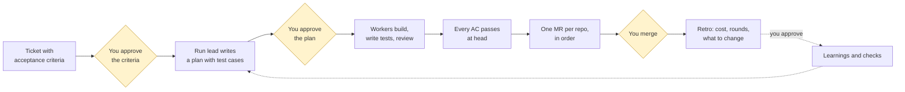

# Why Ark

Five minutes. This page is for someone deciding whether their team should run tickets through Ark. The [architecture](explanation/architecture.md) and [scenarios](explanation/scenarios.md) pages are for the people who then run it.

## The problem

Agents write code fast. Nothing else got faster. A ticket still waits for someone to read it, decide how to do it, write the tests, review the change, open the merge request, chase the pipeline and merge. When an agent does the middle part in an hour, the rest of the week is the new bottleneck, and the agent's work arrives as a diff nobody can judge without redoing it.

Three things go wrong when teams add agents without changing the process around them:

- **The plan is invisible.** The agent decided how to do the work while it did the work. The first time a person sees the design is in the diff.
- **The proof is a claim.** "Tests pass" in a merge request description, with no test that would fail if the change were wrong, and no way to tell.
- **One run blocks everything.** One agent, one session, one ticket at a time, and every question it asks stops the queue.

## What Ark does

Ark puts a small fixed process around the agents and keeps the people in it where their judgment matters.

The yellow diamonds are the only places a run waits for you. Everything between them runs by itself, under a round budget, with a cross-vendor reviewer that must show evidence for every finding.

## What you get

**You see the design before the code.** The plan is a graph of steps and the test cases that will prove each acceptance criterion. You read it, edit it or send it back. No code is written until you approve it.

**Proof, not claims.** Every acceptance criterion names the test cases that prove it. They are real integration or end-to-end tests that pass at the head of the composed workspace. `ark merge-request open` refuses to open a merge request until they do. For a criterion a person must check, the proof is your own answer, recorded.

**Review that shows its work.** A reviewer from a different vendor than the implementer reads the diff, the callers and the tests. A P0 or P1 finding must carry a command that reproduces it and the output it produced, or it is downgraded. The run lead re-runs the command before anything is sent back.

**Many tickets at once, none of them blocking the others.** Each run has its own worktrees and its own agents. A question in one run waits for you; the others keep going.

**Multi-repo by default.** A ticket that changes a shared package and the service that uses it gets one run, worktrees composed so the service builds against the package change, tests across both, and merge requests in dependency order.

**It gets better with use.** Every run ends in a retro with numbers: cost, time, rounds, how often you had to step in. Recurring problems become checks the `ark` command enforces, so the same mistake is not made twice. Nothing changes without your approval.

## What Ark is not

- It never merges. Branch protection on your git host makes sure of it.
- It is not regulated software. Your product repos keep their own validation; Ark's job is to produce the evidence that validation needs, in the merge request and the run folder.
- It is not a chat UI. You talk to one agent session, and a read-only hub shows what needs you.
- It does not cap cost. It shows cost while a run is live and judges it in the retro.

## Numbers from one real run

ARK-311, a change to how Ark itself proves acceptance criteria. Nine criteria, two implementer steps, two validator steps, one cross-vendor review.

|                            |                                                                                         |
| -------------------------- | --------------------------------------------------------------------------------------- |
| Rounds                     | 3 of a budget of 2; you granted one more at the escalation gate                         |
| Review findings in round 1 | 3 P0, 1 P1; three sent back with their repro commands, one waived by you with a reason  |
| Criteria passing at head   | 9 of 9, by 11 test cases across two suites                                              |
| Cost                       | $8.48, 33.6 M tokens                                                                    |
| Wall time                  | 7.3 hours, most of it unattended                                                        |
| What you did               | approved the criteria and the plan, answered one escalation, waived one finding, merged |

The retro from that run added one learning and one check. The next run does not repeat the mistake.

## Where it goes

Ark is one stage of a closed loop: tickets come in from people and from telemetry, runs produce merge requests with their own evidence, a gate in the git host verifies that evidence instead of re-deriving it, and what ships reports back as incidents, reverts and usage that become the next tickets and the next checks. The [vision](explanation/vision.md) page draws the whole loop and says which parts exist today.

## Try it

Open [the tour](tour.html) in a browser to click through a run. Then read [Run a ticket](how-to/run-a-ticket.md).
