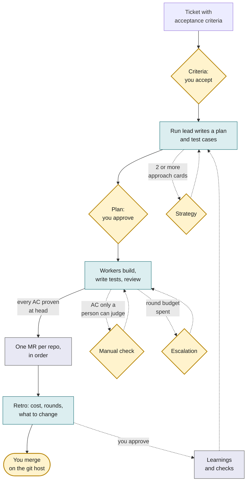

# Why Ark

Five minutes. This page is for someone deciding whether their team should run tickets through Ark. The [architecture](explanation/architecture.md) and [scenarios](explanation/scenarios.md) pages are for the people who then run it. In this guide an MR is a merge request; on GitHub it is a pull request.

**One real run on this repo** (ARK-423, a fix for flaky CI tests): 3 ACs met, two by passing test cases and one by your recorded check. 4 gate answers, 2 yours and 2 Ark's. $6.45 and 3.9 hours, merged as PR #187.

[Scenario 1](explanation/scenarios.md#1-one-repo-a-ticket-on-ark-itself) walks through that run and [the numbers](#numbers-from-one-real-run) come from its own files.

## The problem

Agents write code fast. Nothing else got faster. A ticket still waits for someone to read it, decide how to do it, write the tests, review the change, open the MR, chase the pipeline and merge. When an agent does the middle part in an hour, the rest of the week is the new bottleneck, and the agent's work arrives as a diff nobody can judge without redoing it.

Three things go wrong when teams add agents without changing the process around them:

- **The plan is invisible.** The agent decided how to do the work while it did the work. The first time a person sees the design is in the diff.
- **The proof is a claim.** "Tests pass" in an MR description, with no test that would fail if the change were wrong, and no way to tell.
- **One run blocks everything.** One agent, one session, one ticket at a time, and every question it asks stops the queue.

## What Ark does

Ark puts a small fixed process around the agents and keeps the people in it where their judgment matters.

**What you give it:** a ticket, which is a Markdown file with acceptance criteria. Master Chief, the one agent you talk to, fetches it from the project's `ticket_source` and snapshots it under `~/.ark/projects/<project>/tickets/`. The source is `local` (a file there), `github` (an issue, read with `gh`) or `jira` (read with the Jira tools your agent has). A brainstorm partner can also write proposed tickets with you.

Amber means you decide or act. Teal is an agent. Grey is the `ark` command. Diamonds are gates; your merge is a rounded node because it is not a gate.

Every run meets two gates, criteria and plan, and ends with your merge on the git host. Three more gates open when needed: strategy (the run lead offers 2 or more approach cards), manual (an AC only a person can judge) and escalation (the round budget is spent). The criteria gate is always a person. A project can set strategy, plan and escalation to `auto` in `ark.yml`: Ark then answers and records `by: auto`. Everything between the gates runs by itself, under a round budget, with a reviewer that must show evidence for every finding.

## What you get

**You see the design before the code.** The plan is a graph of steps and the test cases that will prove each acceptance criterion. You read it, edit it or send it back. No code is written until the plan is approved.

**Proof, not claims.** Every acceptance criterion names the test cases that prove it. They are real integration or end-to-end tests that pass at the head of the composed workspace. `ark merge-request open` refuses to open an MR until they do. For a criterion a person must check, the proof is your own answer, recorded.

**Review that shows its work.** A reviewer in a fresh context, from another vendor when the project configures one, reads the diff, the callers and the tests. A P0 or P1 finding must carry a command that reproduces it and the output it produced, or it is treated as P2. The run lead re-runs the command before anything is sent back.

**Many tickets at once, none of them blocking the others.** Each run has its own worktrees and its own agents. A question in one run waits for you; the others keep going.

**Multi-repo by default.** A ticket that changes a shared package and the service that uses it gets one run, worktrees composed so the service builds against the package change, tests across both, and MRs in merge order (the repo edges of the plan, upstream first). A project set to `merge_requests: none` stops at a branch you take; see [scenario 3](explanation/scenarios.md#3-a-hand-off-a-repo-where-ark-may-not-push).

**It gets better with use.** Every run ends in a retro with numbers: cost, time, rounds, how often you had to step in. Recurring problems become proposals; a lesson that a command can check becomes a refusal the `ark` command enforces. Nothing changes until you approve the proposal.

## What Ark is not

- **It does not merge.** Ark's agents and the `ark` command never merge; you merge on the git host. One optional exception: `ark services install` (macOS, launchd) installs an auto-merger service. It merges an MR only once the host reports it CLEAN under your branch protection, the run's `retro.md` exists, the ticket is not done or superseded and the run is still in `merge_requests_open`.
- **It is not regulated software.** Your product repos keep their own validation; Ark's job is to produce the evidence that validation needs, in the MR and the run folder.
- **It is not a chat UI.** You talk to one agent session, Master Chief. The hub (`ark ui`) is a read-only view with one action, "Open in Orca". You steer through Master Chief; the hub steers nothing.
- **It does not cap cost.** It shows cost while a run is live and judges it in the retro.

## Numbers from one real run

Run `2026-11-11-ARK-423-1`: tests that raced git background maintenance and depended on the wall clock. Figures come from the run's `metrics.json` and `state.json`; the run's `retro.md` was written before the last metrics refresh, so where the two differ this page uses `metrics.json`.

| Measure                     | Value                                                                                                           | Field                                                         |
| --------------------------- | --------------------------------------------------------------------------------------------------------------- | ------------------------------------------------------------- |
| Acceptance criteria         | 3. AC1 and AC2 passing at head by 3 test cases (ARK-T261, ARK-T262, ARK-T227); AC3 by your recorded manual `ok` | `state.json` `criteria`                                       |
| Gate answers                | 2 by you (criteria, manual check), 2 by Ark (plan, escalation)                                                  | `gates`                                                       |
| Rounds                      | 3. The budget was 2; one escalation, answered `auto`, allowed a third                                           | `rework.rounds`, `rework.escalations`                         |
| Findings sent back          | 3 P1: one from review with a repro command, two from CI logs; none left open at P0 or P1                        | `rework.findings_sent_back`, `rework.findings_left_p0p1`      |
| Test runs                   | 9                                                                                                               | `tests.runs`                                                  |
| Your changes after the plan | 0 plan changes, 0 MR comments, 0 commits after the MR opened                                                    | `human_intervention`                                          |
| Cost                        | $6.45 and 26.8 M tokens. A typical run costs $2.65 (median of 152 earlier runs)                                 | `cost.total_usd`, `cost.tokens`, `comparison.median_cost_usd` |
| Wall time                   | 3.9 hours (14,171 s). A typical run takes 3.2 hours                                                             | `time.wall_seconds`, `comparison.median_wall_seconds`         |

The run cost more and took longer than a typical run. Its third round came from two CI failures that showed only on Linux. The retro proposed four changes; none applies until you approve it.

## Where it goes

Ark is one stage of a closed loop: tickets come in from people today and from telemetry later, runs produce MRs with their own evidence, a gate in the git host would verify that evidence instead of re-deriving it, and what ships would report back as incidents, reverts and usage that become the next tickets and the next checks. The [vision](explanation/vision.md) page draws the whole loop and says which parts exist today.

## Try it

Open [the tour](tour.html) in a browser to click through a run. Then read [Run a ticket](how-to/run-a-ticket.md).
